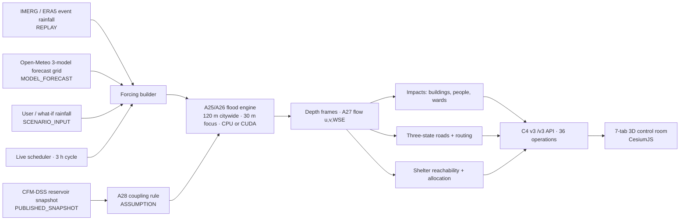

# TwinGuard AI — Final Report

**An integrated rainfall + reservoir → flood simulation → 3D digital twin → impact, three-state routing and shelter decision pipeline with what-if scenarios for Chennai**

Bachelor's final-year project · Chennai Metropolitan Area · Report version: Round 4 (A29), November 2026

---

## 1. Summary

TwinGuard AI is a working flood digital twin for Chennai. The pipeline:
1. Takes rainfall, either historical (IMERG/ERA5), user-defined, or a live numerical weather forecast (Open-Meteo), plus the public CFM-DSS reservoir state.
2. Simulates flooding with a local-inertial shallow-water engine at 120 m citywide and 30 m in four focus areas, on CPU or GPU.
3. Turns the depth and flow fields into impacts on buildings, people, roads and wards.
4. Classifies every road edge as passable, blocked or unknown, and computes routes and shelter reachability.
5. Shows the results in a seven-tab 3D control-room interface backed by a versioned API, with what-if scenarios and an automatic live-forecast cycle.

The project contribution is the **integration**. In the owner's wording (OD-2026-11-07), it is *"an integrated rainfall + reservoir → flood simulation → 3D digital twin → impact, three-state routing and shelter decision pipeline with what-if scenarios for Chennai."* The individual components build on established methods (§9). The project does not claim validated forecast or depth accuracy; §10 states the evidence limits.

Evidence status by review gate (`docs/master/GATE_G*_REPORT.md`):

| Gate | Scope | Decision |
|---|---|---|
| G0 | Contracts C1–C8 frozen | Ready ([G0 report](master/GATE_G0_REPORT.md)) |
| G1 | Label acceptance and depth contract | PASS with caveats ([G1](master/GATE_G1_REPORT.md)) |
| G2 | Risk map, fair baselines, out-of-event evaluation | PASS with caveats ([G2](master/GATE_G2_REPORT.md)) |
| G3 | Replay connected to the twin | PASS with caveats ([G3](master/GATE_G3_REPORT.md)) |
| G4 | Forecast-through-shelter chain and API | PASS with caveats after B47 ([G4](master/GATE_G4_REPORT.md)) |
| G5 | Packaged end-to-end product replay | PASS with caveats after B50 ([G5](master/GATE_G5_REPORT.md)) |
| Round 2 | Live forecast mode with reservoir coupling | PASS with caveats ([I27 review](master/ROUND2_LIVE_REVIEW.md)) |

## 2. System overview

Every value carries a `source_mode` (SIMULATED, MODEL_FORECAST, PUBLISHED_SNAPSHOT, SCENARIO_INPUT, REPLAY, STATIC_REFERENCE). No simulated or assumed value is presented as observed.

## 3. Data and labels (G1)

- **Study area:** the 1,187 km² Chennai Metropolitan Area (older CMA boundary), EPSG:32644.
- **Terrain:** Copernicus GLO-30, conditioned with burned channels for the Adyar, Cooum, Kosasthalaiyar and Buckingham Canal ([conditioning metadata](../data/processed/terrain_cleaned/conditioning_metadata.json)).
- **Other inputs:**
  - land cover: ESA WorldCover 2021;
  - population: WorldPop 2021;
  - OpenStreetMap: 382,294 building footprints, 566,307 road segments, plus hospitals and shelters;
  - GCC wards: 200 wards (DataMeet/Transparent Chennai, CC BY-SA 2.5 IN).
- **Raw-data integrity:** 157 raw files (30.5 GB) are hash-audited, with 157/157 matches at every gate and at this report (§11).
- **Labels:** a pre-registered acceptance rule was applied to SAR-derived flood labels. The SAR rule did **not** pass (24 Nov 2015 IoU 0.0013, tier D), so only the official UNOSAT November 2015 references enter the usable label view: 10,419 records, of which 8,414 are event-flood and 2,005 baseline-water ([G1 report](master/GATE_G1_REPORT.md) G1.3–G1.4; [label acceptance](LABEL_ACCEPTANCE.md)).
- **Depth fields** follow the frozen C1 contract (Float32 metres, EPSG:32644, 30 m, NoData −9999; [depth contract](DEPTH_FIELD_CONTRACT.md)).

## 4. Susceptibility model and out-of-event check (G2)

Models were evaluated with 5-fold spatial GroupKFold on 3 km blocks with a one-block buffer, at the true prevalence, against eight calibrated baselines.

| Result | Value | Evidence |
|---|---|---|
| Phase 9B ensemble vs terrain-logistic baseline | PR-AUC +0.183 ± 0.054, better in 5/5 folds | [Phase 9B v2](PHASE9B_MODEL_UPGRADE_V2.md), [metrics](PHASE9B_V2_METRICS.json) |
| Phase 9C exposure-free model (pooled) | PR-AUC 0.219, against elevation 0.069, waterway distance 0.074 and random 0.063 | [Phase 9C final](PHASE9C_ADDENDUM_CR004_FINAL.md), [model card](MODEL_CARD_SUSCEPTIBILITY_CR004.md) |
| Out-of-event cross-check against the Dec 2023 NRSC map | PR-AUC 0.121 (lift 2.76), ROC-AUC 0.778 on 574,018 cells (prevalence 0.0438) | [2023 out-of-event check](PHASE9C_OUT_OF_EVENT_2023.md) |
| Risk map | 4 display classes inside the radar-observable mask; physical score elsewhere; MVT tiles z8–12 | [Phase 10 risk map](PHASE10_RISK_MAP_CR004.md) |

Figures: [risk map](figures/phase10_risk_map_cr003_v3.png), [Phase 9C addendum](figures/phase9c_addendum_cr004_v6.png), [2023 NRSC overlay](figures/nrsc_2023_dec07_geopdf_overlay.png).

## 5. Historical replay into the twin (G3)

Archived rain and reservoir records were replayed through Kafka, the consumer, Redis and Prometheus:
- 120/120 producer acknowledgements per pass;
- 170 unique messages consumed (60 rain, 60 reservoir, 50 alerts) with 0 rule errors;
- zero consumer lag (runs `a68fb84f…`, `0985c9e7…`; [Track B runbook](trackb/RUNBOOK.md)).

The replay persisted idempotently into twin tables in an isolated PostgreSQL database. Reservoir dates keep C3 date-only semantics, with no invented measurement time ([G3 report](master/GATE_G3_REPORT.md)).

## 6. Forecast → simulation → impact → routing → shelters (G4)

**Research chain at 600 m (A05–A10).** The first-generation chain ran 300 deterministic hindcast runs (3 events × 5 rainfall scenarios × 20 parameter members), with maximum mass-balance error 0.591% ([Phase 11](PHASE11_FORECAST_BATCH2.md)).

| Stage | Key result | Evidence |
|---|---|---|
| A05 hindcast, 2015-12-02 window | 351.54 mm in 72 h; 59.76 km² ≥ 0.10 m at 72 h | `data/features/forecast/batch2_v1/forecast_summary.json` |
| A06 simulation | Within-episode map reproduction IoU 0.139 ± 0.048 (24 Nov 2015) | [Phase 12](PHASE12_SIMULATION.md) |
| A07 impact, 2015, 48 h, 0.30 m screen | 221,131 people and 734 km of road in screened cells | [Phase 13 v4](PHASE13_IMPACT_BATCH2_V4.md), `batch2_v4_contract` |
| A08 time-dependent graph | 1,071,656 directed arcs, 71.73% mapped to depth cells | [routing graph](ROUTING_GRAPH_BATCH2.md) |
| A09 route comparison (OSSE) | 216 records; uncertainty-aware routing had 0/15 held-out failures | [routing](ROUTING_BATCH2.md), `revision_3` |
| A10 shelter allocation | 540 cases; at capacity factor 1, 136,975 served of 4.84 M modelled demand | [shelters](SHELTER_ALLOCATION_BATCH2.md), `batch2_v3` |

**Three-state routing (A21).** Each road edge is `ASSESSED_PASSABLE`, `ASSESSED_BLOCKED` or `UNKNOWN`. Routes through unknown edges are emitted only as `CONDITIONAL / NEEDS VERIFICATION`. On 108,000 primary OD cases, route availability rises from a fail-closed 8.1–18.3% to 98.0–99.7% when conditional routes are included (cluster-bootstrap 95% intervals). 85.88% of all cases need verification. A greedy queue covers all 92,750 conditional cases by verifying 50 road arcs ([three-state routing](ROUTING_THREE_STATE_BATCH3.md); commit f33797b).

**API.** The C4 v3 API (B47, commit d5a45e9) serves the chain as 19 operations: simulations, depth, wards, buildings, roads, routes, shelters, incidents, emergency plan, what-if comparison and static layers. It later grew to 36 operations with flow and live mode ([C4 v3 contract](master/contracts/c4_openapi_v3.md); `docs/api/ai-service.yaml`).

## 7. High-resolution GPU flood engine, flow and live coupling (A25–A28)

**Engine (A25, commit a4b2cbc).**
- **Solver:** the NumPy local-inertial solver of Bates et al. (2010), with the sea as a fixed-stage boundary (tide offset), river channels conveying reservoir releases, per-cell rain, and 15/30 min frames.
- **Grids:** citywide 120 m (440 × 343, 77,296 active cells) and 90 m (136,096 cells); 30 m focus areas Velachery, Adyar, T. Nagar and Porur (200 × 200 each), nested inside the citywide run.
- **Outputs:** per-building maximum depth for all 382,294 footprints; per-ward summaries for the 200 GCC wards; per-frame three-state road states; shelter reachability.

| Run (Dec 2015 event unless noted) | Grid | Flooded ≥ 0.10 m | Buildings ≥ 0.10 m | Mass balance | run_id |
|---|---|---:|---:|---:|---|
| 48 h citywide | 120 m | 406.7 km² | 94,034 | 1e-6 | `evt-20261107T120140Z-b0df587c` |
| 48 h citywide, 2021-11-11 | 120 m | 241.6 km² | 52,261 | 2e-6 | `evt-20261107T120550Z-acee1c29` |
| 48 h citywide, 2023-12-03 | 120 m | 233.5 km² | 52,870 | 0 | `evt-20261107T172118Z-1f3e8383` |
| 48 h focus Velachery | 30 m | 15.3 km² | 11,210 | 8.1e-5 | `evt-20261107T172655Z-b8175ee2` |
| What-if: rain 130%, Chembarambakkam 850 m³/s, tide +0.5 m | 120 m | 481.0 km² | 113,535 | 1.8e-5 | `whatif-20261108T045006Z-3e52ff0a` |

Source: [A25 report](../pipelines/a25_hires/REPORT.md); `data/features/simulation/a25_runs_v1/batch_summary.json`. Building heights come from OSM `height` (61), `building:levels` × 3.2 m (8,348) or a documented type/area estimate (373,885).

**GPU backend (A26, commits 887d089, a64cc30, 943ae77).**
- **Implementation:** an optional torch float32 CUDA path. Each time step runs as one replayed CUDA graph, with NumPy as default and automatic fallback.
- **Speed (RTX 3050 Laptop, 4 GB):**
  - 24 h citywide: 17.1 s against 62.8 s on CPU;
  - 48 h citywide (2021 event): 12.8 s of solve, 1.0 ms per step;
  - 72 h live forecast: 18.3 s against 154.6 s on CPU;
  - peak VRAM 4–30 MB.
- **Agreement with CPU:** identical step counts and mass balance; mean peak-depth difference under 1 mm; flooded-extent IoU ≥ 0.9995.

Source: [GPU benchmark](FLOOD_ENGINE_GPU_BENCHMARK.md).

**Flow fields (A27, commit b90c0c6).**
- **Output:** per-frame cell-centred depth-averaged velocity (u east, v north) and water-surface elevation (EGM2008), stored next to the depth frames at about 2× their size.
- **Use:** they drive the UI's flowing-water animation through `GET /v3/simulations/{run_id}/flow` (B49).
- **Example:** peak speed 3.4 m/s in the Velachery channels at frame 60 of `evt-20261108T093021Z-a4857cea`.

Source: [A27 notes](../pipelines/a25_hires/A27_FLOW.md).

**Reservoir coupling (A28, commit bf50c38).**
- **Why a rule is needed:** CFM-DSS publishes daily level and storage but no releases. Rule `A28-RES-STORAGE-v1` converts storage into an assumed outlet inflow, labelled as an assumption.
- **The rule:** zero below 90% of capacity; a linear ramp to Q_ctrl at 100%; then 2 × Q_ctrl. Q_ctrl is Chembarambakkam 170, Poondi 140, Puzhal 60 and Cholavaram 30 m³/s.
- **Missing or stale snapshots** (> 48 h) give zero inflow.
- **Live-style check (2026-11-10):** real forecast (0.5 mm over 72 h) and real snapshot (15–73% full, so 0 m³/s). Mass balance 1e-6. A no-rain control stayed near-dry (0.014 km²).

Source: [A28 rule](../pipelines/a25_hires/A28_RESERVOIR_COUPLING.md).

## 8. Product: 3D control room and live forecast mode

**User interface (B48/B52).** Seven tabs: Situation Overview, Flood Simulation, Emergency Support, Road Routing, What-if Simulation, Reservoir Monitoring and Digital Twin 3D City. It uses CesiumJS with Google Photorealistic 3D Tiles, OSM buildings coloured by depth, and water animated from A27 flow. Screenshots:
- the seven tabs: [01](ui/screenshots/01_situation_overview.webp)–[07](ui/screenshots/07_digital_twin_3d_city.webp);
- [modelled flow](ui/screenshots/14_flow_modelled_velocity.webp);
- [30 m focus run](ui/screenshots/18_focus_run_after_t24.webp);
- [live overview](ui/screenshots/20_live_overview.webp);
- [live badge](ui/screenshots/21_live_badge_status.webp).

**Live forecast mode (CR-021; B51 commits d987199 and 818c7fc; B53 commit bb6e690).**
- **Cycle:** every 3 h, with start-up catch-up. Each cycle fetches the three-model Open-Meteo forecast, reuses a CFM-DSS snapshot under 24 h old, applies A28, runs 72 h citywide (GPU when available), and publishes the latest live run.
- **Manual refresh:** allowed at most once per 600 s.
- **Retention and fallback:** keeps 16 runs; serves the last good run when a cycle fails.
- **Packaged verification:** catch-up run `sim-20261110T120422Z-1a781dbd` (277 s on CPU) and manual run `sim-20261110T121126Z-979f9524` (286 s). Open-Meteo usage stayed under the self-imposed 5,000-call daily budget ([B53 report](trackb/B53_LIVE_CYCLE_REPORT.md)).
- **Disclaimer:** every live view shows "Model forecast — not an official warning".

**Packaged end-to-end replay (G5).**
- **Path:** the archived 2015-12-01 event goes through the packaged stack: nginx → `/v3` → A25 engine → UI.
- **Primary run:** `evt-20261108T152128Z-59eba744`. A fresh in-container CPU computation took 161.2 s (`evt-20261108T152132Z-49db828b`).
- **API checks:** all seven `/v3` outputs returned 200 and were schema-valid and hashed. A repeat request returned byte-identical results.
- **Failure handling:** errors failed closed (404/422/503/409).
- **UI evidence:** packaged UI screenshots of Tabs 2 and 7: [flood simulation](ui/screenshots/17_g5_packaged_flood_simulation.webp), [digital twin](ui/screenshots/17_g5_packaged_digital_twin.webp).
- Sources: [G5 report](master/GATE_G5_REPORT.md), [B13 scenario](trackb/B13_E2E_SCENARIO.md).

## 9. Contribution and related work

Each component builds on prior work:
- local-inertial inundation modelling (Bates et al., 2010);
- depth–disruption functions for road speed (Pregnolato et al., 2017);
- flood-aware evacuation routing and shelter planning (Li et al., 2025; An et al., 2025);
- verification of uncertain lifeline roads (Li, Song & Li, 2026; Pan et al., 2026), as identified in the A21 literature review ([routing literature](literature/ROUTING_UNKNOWN_EVIDENCE_2025_2026.md)).

The project's contribution is the **integration** of these steps into one versioned, provenance-labelled pipeline for Chennai: rainfall (historical, user, or live three-model forecast), public reservoir state, a CPU/GPU flood engine at 120 m and 30 m, impacts on 382,294 buildings and 200 wards, three-state routing, shelter reachability, what-if scenarios, and a 3D digital twin. It runs end to end on a single laptop GPU. The A21 review did not establish novelty for the three-state routing step on its own; the contribution claimed here is the integrated system, not a new component method.

## 10. Limitations

1. **Labels and validation.** The susceptibility model and engine are calibrated on a single November 2015 event. The out-of-event check uses an unaccepted, unverified 2023 map. No independent observed depths or road outcomes are available, so accuracy is not validated.
2. **Hydraulics.** The model is a simplified 120 m local-inertial model on a surface DEM, with no storm drains. Ponding and flooded extents are upper-end, and DEM pits can produce unrealistic local depths.
3. **Assumptions.** Reservoir outlet inflows (A28), shelter capacities (100/250/500 people), road thresholds (0.30 m, tunnels 0.15 m) and most building heights are assumptions, labelled as such.
4. **Forecast.** Live mode pushes numerical weather-model rainfall through this model. It is a research forecast, not an official warning, and its skill is not measured.
5. **Deployment.**
   - The packaged verification ran on CPU, and the GPU container image is not built.
   - The G5 primary run reused cached GPU output; in-package CPU compute is shown separately.
   - The Cesium token is compiled into the local bundle, so images must not be published as built.

## 11. Reproducibility

- **Code:** each component is committed with its task; commits are cited above, and the gate reports list the test commands.
- **Data products:** under `data/features/` (git-ignored), with manifests and SHA-256 hashes.
- **Commands:**
  - static bundles: `python -m pipelines.a25_hires.build_static`;
  - acceptance runs: `python -m pipelines.a25_hires.run_batch`;
  - GPU benchmark: `python -m pipelines.a25_hires.benchmark_gpu`;
  - live check: `python -m pipelines.a25_hires.live_check`.
- **Report checks (A29, 2026-11-10):**
  - Lane A engine tests: `pytest tests/flood_engine tests/phase12_openmeteo_grid` — see the A29 closeout in `docs/master/STATE.json`.
  - Raw audit: `python tools/audit_raw_logs.py` → 157/157 hash matches.
  - No new science runs were made for this report.

## References

- An, G., Wang, Z., Qu, M., Hu, S. (2025). Integrated optimization of emergency evacuation routing for dam failure-induced flooding: a coupled flood–road network modeling approach. *Applied Sciences* 15(8), 4518. doi:10.3390/app15084518
- Bates, P. D., Horritt, M. S., Fewtrell, T. J. (2010). A simple inertial formulation of the shallow water equations for efficient two-dimensional flood inundation modelling. *Journal of Hydrology* 387, 33–45. doi:10.1016/j.jhydrol.2010.03.027
- Li, C., Jiang, C., Chen, J., Lam, M. Y., Xia, J., Ahmadian, R. (2025). An overview of flood evacuation planning: models, methods, and future directions. *Journal of Hydrology* 656, 133026. doi:10.1016/j.jhydrol.2025.133026
- Li, H., Song, X., Li, Y. (2026). Bayesian active verification of lifeline roads for risk aware emergency logistics with trucks and drones. *Discover Artificial Intelligence* 6, 962. doi:10.1007/s44163-026-02033-1
- Pan, X., Mohammadi, N., Taylor, J. E. (2026). Positioning road-level flood sensing for disruption assessment based on uncertainties and Bayesian networks. *Reliability Engineering & System Safety*, 113592. doi:10.1016/j.ress.2026.113592
- Pregnolato, M., Ford, A., Wilkinson, S. M., Dawson, R. J. (2017). The impact of flooding on road transport: a depth-disruption function. *Transportation Research Part D* 55, 67–81. doi:10.1016/j.trd.2017.06.020
- Data sources: Copernicus GLO-30 DEM; ESA WorldCover 2021; WorldPop 2021; © OpenStreetMap contributors (ODbL); GPM IMERG; ERA5; Open-Meteo (CC BY 4.0); Tamil Nadu CFM-DSS public dashboard; GCC wards (DataMeet/Transparent Chennai, CC BY-SA 2.5 IN); UNOSAT; NRSC.
