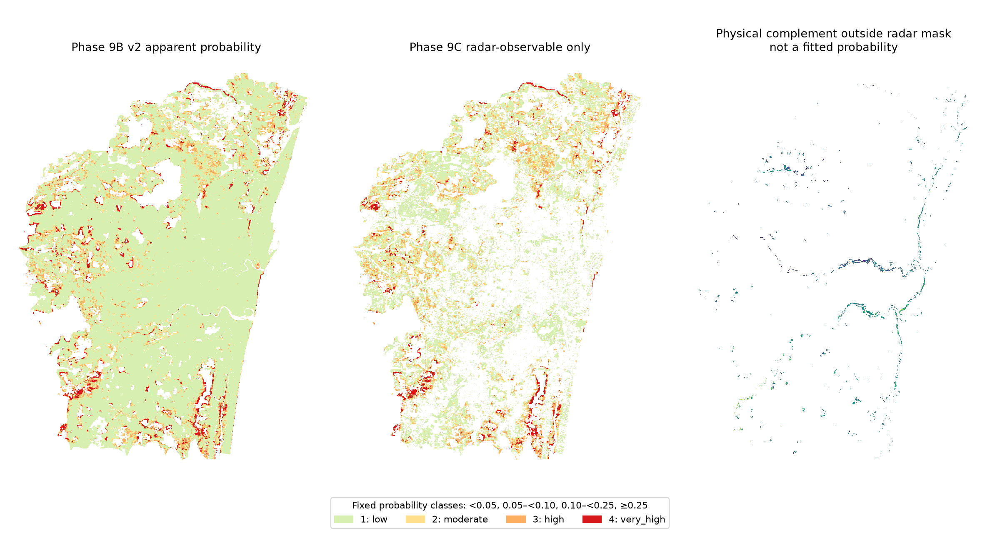

# Phase 10 apparent risk map

> PILOT: single-event apparent susceptibility only. It is not a forecast, and it is not validated for future events.

## Class maps and uncertainty

Probability classes use fixed cut-points: low <0.05; moderate 0.05–<0.10; high 0.10–<0.25; very high ≥0.25. These are descriptive probability bins, not emergency thresholds. The Phase 9B v2 apparent map covers its saved prediction domain. The Phase 9C risk map uses radar-observable cells only; cells outside its observation mask are not assessed from radar labels. A physical complement is retained as a separate ordinal layer and is not merged with radar probabilities.

Phase 9B's apparent lower/upper interval rasters are copied unchanged. Phase 9C's spatial Mondrian p05/p95 bounds and urban-confidence/observability layers are copied unchanged. Phase 9C reported 93.4% outer-fold coverage for its nominal 90% band, but this is within-event blocked validation, not independent-event coverage. See the model card and Phase 9C report for limits.

## OpenCity point cross-check

The 945 source points are approximate and have unclear dates. Existing Phase 9C checks scored 111 points (99 radar-assessed and 12 physical-only). On its composite ordinal ranking, observed hits were 0/111 in the top 1%, 0/111 in the top 5%, 1/111 (0.90%) in the top 10%, and 3/111 (2.70%) in the top 20%. These were below the land-cover-matched random-cell shares reported by Phase 9C (0.29%, 1.52%, 3.17%, 6.67%). This is a spatial cross-check, not date-matched validation. Radar and physical-only ranks are separate domains, not comparable probabilities.

## Zonal summaries

The machine-readable class totals and class-by-3 km block rows are in `data/features/predictions/phase10_cr003_v3/zonal_stats_by_risk_class_and_3km_block.csv` and `docs/PHASE10_RISK_MAP_CR003_V3.json`. Population NoData cells are counted separately; population sums include only valid values and remain model estimates. Facility points are assigned by their containing master-grid cell. Road length is an approximation: each CMA edge's full stored length is assigned to its PostGIS point-on-surface cell, rather than split across risk/block boundaries. Do not interpret it as exact road length within each class.

A generalized MVT set is in `data/processed/tiles/phase10_cr003_v3/phase10_apparent_risk.mbtiles` at zooms 8–12. Tile geometries use a 120 m majority-class generalization; the 30 m GeoTIFFs remain the analysis layers. Out-of-event validation is pending digitised official labels.

## Files

The authoritative outputs are under `data/features/predictions/phase10_cr003_v3/`. Earlier same-session draft products in the unversioned `phase10/` and `phase10_cr003_v2/` folders are superseded; use the v3 report and tiles. Class 255 in the zonal table means not assessed; those cells are excluded from the MVT risk classes, not re-labelled low risk. The complete source list, cell counts, facility/road query counts, point metrics and tile metadata are in the JSON summary. No source raster or raw file was modified.
