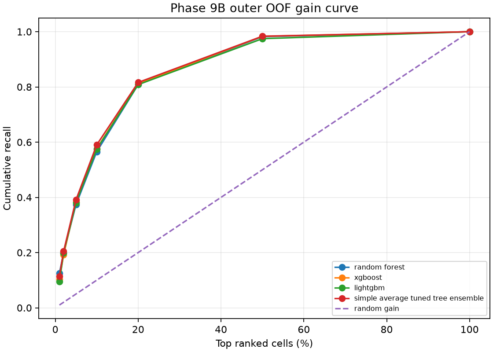
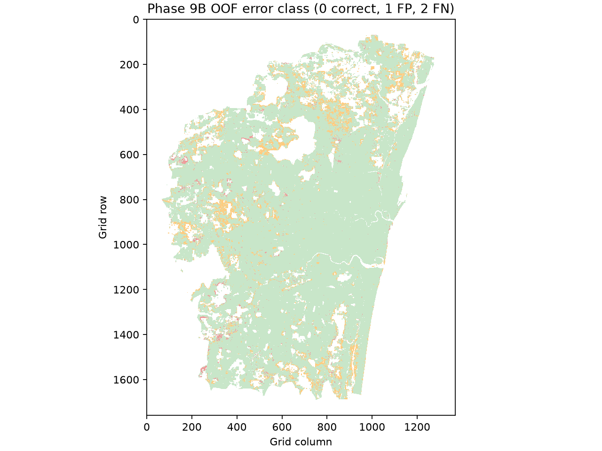
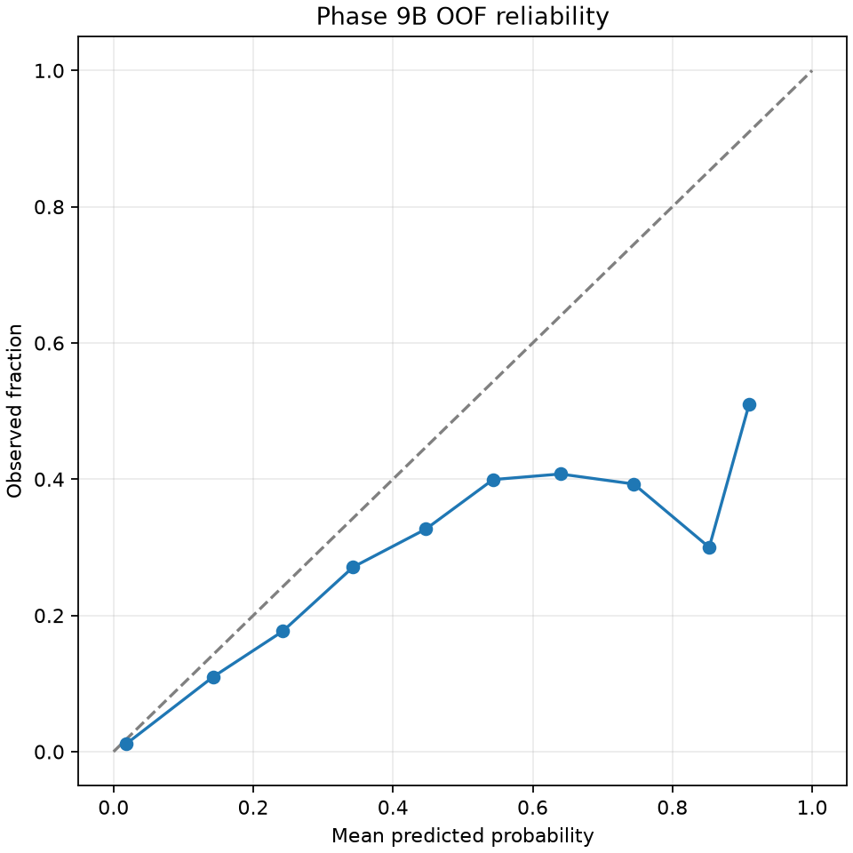
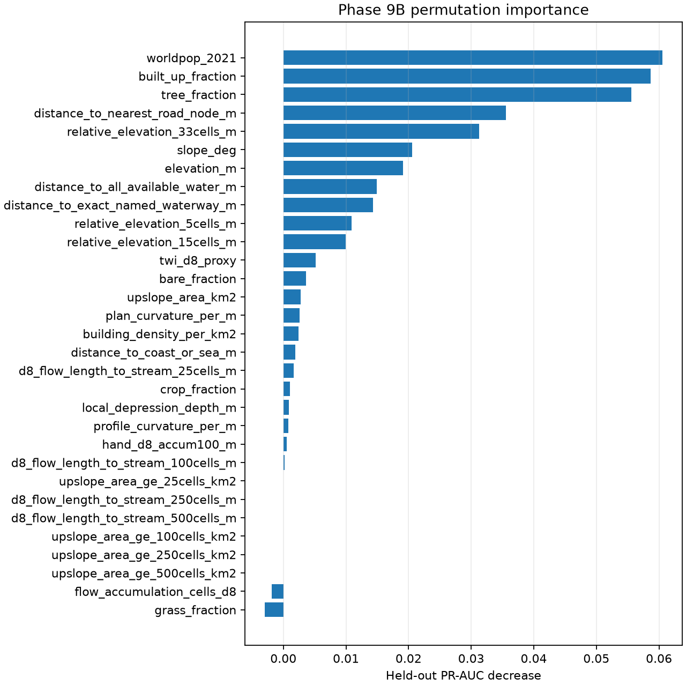

# Phase 9B model upgrade

> **PILOT, SINGLE EVENT.** Labels are unchanged from the official SAR-derived November 2015 Phase 9 target. This is not field validation and not a time-varying flood forecast.

## Data and split

Phase 9 eligible cells: 1,196,300; positives: 61,166; prevalence: 5.1129%.
For Phase 9B, population-NoData is used only as an eligibility mask: 1,078,595 cells remain (35,615 flooded; 3.3020%). NoData flag is not a predictor.
The five outer folds were reconstructed using the same deterministic GroupKFold algorithm and spatial buffer as the Phase 9 pilot; test-cell counts and prevalences match its metrics. The saved Phase 9 `test_block_ids` repeat the final fold across all five records due to a bookkeeping defect, so those IDs were not used; reconstructed folds are checked for disjointness and complete partitioning. For each outer training set, inner validation uses two contiguous block-row halves; the cut balances eligible cells while retaining both classes after the same one-block buffer. This is a spatially grouped two-fold inner CV. Each tree family tested 30 random configurations in each outer fold (150 configurations per family across the five outer folds); every configuration was scored on both inner splits. Sampling, imputation, scaling, Platt calibration, F1 threshold selection, and conformal quantile estimation use training blocks only. Outer test blocks remain at observed prevalence.

## New physical feature table

The old cell table and Phase 9 target are unchanged. The v2 table has 1,319,380 rows on the same 30 m EPSG:32644 grid. It adds relative elevation at 5, 15 and 33 cells; local depression depth; plan/profile curvature; HAND; D8 flow length to streams at 25, 100, 250 and 500 contributing-cell thresholds; upslope area at those thresholds; tree, crop, grass and bare fractions; distance to locally available water; and distance to mapped coastline. HAND is a D8 DSM proxy seeded by existing OSM waterways, locally extracted OSM water bodies/reservoirs, WorldCover class 80 water, and the >=100-cell flow-accumulation stream threshold. That produced 17,623 combined drainage seed cells, including 16,112 mapped-water cells below the accumulation threshold. Cells without a downstream D8 drainage seed remain NoData. Threshold flow-length stream counts were 27,510, 1,511, 105 and 7 for 25/100/250/500 cells. No standalone natural-water line was present; OSM relation multipolygons were not reconstructed, and OpenCity reservoir rows have no spatial coordinates. Distances are Euclidean; flow lengths follow existing D8 routing. The zero-variance old `water_fraction` predictor is dropped, and population-NoData remains an eligibility mask only. See the feature-table JSON sidecar for input hashes and details.

## Fair baselines and paired fold comparison

Baselines use train-oriented logistic scores with Platt calibration: elevation, river distance, TWI, slope, 15-cell relative elevation, HAND, and a small terrain logistic model. The random baseline is constant training-fold prevalence (no ranking signal).

| Baseline | ROC-AUC mean ± SD | PR-AUC mean ± SD | Brier mean ± SD |
|---|---:|---:|---:|
| elevation_logistic | 0.5130 ± 0.0931 | 0.0663 ± 0.0269 | 0.0333 ± 0.0088 |
| river_distance_logistic | 0.4711 ± 0.0843 | 0.0396 ± 0.0190 | 0.0324 ± 0.0092 |
| twi_logistic | 0.7035 ± 0.0134 | 0.0626 ± 0.0162 | 0.0325 ± 0.0087 |
| slope_logistic | 0.7215 ± 0.0127 | 0.0731 ± 0.0152 | 0.0322 ± 0.0088 |
| relative_elevation_15_logistic | 0.5545 ± 0.1100 | 0.0389 ± 0.0165 | 0.0327 ± 0.0088 |
| hand_logistic | 0.5110 ± 0.0266 | 0.0362 ± 0.0120 | 0.0326 ± 0.0090 |
| terrain_logistic | 0.7416 ± 0.0056 | 0.0773 ± 0.0257 | 0.0323 ± 0.0087 |
| random_prevalence | 0.5000 ± 0.0000 | 0.0331 ± 0.0100 | 0.0325 ± 0.0089 |

## Feature ablation and label-bias check

| Feature set / test | ROC-AUC mean ± SD | PR-AUC mean ± SD | Brier mean ± SD |
|---|---:|---:|---:|
| A_terrain_hydrology | 0.8570 ± 0.0183 | 0.1523 ± 0.0541 | 0.0301 ± 0.0079 |
| B_terrain_plus_landcover | 0.8989 ± 0.0157 | 0.2600 ± 0.0532 | 0.0279 ± 0.0065 |
| C_all_pilot_features | 0.9051 ± 0.0126 | 0.2817 ± 0.0661 | 0.0278 ± 0.0062 |
| C, built-up >0.50 removed from train and test | 0.8410 ± 0.0082 | 0.2988 ± 0.0728 | 0.0506 ± 0.0099 |

Flood fraction by built-up bin:

| Built-up fraction | Cells | Flooded | Flood fraction |
|---|---:|---:|---:|
| 0_to_0.1 | 446,662 | 32,821 | 7.3481% |
| 0.1_to_0.3 | 55,435 | 796 | 1.4359% |
| 0.3_to_0.5 | 50,895 | 583 | 1.1455% |
| 0.5_to_0.75 | 74,523 | 595 | 0.7984% |
| 0.75_to_1 | 451,080 | 820 | 0.1818% |

Adding land cover increased mean PR-AUC; adding road/building/population proxies increased it further. Most full-feature skill remains after dense-urban exclusion: PR-AUC did not fall, although Brier score worsened markedly as the excluded set changed prevalence. So the observed skill from those proxies does not disappear in this exclusion test; that does not establish causal flood mechanisms. The paired comparisons are descriptive, not causal effects.

## Default, tuned and ensemble models

| Model | PR-AUC mean ± SD | ROC-AUC | F1 | IoU | Brier | ECE | PR-AUC 95% block-bootstrap CI |
|---|---:|---:|---:|---:|---:|---:|---|
| random_forest default | 0.2850 ± 0.0660 | 0.9030 | 0.3123 | 0.1851 | 0.0278 | 0.0090 | — |
| random_forest tuned | 0.2627 ± 0.0527 | 0.8932 | 0.2958 | 0.1736 | 0.0284 | 0.0084 | [0.20736487807364604, 0.27717186730273935] |
| xgboost default | 0.2576 ± 0.0663 | 0.8897 | 0.2851 | 0.1663 | 0.0293 | 0.0192 | — |
| xgboost tuned | 0.2449 ± 0.0662 | 0.8958 | 0.2810 | 0.1634 | 0.0291 | 0.0155 | [0.19081473003965596, 0.26422476168802705] |
| lightgbm default | 0.2467 ± 0.0630 | 0.8819 | 0.2758 | 0.1600 | 0.0296 | 0.0223 | — |
| lightgbm tuned | 0.2393 ± 0.0635 | 0.8914 | 0.2884 | 0.1685 | 0.0298 | 0.0168 | [0.18084802264319147, 0.2598702016225807] |
| simple average tuned tree ensemble | 0.2599 ± 0.0702 | 0.8987 | 0.2934 | 0.1719 | 0.0285 | 0.0136 | [0.1993, 0.2806] |

The PR-AUC mean ± SD is the outer-fold distribution; the other listed metrics are pooled OOF results, with each held-out row predicted by its outer-fold model. PR-AUC confidence intervals use 200 spatial-block bootstrap replicates.

## Outer-fold metric spread

All entries are mean ± sample SD across the five outer test folds; every fold is evaluated at its true prevalence and uses the training-only selected threshold. Default-model ECE is shown as pooled OOF ECE because default fold ECE values are not retained separately; tuned ECE is shown as outer-fold mean ± SD.

| Model | ROC-AUC | PR-AUC | F1 | IoU | Brier | ECE |
|---|---:|---:|---:|---:|---:|---:|
| random_forest default | 0.9047 ± 0.0114 | 0.2850 ± 0.0660 | 0.3067 ± 0.0646 | 0.1825 ± 0.0448 | 0.0278 ± 0.0061 | 0.0090 pooled |
| random_forest tuned | 0.8998 ± 0.0155 | 0.2627 ± 0.0527 | 0.3031 ± 0.0381 | 0.1791 ± 0.0268 | 0.0285 ± 0.0070 | 0.0136 ± 0.0081 |
| xgboost default | 0.8978 ± 0.0130 | 0.2576 ± 0.0663 | 0.2798 ± 0.0452 | 0.1633 ± 0.0308 | 0.0294 ± 0.0063 | 0.0192 pooled |
| xgboost tuned | 0.9008 ± 0.0147 | 0.2449 ± 0.0662 | 0.2692 ± 0.0450 | 0.1562 ± 0.0309 | 0.0291 ± 0.0062 | 0.0183 ± 0.0107 |
| lightgbm default | 0.8958 ± 0.0138 | 0.2467 ± 0.0630 | 0.2718 ± 0.0338 | 0.1576 ± 0.0224 | 0.0297 ± 0.0064 | 0.0223 pooled |
| lightgbm tuned | 0.8984 ± 0.0139 | 0.2393 ± 0.0635 | 0.2833 ± 0.0398 | 0.1655 ± 0.0272 | 0.0298 ± 0.0071 | 0.0185 ± 0.0119 |
| simple average tuned tree ensemble | 0.9035 ± 0.0146 | 0.2599 ± 0.0702 | 0.2885 ± 0.0411 | 0.1691 ± 0.0281 | 0.0286 ± 0.0065 | 0.0158 ± 0.0108 |

Chosen: **simple_average_tuned_tree_ensemble**. highest mean outer-fold PR-AUC; if the simple ensemble is within one SD of the best, choose the ensemble for stability; no out-of-event evidence supports a deployment claim.

Paired fold comparison of the chosen model to the main baselines:

| Comparison | PR-AUC delta mean ± SD (folds won) | Brier delta mean ± SD (folds won) |
|---|---:|---:|
| random_prevalence | 0.2268 ± 0.0641 (5/5) | -0.0040 ± 0.0041 (4/5) |
| elevation_logistic | 0.1936 ± 0.0874 (5/5) | -0.0047 ± 0.0033 (5/5) |
| river_distance_logistic | 0.2203 ± 0.0573 (5/5) | -0.0038 ± 0.0043 (4/5) |
| twi_logistic | 0.1973 ± 0.0627 (5/5) | -0.0040 ± 0.0036 (4/5) |
| slope_logistic | 0.1868 ± 0.0623 (5/5) | -0.0036 ± 0.0039 (4/5) |
| relative_elevation_15_logistic | 0.2210 ± 0.0565 (5/5) | -0.0041 ± 0.0040 (4/5) |
| hand_logistic | 0.2237 ± 0.0610 (5/5) | -0.0040 ± 0.0040 (4/5) |
| terrain_logistic | 0.1826 ± 0.0542 (5/5) | -0.0037 ± 0.0033 (4/5) |
| A_terrain_hydrology_default_RF | 0.1076 ± 0.0486 (5/5) | -0.0015 ± 0.0033 (4/5) |
| B_terrain_plus_landcover_default_RF | -0.0001 ± 0.0383 (3/5) | 0.0007 ± 0.0019 (3/5) |
| C_all_features_default_RF | -0.0218 ± 0.0286 (1/5) | 0.0008 ± 0.0008 (0/5) |

Tuned-minus-default paired fold deltas (tuned minus default):

| Family | PR-AUC mean ± SD (folds won) | ROC-AUC mean ± SD (folds won) | Brier mean ± SD (folds won; lower is better) |
|---|---:|---:|---:|
| Random Forest | -0.0223 ± 0.0307 (1/5) | -0.0050 ± 0.0110 (3/5) | +0.0007 ± 0.0011 (2/5) |
| XGBoost | -0.0126 ± 0.0176 (1/5) | +0.0029 ± 0.0035 (4/5) | -0.0002 ± 0.0006 (3/5) |
| LightGBM | -0.0074 ± 0.0103 (1/5) | +0.0027 ± 0.0037 (4/5) | +0.0001 ± 0.0013 (3/5) |

Tuning did not improve mean PR-AUC for any family in this run. The selected ensemble is simpler than choosing a single family per fold and was within one outer-fold SD of the top mean PR-AUC.
Full paired fold deltas for ROC-AUC, PR-AUC, F1, IoU and Brier are in `PHASE9B_V2_METRICS.json` under `paired_fold_differences`.

## Threshold, ranking and uncertainty

Chosen OOF precision, recall and gain when reviewing the highest-scoring share of cells:

| Highest-scoring cells | Precision | Recall | Gain over random ranking |
|---:|---:|---:|---:|
| 1% | 0.3790 | 0.1148 | 11.48x |
| 2% | 0.3373 | 0.2043 | 10.22x |
| 5% | 0.2584 | 0.3913 | 7.83x |
| 10% | 0.1949 | 0.5902 | 5.90x |

Conformal band outer-fold coverage: 0.858 (nominal 0.90); mean width 0.192 probability units; under-covers: true. Spatial dependence weakens exchangeability. Pooled OOF Brier skill versus the training-prevalence baseline is 0.1060.

## Physical sanity, errors and maps

OOF residual Moran's I (4-neighbor) = 0.5930 across 2,116,766 neighbor pairs; no inferential p-value was computed. The high positive spatial autocorrelation means errors cluster geographically.

| Built-up fraction | OOF false-negative rate |
|---|---:|
| 0–0.1 | 35.4% |
| 0.1–0.3 | 85.4% |
| 0.3–0.5 | 89.2% |
| 0.5–1.0 | 95.8% |

False-negative rates also rise from 29.8% in the nearest coast-distance quintile to 66.3% in the farthest. Selected high-error 3 km blocks with all labelled flooded cells missed at the OOF threshold:

| Block ID | Cells | Label prevalence | False-negative rate |
|---:|---:|---:|---:|
| 55 | 2,275 | 1.54% | 100% |
| 85 | 88 | 15.91% | 100% |
| 96 | 3,165 | 0.35% | 100% |
| 108 | 9,989 | 0.04% | 100% |

See `PHASE9B_V2_METRICS.json` for the full coast, urban, block, and false-positive summaries.
Physical-feature check: Exposure/access proxy is among the strongest ten features; treat apparent predictive skill cautiously.
Top permutation features: worldpop_2021 (0.06057), built_up_fraction (0.05870), tree_fraction (0.05559), distance_to_nearest_road_node_m (0.03556), relative_elevation_33cells_m (0.03127), slope_deg (0.02059), elevation_m (0.01911), distance_to_all_available_water_m (0.01495), distance_to_exact_named_waterway_m (0.01428), relative_elevation_5cells_m (0.01087)

Full-data rasters are explicitly apparent maps: probability mean and conformal lower/upper bounds. They are not OOF maps.

## Out-of-event check

Pending: a read-only check of labels.v_usable_flood_labels found only the two November 2015 event dates used in the Phase 9 target; baseline-water layers are not independent flood events. No out-of-event metric is available.

## Leakage review and claims

The Phase 9 target Parquet and split algorithm are reused unchanged. The target count is asserted to remain 61,166 before the population-NoData eligibility mask. Per-fold held-out cell counts and prevalence match Phase 9. Its serialized held-out block-ID lists repeat the final fold because of a bookkeeping defect; Phase 9B reconstructs assignments with the original GroupKFold code and checks held-out groups are disjoint and cover the eligible block set. The one-block spatial buffer is reapplied to training. Hyperparameter search, sampling, missing-value imputation, scaling, Platt calibration, threshold selection and conformal quantile estimation use training blocks only. OOF residuals and all outer metrics are evaluated on held-out blocks at their observed prevalence.
The model can describe spatial association with the November 2015 target under this one event and these inputs. It cannot claim future flood prediction, event transfer, field accuracy, calibrated hydraulic depth, or reliable performance for the December 2015 peak. Built-up, road and population associations may encode exposure and mapping biases rather than flood physics.

Reproducible command: `.venv\Scripts\python.exe pipelines\phase9b\model_upgrade.py --configs 30 --bootstrap-reps 200`. Input hashes and complete fold/model details: `PHASE9B_V2_METRICS.json` and `PHASE9B_V2_MODEL_REGISTRY.json`.
