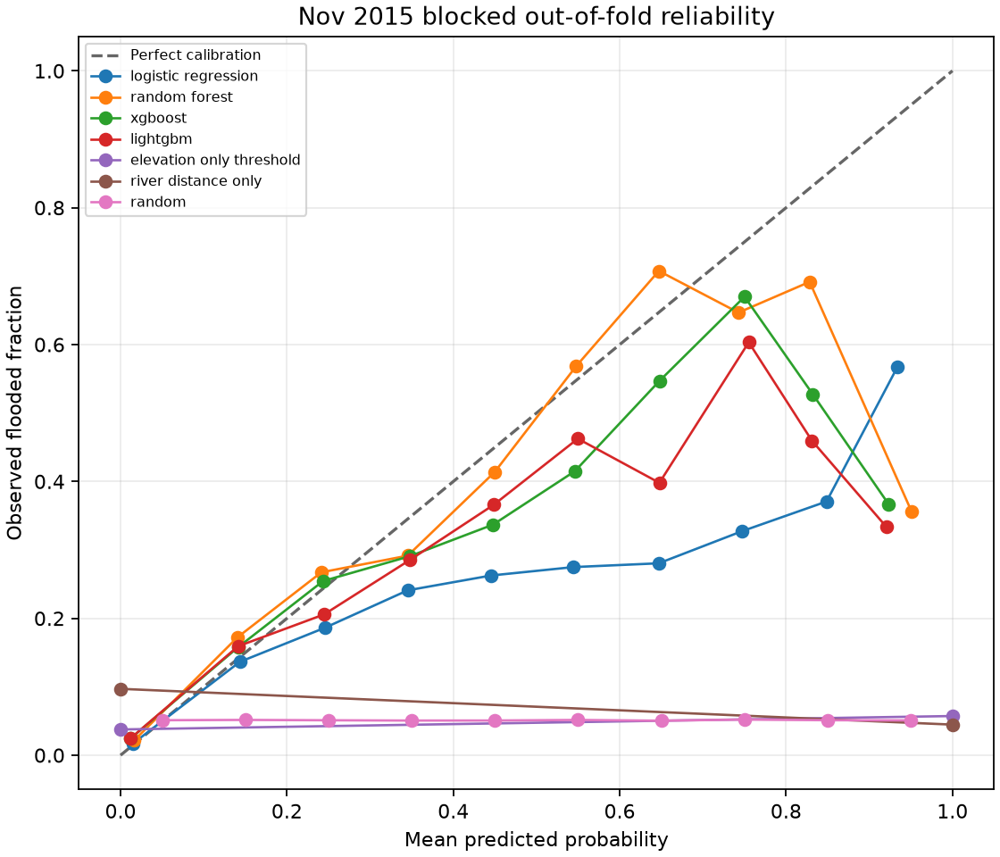
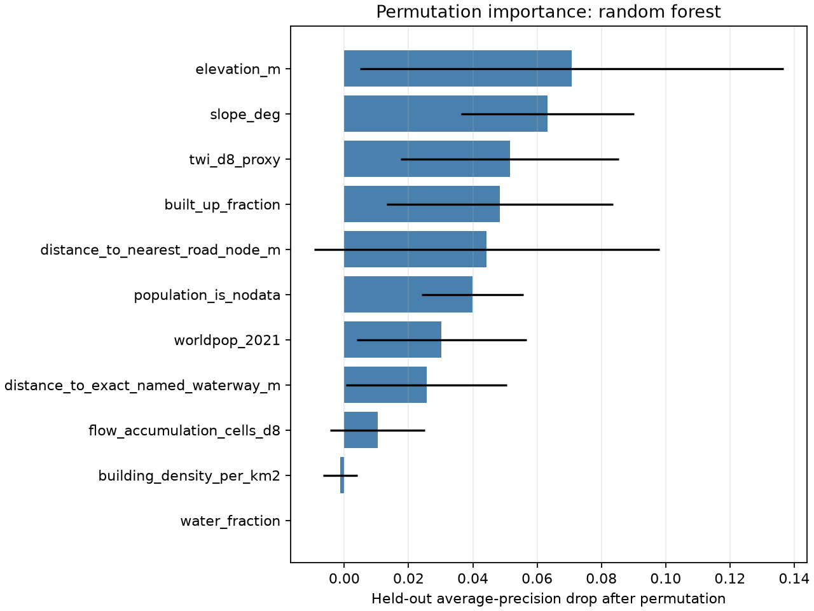
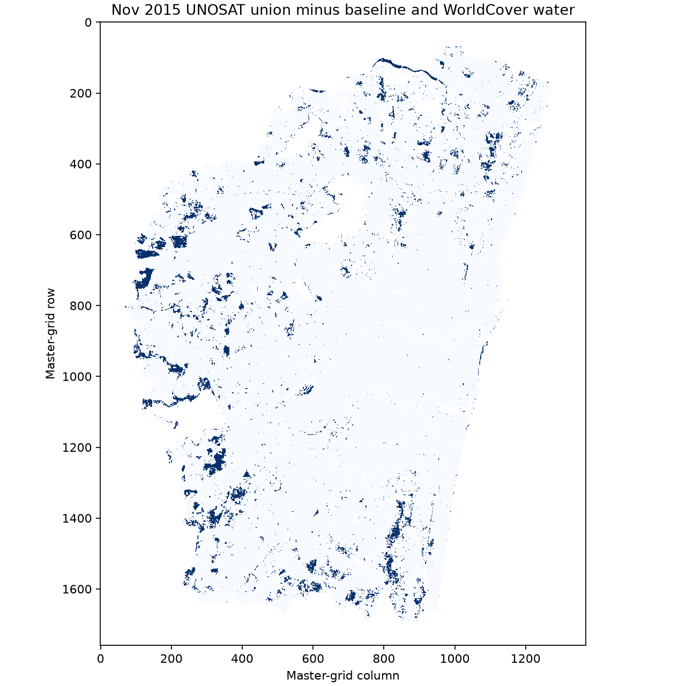

# Phase 9 pilot — November 2015 flood susceptibility baseline

> **PILOT, SINGLE EVENT — OFFICIAL SAR-DERIVED, NOT FIELD-VALIDATED.** This is a susceptibility model for spatial pattern, not a time-varying forecast.

## Label and eligible cells

| Quantity | Result |
|---|---:|
| CMA grid cells in static table | 1,319,380 |
| Baseline-water cells excluded | 80,311 |
| WorldCover water cells excluded | 84,205 |
| Unique cells excluded by the combined water mask | 123,080 |
| Eligible cells | 1,196,300 |
| 12 Nov positives among eligible cells | 31,936 (2.6696%) |
| 24 Nov positives among eligible cells | 42,146 (3.5230%) |
| Default union-minus-baseline positives | 61,166 (5.1129%) |
| Default target area at 30 m cell area | 55.05 km² |

The default target is the union of the 12 and 24 November UNOSAT rasters after subtracting every non-zero cell in the 1 September and 14 October baseline layers and any WorldCover water fraction above zero. The baseline layers include uncertain wet-soil class 2, so the subtraction is an unverified label choice. Sea is excluded where represented by WorldCover water; there is no separate sea mask in the cell table.

## Inputs and model design

Predictors came only from `data/features/static/cell_table.parquet`: cleaned elevation, slope, TWI proxy, D8 flow accumulation, built-up/water fractions, OSM building density, road and named-waterway distances, WorldPop 2021 and its NoData flag. Coast distance was omitted because it is NoData for every cell. The water fraction is retained as specified but becomes zero for eligible cells because all positive water fractions were masked.

Validation used five folds of whole 3 km blocks, a one-block neighbor buffer between training and test blocks, and complete eligible test blocks at their true prevalence. Each model used every flooded training-fold cell plus a spatial-block-stratified sample of nonflooded cells at 3:1, seed 20261024. Imputation and scaling were fitted within each training fold. Probability prior correction uses only training-fold prevalence. Threshold selection weights sampled negatives by the inverse sampling fraction, restoring true training-fold prevalence for the F1 objective; thresholds are still selected on in-sample predictions and can be optimistic.

Fixed model settings were used; no hyperparameter search was run. The bootstrap uncertainty ensemble has 20 resampled fits of the CV-selected model. Its full-grid probability rasters are fitted on the complete eligible single-event dataset (apparent pilot maps), not out-of-fold predictions. They capture model/resampling spread, not all label or source uncertainty; use the blocked CV metrics to judge performance.

## Out-of-fold model results

PR-AUC is average precision. Fold spread is mean ± sample standard deviation. The overall columns aggregate the out-of-fold predictions; F1/IoU use the threshold selected separately on each training fold.

| Model | ROC-AUC pooled (fold mean ± SD) | PR-AUC pooled (fold mean ± SD) | F1 mean ± SD | IoU mean ± SD | Brier pooled (fold mean ± SD) | ECE pooled (fold mean ± SD) | Predicted area vs actual (km²) |
|---|---:|---:|---:|---:|---:|---:|---:|
| logistic regression | 0.8742 (0.8741 ± 0.0141) | 0.2393 (0.2540 ± 0.0862) | 0.3058 ± 0.0557 | 0.1815 ± 0.0392 | 0.0461 (0.0461 ± 0.0095) | 0.0178 (0.0220 ± 0.0118) | 104.15 vs 55.05 |
| random forest | 0.8911 (0.8898 ± 0.0078) | 0.3415 (0.3340 ± 0.1018) | 0.3499 ± 0.0791 | 0.2143 ± 0.0599 | 0.0398 (0.0398 ± 0.0093) | 0.0093 (0.0131 ± 0.0070) | 46.78 vs 55.05 |
| xgboost | 0.8840 (0.8813 ± 0.0152) | 0.3278 (0.3273 ± 0.1200) | 0.3498 ± 0.0998 | 0.2156 ± 0.0753 | 0.0407 (0.0407 ± 0.0077) | 0.0162 (0.0197 ± 0.0041) | 48.93 vs 55.05 |
| lightgbm | 0.8809 (0.8796 ± 0.0167) | 0.3080 (0.3178 ± 0.1213) | 0.3391 ± 0.1048 | 0.2082 ± 0.0797 | 0.0416 (0.0416 ± 0.0080) | 0.0179 (0.0209 ± 0.0081) | 49.52 vs 55.05 |
| elevation only threshold | 0.5040 (0.5489 ± 0.0312) | 0.0515 (0.0706 ± 0.0391) | 0.1457 ± 0.0840 | 0.0804 ± 0.0503 | 0.4153 (0.4153 ± 0.4212) | 0.4153 (0.4153 ± 0.4212) | 437.67 vs 55.05 |
| river distance only | 0.4454 (0.4843 ± 0.0336) | 0.0465 (0.0499 ± 0.0145) | 0.0829 ± 0.0199 | 0.0433 ± 0.0109 | 0.8378 (0.8378 ± 0.2603) | 0.8378 (0.8378 ± 0.2603) | 930.70 vs 55.05 |
| random | 0.4999 (0.4995 ± 0.0031) | 0.0512 (0.0513 ± 0.0168) | 0.0965 ± 0.0291 | 0.0509 ± 0.0162 | 0.3336 (0.3336 ± 0.0006) | 0.4493 (0.4505 ± 0.0149) | 1033.58 vs 55.05 |

### Per-fold performance and uncertainty

| Model | Fold | ROC-AUC | PR-AUC | F1 | IoU | Brier | ECE | Threshold | Actual / predicted area km² |
|---|---:|---:|---:|---:|---:|---:|---:|---:|---:|
| logistic regression | 1 | 0.8532 | 0.1872 | 0.2520 | 0.1441 | 0.0464 | 0.0380 | 0.2636 | 8.25 / 19.56 |
| logistic regression | 2 | 0.8803 | 0.3596 | 0.3824 | 0.2364 | 0.0593 | 0.0217 | 0.1830 | 16.07 / 40.60 |
| logistic regression | 3 | 0.8866 | 0.3222 | 0.3124 | 0.1851 | 0.0388 | 0.0089 | 0.2120 | 10.44 / 6.51 |
| logistic regression | 4 | 0.8844 | 0.1573 | 0.2513 | 0.1437 | 0.0356 | 0.0285 | 0.2689 | 7.35 / 17.24 |
| logistic regression | 5 | 0.8662 | 0.2438 | 0.3308 | 0.1982 | 0.0504 | 0.0128 | 0.1956 | 12.94 / 20.23 |
| random forest | 1 | 0.8843 | 0.2442 | 0.2952 | 0.1732 | 0.0333 | 0.0097 | 0.2250 | 8.25 / 9.58 |
| random forest | 2 | 0.9028 | 0.4906 | 0.4721 | 0.3090 | 0.0512 | 0.0214 | 0.2206 | 16.07 / 13.20 |
| random forest | 3 | 0.8838 | 0.3505 | 0.3675 | 0.2251 | 0.0378 | 0.0081 | 0.2467 | 10.44 / 8.37 |
| random forest | 4 | 0.8907 | 0.2417 | 0.2677 | 0.1545 | 0.0292 | 0.0064 | 0.3008 | 7.35 / 4.71 |
| random forest | 5 | 0.8874 | 0.3429 | 0.3469 | 0.2099 | 0.0473 | 0.0200 | 0.1898 | 12.94 / 10.91 |
| xgboost | 1 | 0.8769 | 0.2105 | 0.2791 | 0.1622 | 0.0389 | 0.0254 | 0.2731 | 8.25 / 12.67 |
| xgboost | 2 | 0.8994 | 0.5082 | 0.4938 | 0.3278 | 0.0494 | 0.0161 | 0.2692 | 16.07 / 12.80 |
| xgboost | 3 | 0.8582 | 0.3467 | 0.3897 | 0.2420 | 0.0387 | 0.0206 | 0.2561 | 10.44 / 10.75 |
| xgboost | 4 | 0.8868 | 0.2249 | 0.2378 | 0.1349 | 0.0300 | 0.0152 | 0.2926 | 7.35 / 3.86 |
| xgboost | 5 | 0.8853 | 0.3461 | 0.3487 | 0.2112 | 0.0468 | 0.0211 | 0.2397 | 12.94 / 8.86 |
| lightgbm | 1 | 0.8709 | 0.1915 | 0.2798 | 0.1626 | 0.0418 | 0.0329 | 0.2895 | 8.25 / 13.60 |
| lightgbm | 2 | 0.9008 | 0.5008 | 0.4994 | 0.3328 | 0.0498 | 0.0154 | 0.2510 | 16.07 / 14.65 |
| lightgbm | 3 | 0.8583 | 0.3476 | 0.3892 | 0.2416 | 0.0388 | 0.0215 | 0.2671 | 10.44 / 10.68 |
| lightgbm | 4 | 0.8909 | 0.2255 | 0.2441 | 0.1390 | 0.0298 | 0.0119 | 0.3053 | 7.35 / 4.36 |
| lightgbm | 5 | 0.8770 | 0.3238 | 0.2829 | 0.1647 | 0.0480 | 0.0229 | 0.3006 | 12.94 / 6.23 |
| elevation only threshold | 1 | 0.5207 | 0.0399 | 0.0767 | 0.0399 | 0.8347 | 0.8347 | -28.0784 | 8.25 / 186.52 |
| elevation only threshold | 2 | 0.5974 | 0.1333 | 0.2721 | 0.1575 | 0.0934 | 0.0934 | -2.8982 | 16.07 / 11.56 |
| elevation only threshold | 3 | 0.5613 | 0.0771 | 0.1825 | 0.1004 | 0.0632 | 0.0632 | -3.1684 | 10.44 / 6.20 |
| elevation only threshold | 4 | 0.5268 | 0.0360 | 0.0695 | 0.0360 | 0.9123 | 0.9123 | -28.0846 | 7.35 / 203.74 |
| elevation only threshold | 5 | 0.5382 | 0.0667 | 0.1273 | 0.0680 | 0.1726 | 0.1726 | -6.6993 | 12.94 / 29.65 |
| river distance only | 1 | 0.4973 | 0.0381 | 0.0734 | 0.0381 | 0.9594 | 0.9594 | -16706.4043 | 8.25 / 214.79 |
| river distance only | 2 | 0.4242 | 0.0687 | 0.0691 | 0.0358 | 0.3725 | 0.3725 | -3685.7297 | 16.07 / 70.08 |
| river distance only | 3 | 0.5002 | 0.0485 | 0.0925 | 0.0485 | 0.9512 | 0.9512 | -17135.7383 | 10.44 / 215.24 |
| river distance only | 4 | 0.5000 | 0.0341 | 0.0660 | 0.0341 | 0.9659 | 0.9659 | -16343.3047 | 7.35 / 215.29 |
| river distance only | 5 | 0.4996 | 0.0600 | 0.1133 | 0.0600 | 0.9399 | 0.9399 | -17023.1348 | 12.94 / 215.30 |
| random | 1 | 0.4987 | 0.0380 | 0.0737 | 0.0383 | 0.3338 | 0.4619 | 0.0075 | 8.25 / 213.83 |
| random | 2 | 0.5023 | 0.0753 | 0.1370 | 0.0736 | 0.3327 | 0.4297 | 0.1721 | 16.07 / 178.37 |
| random | 3 | 0.5024 | 0.0490 | 0.0924 | 0.0484 | 0.3338 | 0.4523 | 0.0126 | 10.44 / 212.53 |
| random | 4 | 0.4949 | 0.0340 | 0.0661 | 0.0342 | 0.3342 | 0.4664 | 0.0050 | 7.35 / 214.25 |
| random | 5 | 0.4992 | 0.0600 | 0.1134 | 0.0601 | 0.3333 | 0.4419 | 0.0033 | 12.94 / 214.60 |

## Baseline comparison

The CV-selected model by overall PR-AUC was **random forest**. Each model's PR-AUC comparison with each simple baseline is:

| Model | Elevation-only baseline | River-distance-only baseline | Random baseline |
|---|---|---|---|
| logistic regression | beats (0.2393 vs 0.0515) | beats (0.2393 vs 0.0465) | beats (0.2393 vs 0.0512) |
| random forest | beats (0.3415 vs 0.0515) | beats (0.3415 vs 0.0465) | beats (0.3415 vs 0.0512) |
| xgboost | beats (0.3278 vs 0.0515) | beats (0.3278 vs 0.0465) | beats (0.3278 vs 0.0512) |
| lightgbm | beats (0.3080 vs 0.0515) | beats (0.3080 vs 0.0465) | beats (0.3080 vs 0.0512) |

## Permutation importance

Mean average-precision decrease on held-out fold samples for random forest (2 permutations, up to 2,000 cells per fold):

| Feature | Mean PR-AUC drop | Across-fold SD |
|---|---:|---:|
| elevation_m | 0.070766 | 0.065850 |
| slope_deg | 0.063266 | 0.026931 |
| twi_d8_proxy | 0.051540 | 0.033947 |
| built_up_fraction | 0.048411 | 0.035236 |
| distance_to_nearest_road_node_m | 0.044300 | 0.053725 |
| population_is_nodata | 0.039881 | 0.015885 |
| worldpop_2021 | 0.030256 | 0.026435 |
| distance_to_exact_named_waterway_m | 0.025558 | 0.024954 |
| flow_accumulation_cells_d8 | 0.010356 | 0.014769 |
| building_density_per_km2 | -0.001256 | 0.005315 |
| water_fraction | 0.000000 | 0.000000 |

## Figures and prediction rasters

PILOT single-event ensemble GeoTIFFs on the master grid: mean probability, 5th percentile and 95th percentile are under `data/features/predictions/`. Outside-CMA cells, masked water/sea and cells not in the cell table remain NoData (-9999). The cell-level three-target table is `data/features/predictions/labels_nov2015.parquet`.

## Leakage review, interpretation and remaining labels

- No input feature is derived from the November target rasters. The September/October and WorldCover masks are used only to construct/exclude labels; rows masked by them are not evaluated.
- Thresholds are selected on training-fold predictions with inverse negative-sampling weights to restore true fold prevalence; tree thresholds can still be optimistic because predictions are in-sample.
- Entire block IDs stay on one side of each fold. Training blocks within one block ring of the held-out blocks are removed. Feature imputation/scaling and negative sampling happen after each split and use training-fold cells only.
- The models use static inputs and one November 2015 label. They estimate relative spatial susceptibility for this one event; they do not predict when or how deep future flooding will be.
- The mean and percentile map rasters are full-data bootstrap predictions for visualization, not held-out maps; only the reported fold metrics are out-of-block evaluation.
- The November UNOSAT layers do not cover the 1–8 Dec 2015 peak. WorldCover is 2021, and WorldPop is an alpha model product; temporal and source limitations remain.
- A single event cannot test cross-event generalisation or support hypotheses H1 to H5. Do not claim these results establish forecast skill or field accuracy.
- Needed next: digitised and checked December 2015 extent, manually digitised/georeferenced 2021 and 2023 NRSC PDFs, and independent field/gauge or authoritative flood observations. Labels need dates, uncertainty and provenance.

Input data hash: `02efe3144db402b53853fd9e0bf6fb9f5a6e6b87d83a1f892f767d56a62650d6`. Detailed fold data and model settings are in `PHASE9_METRICS.json` and `PHASE9_MODEL_REGISTRY.json`.
