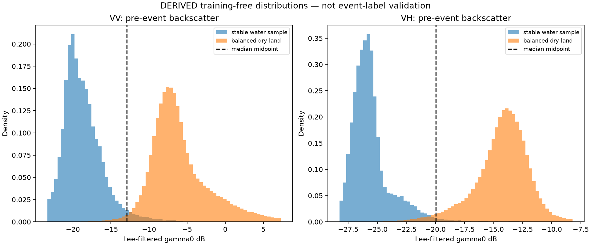

# Batch 1 T2: pre-event SAR distributions

**Status:** completed as a descriptive, DERIVED screening analysis. No November/December event flood layer or UNOSAT event extent was used to select thresholds. This does not establish flood-detection accuracy.

The reproducible command is `.venv/Scripts/python.exe -m pipelines.phase8.physics_thresholds`. It reads the existing 30 m Lee 5×5 gamma0 dB RTC mosaics for 19 Oct 2015, 23 Oct 2021 and 4 Nov 2021. Adjacent acquisition slices were already mosaicked by the earlier Stage 8 workflow. Pixels are aligned by verified integer offsets on the EPSG:32644 30 m grid; no resampling is used for these congruent grids.

Permanent-water samples are the intersection of the CMA, a one-cell (30 m) eroded WorldCover 2021 class-80 water mask, and nonzero cells in both exploratory UNOSAT baseline rasters (1 Sep and 14 Oct 2015). This strict agreement leaves 19,998 cells. Dry cells exclude that agreed water set and any nonzero baseline water, then are stratified as WorldCover classes 50 built-up, 40 cropland, 10 tree, 60 bare and 30 grass. The dry definition is a **DEFAULT, to confirm**: land-cover class and baseline non-water are proxies for stable dry ground, not field observations. Up to 20,000 samples per stratum and scene were selected with seed 20261025. The repeated scenes and neighbouring pixels are autocorrelated; sample size is not an independent-observation count.

| Pre-event scene | Pol | Water median dB (n) | Balanced dry median dB (n) | AUC (lower dB = water) | Median-midpoint screen dB |
|---|---:|---:|---:|---:|---:|
| 19 Oct 2015 | VV | -18.44 (19,998) | -7.28 (98,461) | 0.993 | -12.86 |
| 19 Oct 2015 | VH | -25.36 (19,998) | -14.33 (98,461) | 0.997 | -19.84 |
| 23 Oct 2021 | VV | -20.07 (19,998) | -7.05 (98,461) | 0.996 | -13.56 |
| 23 Oct 2021 | VH | -26.71 (19,998) | -14.36 (98,461) | 0.994 | -20.53 |
| 4 Nov 2021 | VV | -18.68 (19,998) | -5.77 (98,462) | 0.995 | -12.22 |
| 4 Nov 2021 | VH | -25.89 (19,998) | -13.19 (98,462) | 0.997 | -19.54 |

Pooled over the three scenes, the water medians were -19.13 dB VV and -25.89 dB VH; balanced dry medians were -6.74 dB VV and -14.03 dB VH. The median-midpoint defaults are therefore **-12.93 dB VV** and **-19.96 dB VH**. The pooled sample AUCs are 0.995 VV and 0.996 VH. These high separations describe this deliberately strict water-core versus land sample. The baseline labels and WorldCover water class help define the samples, so these AUCs are not independent validation and must not be read as event-flood skill.

For the change screen, use 4 Nov 2021 minus 23 Oct 2021 dB over common-valid stable-dry samples in the five stated land-cover classes. `mean − 2 × SD` (**k=2, DEFAULT to confirm**) is -3.00 dB VV and -1.80 dB VH; n=1,188,386 valid cells for each. The change distribution means are +2.01 dB VV and +1.22 dB VH. This lower-tail rule is a screening convention, not a validated physical flood threshold.

The run exposed a mask-alignment defect in its first attempt: a resampling operation changed valid zero-valued mask cells to one. The run was discarded. Exact affine pixel-offset copying replaced resampling; the resulting CMA-cell count is 1,319,380, matching the existing master grid. Automated tests cover zero preservation and rejection of fractional-pixel offsets.

**Limits:** UNOSAT baselines are marked exploratory, WorldCover is from 2021, and the strict agreement mask selects only core-like water. The thresholds are candidates for the fixed Flood Rule v2; T4 will preregister acceptance before any comparison with the UNOSAT 24 Nov event layer. Nothing here is field-validated or ground truth.

Detailed numeric output: `T2_PHYSICS_THRESHOLDS.json`. Script: `../pipelines/phase8/physics_thresholds.py`.
