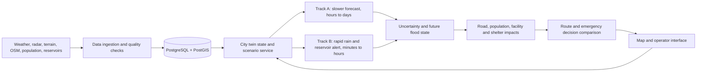

# Architecture and technology stack

## Intended architecture

This is a design diagram, not a depiction of deployed services. [user; repo: `docs/PROJECT_STATUS.md`]

Plain-text version: `sources → ingestion and checks → spatial database → twin state → Track A forecast + Track B rapid alert → uncertainty → impacts → route/shelter/action comparison → operator map → twin update`. Java services are intended to manage users, APIs and scenarios; Python services are intended to perform scientific modelling. No prediction service, twin state service, routing application, or frontend is recorded as implemented. [user; repo: `README.md`, `docs/PROJECT_STATUS.md`]

## Two tracks

- **Track A, slower forecast:** weather and spatial information support an hours-to-days flood outlook and feed the uncertainty/impact workflow. Satellites support historical labels and context. Their revisit interval makes them unsuitable as the sole rapid alert input. [user]
- **Track B, rapid alert:** current rain and reservoir trend are intended to produce a minutes-to-hours screen that shares the same twin state. Current work only has an illustrative historical rule; no live feed or validated alert service exists. [repo: `data/features/reservoirs/illustrative_track_b_backtest.json`; user]

## Intended technology choices

All technologies below are planning choices supplied by the user. Except for the Python geospatial packages recorded in `requirements.txt`, treat them as **planned or not verified installed**, not as implemented components. [user; repo: `requirements.txt`, `docs/PHASE3_LOG.md`]

| Layer | Planned technology | Intended job | Current evidence/status |
|---|---|---|---|
| Main application | Java 21, Spring Boot 3, Security, Web, Data JPA, Hibernate | Identity, APIs, scenarios, orchestration, routing requests, shelters, alerts and audit. | Not present as a backend implementation. [repo: `README.md`] |
| User interface | React, TypeScript, Tailwind, MapLibre GL JS | Map, event context, uncertainty and action comparison. | `frontend` folder exists; service is planned. [repo: folder tree] |
| Scientific service | Python, FastAPI | Expose model and geospatial functions to the main application. | Python pipelines exist; no FastAPI model service recorded. [repo: `pipelines/phase3/`, `README.md`] |
| Modelling | PyTorch, scikit-learn, XGBoost, LightGBM; Transformer/vision encoder; GNN only if justified | Forecasts, fusion, uncertainty and experiments. | No model training. [repo: `docs/PROJECT_STATUS.md`; user] |
| Geospatial | GeoPandas, Rasterio, GDAL, Shapely, xarray | Read, align, inspect and summarize spatial/weather inputs. | Pinned packages include GeoPandas, Rasterio, Shapely, pyproj; rasterio-bundled GDAL was used. [repo: `requirements.txt`, `docs/PHASE3_LOG.md`] |
| Storage | PostgreSQL 18.6 + PostGIS 3.6.2 locally; Docker Compose remains stopped | Spatial and application data storage. | Local `twinguard` database is verified; Compose uses `postgis/postgis:18-3.6-alpine`, host port 5433, and a named volume. [repo: `docker-compose.yml`, `docs/STAGE_5_6_REPORT.md`] |
| Fast messaging/cache | Redis, Apache Kafka | Potential real-time stream and state handling for Track B. | Planned only; include only if a real workload justifies them. [user] |
| Experiment operations | MLflow, GitHub Actions, Docker | Track experiments and repeatable builds. | Not verified configured. [user; repo: folder tree] |
| Operations and tests | Prometheus, Grafana, JUnit, Mockito, Pytest, OpenAPI | Monitoring, tests and API documentation. | Not verified configured. [user] |

The division is deliberate: Java/Spring Boot is the application brain; Python/FastAPI is the scientific brain. Do not force machine-learning work into Java. [user]

## Database and deployment sequence

The local PostgreSQL 18.6/PostGIS 3.6.2 installation and `twinguard` database are verified. Compose remains stopped and uses a separate host port (5433 by default) so it will not collide with the local server on 5432. Compose reads secrets from `.env`; `.env.example` contains placeholders and non-secret defaults only. [repo: `docker-compose.yml`, `.env.example`, `docs/STAGE_5_6_REPORT.md`]

## Decision loop data flow

The planned loop is observation/forecast → twin-state update → flood and uncertainty estimate → road/facility/population impacts → route and shelter alternatives → counterfactual comparison → operator review → updated state. Each future recommendation should retain its input time, model version, uncertainty and reason. This is a design requirement, not current software behavior. [user]
