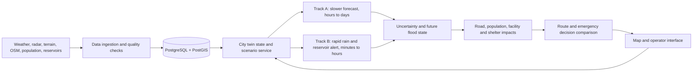

# TwinGuard AI — Complete Project Handbook

**TwinGuard AI: An Intelligent Digital Twin for Urban Flood Management and Emergency Decision Support**

Originally prepared 16 October 2026 from the repository and the user-supplied project brief; Track B chapter refreshed 27 October 2026 from verified repository evidence. Important statements identify their source. Unknown details remain visible placeholders.

\pagebreak

## Contents

- [00 — Project on a Page](00_Project_on_a_Page.md)
- [01 — Overview and Vision](01_Overview_and_Vision.md)
- [02 — Research Foundation](02_Research_Foundation.md)
- [03 — Architecture and Technology Stack](03_Architecture_and_Tech_Stack.md)
- [04 — Decision Log](04_Decision_Log.md)
- [05 — Data Inventory](05_Data_Inventory.md)
- [06 — Flood Events and Labels](06_Flood_Events_and_Labels.md)
- [07 — Reservoirs and Track B](07_Reservoirs_and_Track_B.md)
- [08 — Engineering Phases 2 and 3](08_Engineering_Phase2_and_Phase3.md)
- [09 — Progress and Chronicle](09_Progress_and_Chronicle.md)
- [10 — Roadmap and Next Steps](10_Roadmap_and_Next_Steps.md)
- [11 — Evaluation Plan](11_Evaluation_Plan.md)
- [12 — Team Guide](12_Team_Guide.md)
- [13 — Risks and Limitations](13_Risks_and_Limitations.md)
- [14 — Glossary](14_Glossary.md)
- [15 — FAQ](15_FAQ.md)
- [16 — References and Attribution](16_References_and_Attribution.md)
- [17 — Document Control](17_Document_Control.md)

\pagebreak
\pagebreak
## Contents

- [00 — Project on a Page](00_Project_on_a_Page.md)
- [01 — Overview and Vision](01_Overview_and_Vision.md)
- [02 — Research Foundation](02_Research_Foundation.md)
- [03 — Architecture and Tech Stack](03_Architecture_and_Tech_Stack.md)
- [04 — Decision Log](04_Decision_Log.md)
- [05 — Data Inventory](05_Data_Inventory.md)
- [06 — Flood Events and Labels](06_Flood_Events_and_Labels.md)
- [07 — Reservoirs and Track B](07_Reservoirs_and_Track_B.md)
- [08 — Engineering Phase2 and Phase3](08_Engineering_Phase2_and_Phase3.md)
- [09 — Progress and Chronicle](09_Progress_and_Chronicle.md)
- [10 — Roadmap and Next Steps](10_Roadmap_and_Next_Steps.md)
- [11 — Evaluation Plan](11_Evaluation_Plan.md)
- [12 — Team Guide](12_Team_Guide.md)
- [13 — Risks and Limitations](13_Risks_and_Limitations.md)
- [14 — Glossary](14_Glossary.md)
- [15 — FAQ](15_FAQ.md)
- [16 — References and Attribution](16_References_and_Attribution.md)
- [17 — Document Control](17_Document_Control.md)

\pagebreak
\pagebreak
## Contents

- [00 — Project on a Page](00_Project_on_a_Page.md)
- [01 — Overview and Vision](01_Overview_and_Vision.md)
- [02 — Research Foundation](02_Research_Foundation.md)
- [03 — Architecture and Tech Stack](03_Architecture_and_Tech_Stack.md)
- [04 — Decision Log](04_Decision_Log.md)
- [05 — Data Inventory](05_Data_Inventory.md)
- [06 — Flood Events and Labels](06_Flood_Events_and_Labels.md)
- [07 — Reservoirs and Track B](07_Reservoirs_and_Track_B.md)
- [08 — Engineering Phase2 and Phase3](08_Engineering_Phase2_and_Phase3.md)
- [09 — Progress and Chronicle](09_Progress_and_Chronicle.md)
- [10 — Roadmap and Next Steps](10_Roadmap_and_Next_Steps.md)
- [11 — Evaluation Plan](11_Evaluation_Plan.md)
- [12 — Team Guide](12_Team_Guide.md)
- [13 — Risks and Limitations](13_Risks_and_Limitations.md)
- [14 — Glossary](14_Glossary.md)
- [15 — FAQ](15_FAQ.md)
- [16 — References and Attribution](16_References_and_Attribution.md)
- [17 — Document Control](17_Document_Control.md)

\pagebreak
# TwinGuard AI — project on a page

**A decision-support research project for urban flooding in Chennai.** TwinGuard is intended to combine weather, satellite, terrain, reservoir, map and population information to estimate where flooding may occur, show uncertainty, and help compare emergency actions. [user]

## Why it exists

Flood response is a chain of decisions. A predicted flood can affect roads, people, facilities and shelters. A useful system should carry uncertainty through that chain and help an operator compare choices, rather than show a flood map alone. This is the project's research direction; the operational system does not exist yet. [user]

## What is new (carefully stated)

The project proposes to test an integrated **uncertainty-to-decision** workflow: forecasts update a digital representation of the city, and likely future road access, exposure, shelter availability and decisions are compared. It also proposes time-aware routes and “what if” scenarios. The individual methods are established ideas. The team has not completed a literature review sufficient to claim priority or novelty. [user]

## Status

`Phase 1: foundation — reported complete` → `Phase 2: collection and audit — close-out complete, with gaps` → `Phase 3: feature preparation — Part B complete` → `Phase 4: not started`. No flood model has been trained. [repo: `docs/PROJECT_STATUS.md`, `docs/PHASE3_LOG.md`]

## What exists now

Raw sources are locally collected and logged; a common 30 m analysis grid and exploratory weather, terrain, land-cover, OSM, population, reservoir and flood-inspection outputs exist. They are research inputs, not a deployed twin or final validation set. The grid uses the older, pre-2022 CMA boundary provisionally. [repo: `docs/PHASE3_LOG.md`, `docs/GRID_DECISION.md`]

## The immediate next work

Resolve the old-versus-expanded CMA boundary, review coastal terrain and drainage, reconcile OSM counts and test network connectivity, settle the flood-label strategy, and verify product units and reuse terms. Then follow the reviewed roadmap and get explicit approval before Phase 4. [repo: `docs/MANUAL_TODO.md`, `docs/PHASE3_PLAN.md`]

## Where a new teammate should start

Read this page, [Progress and Chronicle](09_Progress_and_Chronicle.md), [Data Inventory](05_Data_Inventory.md), [Flood Events and Labels](06_Flood_Events_and_Labels.md), and [Document Control](17_Document_Control.md). Use the [Coverage Matrix](COVERAGE_MATRIX.md) to locate evidence. Unknown personal details remain marked `[TO BE FILLED]`.

# Overview and vision

## The problem

Chennai faces urban flood emergencies in which rainfall, drainage, rivers, reservoirs, roads, people and public services interact. A map of predicted water alone does not answer whether a route will stay passable, which shelter may be reachable, or how confident the forecast is. The project context and problem framing come from the user's planning brief. [user]

The system is intended for research and decision support. It is not an official warning service, a replacement for emergency authorities, or a guarantee that a route or shelter is safe. [user]

## Vision: decision continuity

The proposed loop is: collect observations and forecasts → estimate current and future flood conditions → quantify uncertainty → update the city representation (“twin state”) → estimate effects on roads, people and facilities → compare actions → show a recommendation with evidence → update when new information arrives. “Digital Twin” here means a data-linked digital representation of a real place that can be updated and used to test scenarios. The loop is a target design, not an implemented product. [user]

## Example of a future operator experience

> “Flooding may intensify in Zone X in 90 minutes. Road A has a high chance of becoming impassable. Shelter B may approach capacity. Route C is expected to remain safer over the journey. Consider evacuation now; confidence is moderate.”

This is an illustrative sentence only. Zone X, roads, shelter status, timing and confidence are not measured results and must not be presented as actual Chennai alerts. [user]

## What TwinGuard is

- A research platform for testing a connected flood-to-decision workflow. [user]
- A proposed two-track system: a slower, richer event forecast and a faster rain/reservoir alert. [user]
- A way to compare baseline models, uncertainty methods, routes and counterfactual actions under documented data limits. [user]

## What it is not

- Not a CRUD application (a basic create/read/update/delete database interface), static GIS map, dataset dashboard, or collection of disconnected models. [user]
- Not a validated public warning system, dispatch tool, or substitute for local authorities. [user]
- Not currently a trained flood predictor, working routing service or operational digital twin. The repository records feature preparation but no model training. [repo: `docs/PROJECT_STATUS.md`]

## Users and intended decisions

The intended decision-maker is an emergency planning or response operator. Candidate decisions include prioritising an area, selecting a departure time, choosing a route that is likely to remain passable, assigning a shelter, and comparing what-if cases such as a bridge closure. User roles and institution are not yet named. [user]

## Geographic scope

The working boundary is the older, smaller CMA, with a measured area of **1,187.460287 km²** in the coverage analysis. It remains provisional; the expanded post-2022 metropolitan area is not the current analysis boundary. The planning brief explains the choice as a denser urban core with better event and map-data fit, but this rationale must be checked against the final project requirements. [repo: `docs/COVERAGE_2015.md`, `docs/GRID_DECISION.md`; user]

# Research foundation

## Research gap and novelty

The intended research gap is not “flood AI is new.” The user’s literature notes say that reviewed work advances individual capabilities, while the team has not yet found a Chennai study that tests forecast uncertainty all the way through road accessibility, evacuation and shelter decisions in one connected pipeline. This is a provisional gap statement based on titles and abstracts supplied by the user; it is not a completed systematic review. [user]

The proposed contribution is to build and experimentally test a decision-centred workflow: combine evidence, carry uncertainty into impacts and route choices, then compare actions. Do not claim this is the first such system. [user]

## Proposed contributions

| ID | Proposed contribution | Status |
|---|---|---|
| C1 | Multimodal flood intelligence using weather, satellite, terrain/GIS and, if adequate, reservoir telemetry. | Proposed; no flood model trained. [user; repo: `docs/PROJECT_STATUS.md`] |
| C2 | Carry uncertainty from predicted flood extent into exposure and road access. | Proposed. [user] |
| C3 | Predictive, time-aware evacuation routing and shelter choice. | Proposed; graph connectivity still needs validation. [repo: `docs/PHASE3_LOG.md`] |
| C4 | A decision-centred twin for comparing alternative actions. | Proposed. [user] |
| C5 | A fast rain-and-storage alert track. | Proposed; exploratory retrospective screen exists, not a validated alert model. [repo: `docs/PHASE3_LOG.md`] |

The final contribution list is still open for the student team to update and approve. [user]

## Hypotheses and test direction

| Hypothesis | Proposed comparison | Evidence needed |
|---|---|---|
| H1: Multimodal inputs improve flood prediction over single modalities. | Weather-only, terrain-only, satellite-only where labels support it, then fused inputs. | Defensible date-matched flood labels and leakage-safe splits. [user] |
| H2: Explicit uncertainty improves calibration. | Deterministic output versus probabilistic/interval output. | Held-out observed events and calibration measures. [user] |
| H3: Passing flood uncertainty into road-access estimates supports safer evacuation. | Deterministic route risk versus uncertainty-aware route risk. | Validated road graph, time-matched flood conditions, route outcomes. [user] |
| H4: Horizon-aware routes fail less often than routes chosen from current conditions. | Current-state shortest/safest path versus predicted journey-time risk. | Time-varying flood/road observations. [user] |
| H5: Counterfactual twin simulation improves decision quality over a static risk map. | Compare decisions under alternate closures, departure times and shelter availability. | Defined decision outcomes and evaluation protocol. [user] |
| Track B: storage plus rainfall may provide useful warning lead time. | Retrospective rule screen against documented event timing. | Historical capacities, releases and complete flood outcomes. Existing screen is only illustrative. [repo: `data/features/reservoirs/illustrative_track_b_backtest.json`] |

No success thresholds have been selected. Set them after baselines and data review. [user]

## Literature supplied for review

The project brief says the following works were checked only by title and abstract, except where explicitly noted. The links have not been opened during this task. Treat details and relevance as user-supplied leads, not verified citations. [user]

| Work (short title) | Year | What it may contribute | Status |
|---|---:|---|---|
| “Digital Twin Technology for Urban Flood Risk Management” (Remote Sensing 17(17):3104) | 2025 | Review of urban flood digital twins and remote sensing. | Title/abstract only; supplied URL. |
| Taghikhah et al., digital-twin disaster decision support review | 2025 | Frameworks for disaster decision support. | Title/abstract only; supplied URL. |
| University of Hertfordshire, flood visualisation technologies review | 2024 | Visualisation methods for flood management. | Title/abstract only; supplied URL. |
| Razavi et al., generative-AI-aided flood twin | 2024 | Example of AI and twin integration. | Title/abstract only; supplied URL. |
| Chennai extended Elman/spiking-neural-network flood prediction | 2025 | Chennai rainfall/flood prediction comparison. | Title/abstract only; supplied URL. |
| Chennai flood susceptibility mapping | 2024 | Chennai spatial susceptibility baseline context. | Title/abstract only; supplied URL. |
| Chennai high-resolution topography monitoring/simulation | 2026 | Terrain-based local flood modelling. | Title and venue only; supplied URL. |
| IIT Madras Sentinel-1A Chennai flood mapping page | Date not shown | Potential 2015/2021 remote-sensing context. | Research page lead; supplied URL. |
| Pianforini et al., transformer flood-map forecasting for dam breaks | 2024 | Forecasting model design. | Title/abstract only; supplied URL. |
| FloodSformer | 2025 | Transformer-based flood modelling lead. | Title/abstract only; supplied URL. |
| Lou et al., CNN-ConvLSTM urban flood forecasting | 2026 | Deep-learning forecast baseline lead. | Title/abstract only; supplied URL. |
| Peng et al., Bayesian deep learning for disaster prediction | 2025 | Uncertainty methods. | Title/abstract only; supplied URL. |
| Albared, Beise and Stueber, Natural Hazards paper | 2025 | Uncertainty/hazard prediction lead. | Title/abstract only; supplied URL. |
| Saberian et al., EGU abstract | 2026 | Uncertainty research lead. | Conference abstract lead; supplied URL. |
| TerraMind flood mapping preprint | 2025 | Satellite multimodal/foundation-model lead. | Preprint lead; supplied URL. |
| Presto sensor-adaptive flood mapping preprint | 2025 | Sensor-adaptive satellite mapping lead. | Preprint lead; supplied URL. |
| Huang et al., real-time heuristic evacuation pathfinding | 2024 | Flood-aware route methods. | Supplied URL marked for checking. |
| Yoon and Lee, flood-aware evacuation after dam collapse | 2026 | Journey safety under flood scenarios. | Citation details supplied; verify before use. |
| Compound building-road-emergency-facility flood network | 2024 | Cascading spatial network impact assessment. | Title/abstract lead; supplied URL. |
| ASCE safe evacuation and rescue route framework | 2024 | Evacuation/rescue routing methods. | Citation lead; supplied DOI. |

Background sources supplied: CAG’s Chennai flood audit executive summary and IISc ICWaR’s 2015 rapid assessment. The project context says sources describe the role of Chembarambakkam releases and extreme rain differently; the handbook takes no side. The full CAG report was not collected; the executive summary is present. [user; repo: `docs/DATA_MANIFEST.csv`, `docs/MANUAL_TODO.md`]

## Claim discipline

The reservoir-release element may be a useful local research angle, but the user’s supplied search did not find a Chennai paper treating release as a first-class input. This needs a fuller literature search before any gap or novelty claim. Never say “first.” [user]

# Architecture and technology stack

## Intended architecture

This is a design diagram, not a depiction of deployed services. [user; repo: `docs/PROJECT_STATUS.md`]

Plain-text version: `sources → ingestion and checks → spatial database → twin state → Track A forecast + Track B rapid alert → uncertainty → impacts → route/shelter/action comparison → operator map → twin update`. Java services are intended to manage users, APIs and scenarios; Python services are intended to perform scientific modelling. No prediction service, twin state service, routing application, or frontend is recorded as implemented. [user; repo: `README.md`, `docs/PROJECT_STATUS.md`]

## Two tracks

- **Track A, slower forecast:** weather and spatial information support an hours-to-days flood outlook and feed the uncertainty/impact workflow. Satellites support historical labels and context. Their revisit interval makes them unsuitable as the sole rapid alert input. [user]
- **Track B, rapid alert:** current rain and reservoir trend are intended to produce a minutes-to-hours screen that shares the same twin state. Current work only has an illustrative historical rule; no live feed or validated alert service exists. [repo: `data/features/reservoirs/illustrative_track_b_backtest.json`; user]

## Intended technology choices

All technologies below are planning choices supplied by the user. Except for the Python geospatial packages recorded in `requirements.txt`, treat them as **planned or not verified installed**, not as implemented components. [user; repo: `requirements.txt`, `docs/PHASE3_LOG.md`]

| Layer | Planned technology | Intended job | Current evidence/status |
|---|---|---|---|
| Main application | Java 21, Spring Boot 3, Security, Web, Data JPA, Hibernate | Identity, APIs, scenarios, orchestration, routing requests, shelters, alerts and audit. | Not present as a backend implementation. [repo: `README.md`] |
| User interface | React, TypeScript, Tailwind, MapLibre GL JS | Map, event context, uncertainty and action comparison. | `frontend` folder exists; service is planned. [repo: folder tree] |
| Scientific service | Python, FastAPI | Expose model and geospatial functions to the main application. | Python pipelines exist; no FastAPI model service recorded. [repo: `pipelines/phase3/`, `README.md`] |
| Modelling | PyTorch, scikit-learn, XGBoost, LightGBM; Transformer/vision encoder; GNN only if justified | Forecasts, fusion, uncertainty and experiments. | No model training. [repo: `docs/PROJECT_STATUS.md`; user] |
| Geospatial | GeoPandas, Rasterio, GDAL, Shapely, xarray | Read, align, inspect and summarize spatial/weather inputs. | Pinned packages include GeoPandas, Rasterio, Shapely, pyproj; rasterio-bundled GDAL was used. [repo: `requirements.txt`, `docs/PHASE3_LOG.md`] |
| Storage | PostgreSQL 18.6 + PostGIS 3.6.2 locally; Docker Compose remains stopped | Spatial and application data storage. | Local `twinguard` database is verified; Compose uses `postgis/postgis:18-3.6-alpine`, host port 5433, and a named volume. [repo: `docker-compose.yml`, `docs/STAGE_5_6_REPORT.md`] |
| Fast messaging/cache | Redis, Apache Kafka | Potential real-time stream and state handling for Track B. | Planned only; include only if a real workload justifies them. [user] |
| Experiment operations | MLflow, GitHub Actions, Docker | Track experiments and repeatable builds. | Not verified configured. [user; repo: folder tree] |
| Operations and tests | Prometheus, Grafana, JUnit, Mockito, Pytest, OpenAPI | Monitoring, tests and API documentation. | Not verified configured. [user] |

The division is deliberate: Java/Spring Boot is the application brain; Python/FastAPI is the scientific brain. Do not force machine-learning work into Java. [user]

## Database and deployment sequence

The local PostgreSQL 18.6/PostGIS 3.6.2 installation and `twinguard` database are verified. Compose remains stopped and uses a separate host port (5433 by default) so it will not collide with the local server on 5432. Compose reads secrets from `.env`; `.env.example` contains placeholders and non-secret defaults only. [repo: `docker-compose.yml`, `.env.example`, `docs/STAGE_5_6_REPORT.md`]

## Decision loop data flow

The planned loop is observation/forecast → twin-state update → flood and uncertainty estimate → road/facility/population impacts → route and shelter alternatives → counterfactual comparison → operator review → updated state. Each future recommendation should retain its input time, model version, uncertainty and reason. This is a design requirement, not current software behavior. [user]

# Decision log

This table separates recorded repository decisions from the user's planning-chat decisions. Dates are stated only where a repository record supports them. “Options” are included only when recorded; otherwise the entry says they were not recorded. [repo: sources in table; user]

| ID | Decision | Alternatives considered / reason | Decision owner and date | Impact |
|---|---|---|---|---|
| D01 | Use the older pre-2022 CMA boundary provisionally. | User context: dense core, existing event fit and data density; expanded area would change scope. Must confirm final jurisdiction. | User; date not recorded. [user; repo: `docs/GRID_DECISION.md`] | Current raster and summaries cover the old boundary. |
| D02 | Use two tracks: slower multimodal Track A and rapid Track B. | Satellite revisit is too slow to serve as the sole fast alert. | User; date not recorded. [user] | Separate forecast and alert hypotheses. |
| D03 | Treat reservoir observations as Tier 1. | Reservoir operations may affect flood decisions; available series are storage-only, not release records. | User; date not recorded. [user; repo: `docs/PHASE3_PLAN.md`] | Keep storage analysis modest; seek missing releases manually. |
| D04 | Tide/surge and estimated soil moisture are stretch items. | Add only if time/data allow. | User; date not recorded. [user] | Do not block core project on them. |
| D05 | Glacial/geological floods are out of scope. | Chennai project concerns urban rainfall and reservoir-linked flooding; Nepal comparison is excluded. | User; date not recorded. [user] | Keep event and hazard framing local. |
| D06 | Local PostgreSQL/PostGIS first; Docker later. | Avoid a port 5432 conflict and keep the database choice aligned with Compose. | User; date not recorded. [user; repo: `docker-compose.yml`] | Compose exists but remains stopped. |
| D07 | Download data manually; Codex verifies and documents. | User performs logins and browser downloads; avoid credential sharing and unattended login. | User; date not recorded. [user] | Manual collection and manual TODOs remain. |
| D08 | Use NASA ASF Vertex after Copernicus Data Space login failed. | Copernicus sign-in was not working in the user’s browser; ASF provided Sentinel search/download. | User; date not recorded; acquisition records dated 2026-10-14. [user; repo: `docs/SENTINEL_VERIFICATION.md`] | ASF licence terms still need checking. |
| D09 | Keep `data/raw` immutable. | Raw originals are source evidence. | User; repeated; audit date 2026-10-14. [user; repo: `docs/PHASE3_LOG.md`] | Derived products go under processed/features; no raw edits. |
| D10 | Preserve the misspelled `senitnel1` path in manifest references. | Correcting a raw path would violate the no-rename rule. The actual on-disk folder is `sentinel1`; manifest uses `senitnel1` in rows, creating a conflict to resolve without moving files. | User; date not recorded. [user; repo: `docs/PHASE3_LOG.md`, `docs/DATA_MANIFEST.csv`] | Verify path discrepancy before any path-dependent automation. |
| D11 | Use Global Flood Database event 4309 only as a broad cross-check. | Coarse MODIS event centroid is outside CMA; event is not local truth. | Assistant-recommended/documented; user approval date not recorded. [repo: `docs/PHASE3_LOG.md`] | Do not use it as a definitive Chennai label. |
| D12 | Use WorldPop for relative patterns, not absolute headcount. | R2025A is alpha and constrained; total appears below believed census figure; nodata meaning is uncertain. | User-approved caveat; date not recorded. [repo: `docs/DATA_QUALITY_REPORT.md`] | Mark population outputs as model estimates. |
| D13 | Do not treat storage change as reservoir release. | No complete release series was collected. | User/project rule; date not recorded. [user; repo: `docs/PHASE3_PLAN.md`] | Track B remains storage/rainfall only. |
| D14 | Defer emails and records requests to the user. | User said they cannot send emails/RTI through Codex and will handle manually. | User; date not recorded. [user] | NRSC December 2015 and TN WRD records remain open. |
| D15 | Work on a 30 m EPSG:32644 common grid. | A 30 m compromise aligns with the terrain source; earlier 10 m was only a plan and would overstate detail from coarse inputs. | Recorded 2026-10-14. [repo: `docs/GRID_DECISION.md`] | All checked outputs align; does not improve native source detail. |
| D16 | Keep Sep/Oct 2015 water layers as a baseline idea, not an automatic subtraction. | PreFlood classes include possible wet soil and static water; verify before use. | Recorded 2026-10-14. [repo: `docs/PHASE3_PLAN.md`] | Subtraction output is test-only. |
| D17 | Exclude invalid polygons individually rather than unioning invalid KMLs. | Union operation failed on invalid geometry; per-feature handling let inventory complete. | Pipeline correction dated 2026-10-14. [repo: `docs/PHASE3_LOG.md`] | OpenCity KML inventory is not a single dissolved flood mask. |
| D18 | Preserve the five existing tiled label GeoTIFFs without rewriting for COG layout. | Validator found no COG layout; no-overwrite rule preserved files. | 2026-10-14. [repo: `docs/PHASE3_VALIDATION.json`, `docs/PHASE3_LOG.md`] | They remain valid aligned rasters with a performance/layout warning. |
| D19 | No model training or Phase 4 in this pass. | Current deliverable was feature preparation and validation. | User-approved status; 2026-10-14. [repo: `docs/PHASE3_LOG.md`] | Model and application work remain future phases. |

## Decisions still needed

Confirm the final boundary, label strategy, hydrological conditioning, release-data plan, and Sentinel reuse terms. These choices affect final model scope and validation. [repo: `docs/MANUAL_TODO.md`]

# Data inventory

This inventory reflects `docs/DATA_MANIFEST.csv`, its matching raw download logs and the quality reports. The manifest is the detailed index for hashes and complete source metadata. The handbook intentionally does not repeat every large hash; filenames, sizes, source periods and stated licence/status are included here. Licence statements reproduce the repo’s notes and are not new legal advice. [repo: `docs/DATA_MANIFEST.csv`, `data/raw/**/DOWNLOAD_LOG.txt`]

## Collected and partial sources

| Dataset / purpose | Local file or folder | Source / period / resolution | Size | Licence/status and main limit |
|---|---|---|---:|---|
| Older CMA boundary; study mask | `data/raw/boundary/chennai_cma_boundary.geojson` | DataMeet Municipal Spatial Data; static polygon | 42,452 B | CC BY 4.0 as noted in manifest; older boundary, provisional. [repo: manifest] |
| UNOSAT 2015 flood layers; observed water reference | `data/raw/historical_floods/2015/2015-12-04/FL20151123IND_shp.zip` | UNOSAT product 1039; 1 Sep–24 Nov 2015 vector layers | 67,271,010 B | CC BY-NC-SA 3.0 per product map; archive layers do not include 1–8 Dec peak. [repo: manifest; `docs/PHASE3_LOG.md`] |
| NRSC/NDEM 2021 map; flood-map source | `data/raw/historical_floods/2021/ChennaiCity-ChennaiCorporationTaluk-4.pdf` | NRSC; image dated 13 Nov 2021; map sheet | 1,281,740 B | “For official use” on PDF; NRSC/Bhuvan non-commercial attribution/redistribution limits noted; PDF needs georeferencing/digitising. [repo: manifest] |
| NDEM 7 Dec 2023 map; Michaung event | `data/raw/historical_floods/2023/tncyclone50dsc07122023_0600hrs_map.pdf` | NDEM/NRSC; 7 Dec 2023, 06:00 IST; PDF | 967,050 B | Preliminary map; no ground verification; PDF, not a vector. [repo: manifest, `docs/DATA_QUALITY_REPORT.md`] |
| NDEM 18 Dec 2023 map; southern context | `data/raw/historical_floods/2023/tnflood50dsc12182023_1800hrs_vap1.pdf` | NDEM/NRSC; 18 Dec 2023, 18:00 IST; Tuticorin sheet | 17,527,609 B | NRSC restrictions; outside CMA. [repo: manifest] |
| Open-Meteo ERA5; hourly and daily weather | `data/raw/weather/` (files indexed in manifest and folder log) | Open-Meteo archive; 2015–2023 daily baseline and 2015, 2021, 2023 event windows; nine sample points | 1,953,319 B | CC BY 4.0 data noted; coarse reanalysis, points may share model cells; not gauges. [repo: manifest, weather log] |
| NASA POWER; daily weather comparison | `data/raw/weather/` | NASA POWER daily point API; 2015–2023; nine points | 2,467,898 B | Product-specific licence not found in manifest; comparison support differs from ERA5 and parameter units need checking. [repo: manifest] |
| Copernicus GLO-30; surface terrain | `data/raw/dem/` (four tiles) | Copernicus DEM; approx. 30 m DSM; four tiles | 109,843,443 B | Copernicus licence/attribution notice required; DSM includes vegetation/buildings; EGM2008 vertical datum. [repo: manifest, `docs/FEATURE_DICTIONARY.md`] |
| OSM Southern Zone PBF; roads and mapped assets | `data/raw/roads/southern-zone-latest.osm.pbf` | Geofabrik; snapshot through 6 Oct 2026 20:21:06Z | 557,975,955 B | ODbL 1.0; mapped coverage is incomplete/unknown; attribution/share-alike obligations. [repo: manifest, `docs/OSM_COUNTS.md`] |
| ESA WorldCover 2021 v200; land cover | `data/raw/landcover/` | ESA; 2021, 10 m classification | 119,065,806 B | CC BY 4.0; one year only; historic-event temporal mismatch. [repo: manifest] |
| WorldPop constrained 2021; exposure proxy | `data/raw/population/ind_pop_2021_CN_100m_R2025A_v1.tif` | WorldPop; 2021, approx. 100 m | 764,157,097 B | CC BY 4.0; alpha R2025A product and model estimate, not census. Raw-source CMA sum and derived-grid totals differ by aggregation/method. [repo: manifest, `docs/DATA_QUALITY_REPORT.md`] |
| CWC reservoir advisory; background | `data/raw/reservoirs/cwc_chembarambakkam_poondi_reservoir_advisory.pdf` | Public advisory snapshot | 1,521,990 B | PDF-specific terms not found; not an event time series. [repo: manifest] |
| Kaggle Chennai Water Management; daily storage | `data/raw/reservoirs/kaggle_chennai_water_management/archive.zip` | Dataset by sudalairajkumar; about 2004–2020, daily; four Chennai reservoirs and rainfall table | 84,391 B | CC0 1.0 as shown on page; storage only and rainfall units need verification. Zip remains raw. [repo: manifest, reservoir log] |
| OpenCity lake levels; monthly storage | `data/raw/reservoirs/opencity_lake_levels/` | Six CSVs for Poondi, Cholavaram, Chembarambakkam, Veeranam, Kannankottai and Red Hills/Puzhal; page says monthly from 2003, Kannankottai starts 2020 | 5,613 B total | OpenCity lists Public Domain; cadence too coarse for event-day releases. [repo: manifest] |
| OpenCity Chennai flooding points in 2015 | `data/raw/historical_floods/2015/opencity_flood_points/93d2905a-a580-482d-96b0-4d9ccf5273ef.kml` | OpenCity Chennai Flooding Data page; 2015 points | 513,049 B | Public Domain per page; mapped points, not a complete flood polygon. [repo: manifest] |
| OpenCity inundation points with depth | `.../814ca028-4c84-4bd0-aa67-6dbaeb9b6ba5.kml` | Same page; date not stated in KML title | 110,179 B | Public Domain per page; event/date semantics need checking. [repo: manifest] |
| OpenCity Chennai hazard zones | `.../7f29da20-6621-4b49-b0cf-28b9d1de232b.kml` | Same page; hazard-zone classification | 39,853,956 B | Public Domain per page; modelled hazard, not observed event extent. [repo: manifest, `docs/PHASE3_LOG.md`] |
| OpenCity 5-year flow scenario | `.../ef3286de-1c9b-41a2-a5f2-a075863e26f6.kml` | Same page; modelled 5-year return period | 4,836,627 B | Public Domain per page; modelled scenario. [repo: manifest] |
| OpenCity 10-year flow scenario | `.../1bfef958-d4cc-4e50-a926-445e65bac7a8.kml` | Same page; modelled 10-year return period | 5,739,085 B | Public Domain per page; modelled scenario. [repo: manifest] |
| OpenCity 25-year flow scenario | `.../a6b4f2b1-f2b4-4dbc-93da-37be6dc7a345.kml` | Same page; modelled 25-year return period | 6,343,528 B | Public Domain per page; modelled scenario. [repo: manifest] |
| OpenCity 50-year flow scenario | `.../a6b20b7c-d771-4572-a2c7-9d8c125e6e5d.kml` | Same page; modelled 50-year return period | 6,562,929 B | Public Domain per page; modelled scenario. [repo: manifest] |
| OpenCity 100-year flow scenario | `.../994a99a1-6104-40c7-ac10-2b7a7ab74437.kml` | Same page; modelled 100-year return period | 6,011,034 B | Public Domain per page; modelled scenario. [repo: manifest] |
| OpenCity 200-year flow scenario | `.../61f1f06f-1fa1-4ef0-94c7-224d892efbef.kml` | Same page; modelled 200-year return period | 6,853,949 B | Public Domain per page; modelled scenario. [repo: manifest] |
| Global Flood Database event 4309; broad 2015 check | `data/raw/historical_floods/2015/global_flood_database/DFO_4309_From_20151110_to_20151204.zip` | MODIS event, 10 Nov–4 Dec 2015, roughly 250 m | 6,346,709 B | CC BY-NC 4.0 per archive README; centroid outside Chennai, regional comparison only. [repo: manifest, `docs/PHASE3_LOG.md`] |
| CAG 2017 executive summary; reservoir/flood context | `data/raw/reservoirs/reference_docs/Executive_summary_of_Report_No_4_of_2017_-_Performance_Audit_of_Flood_Management_and_Response_in_Chennai_.pdf` | Official CAG listing; seven-page executive summary, downloaded 13 Oct 2026 | 389,441 B | PDF-specific reuse terms not located; not the full audit report. [repo: manifest, reservoir log] |
| Sentinel-1 catalogue | `data/raw/satellite/scenes_candidates.csv` | Copernicus STAC catalogue metadata | 3,967 B | Sentinel Data Legal Notice referenced in manifest; catalogue only, not scene data. [repo: manifest] |
| Sentinel-1 ASF GRD-HD | `data/raw/satellite/sentinel1/{2015,2021,2023}/` on disk; manifest rows say `senitnel1` | NASA ASF Vertex, 13 ZIPs dated 2015-10-19 through 2023-11-30 | 16,047,502,740 B combined | Terms still to confirm. CRC and metadata/name checks passed 13/13. Raw and unprocessed. [repo: `docs/SENTINEL_VERIFICATION.md`, folder `DOWNLOAD_LOG.txt`] |

## Missing, partial or manual-needed sources

| Source needed | Repo status and known path/URL | Why it matters / known issue |
|---|---|---|
| 2015 peak flood GIS layers | Not collected; Bhuvan viewer link in `docs/MANUAL_TODO.md` | Need observed 3–8 Dec products; no direct data file link verified. [repo: `docs/COVERAGE_2015.md`] |
| Supplied NRSC Michaung PDF pair | Not collected; source URLs in manifest | Supplied URLs failed; official NDEM 7 Dec equivalent is collected, but is not the same file. [repo: `docs/MANUAL_TODO.md`] |
| NRSC 2021/2023 GIS flood polygons | PDFs only | Manual georeferencing/digitising needed if map frame/legend supports it. [repo: `docs/PHASE3_PLAN.md`] |
| Chennai reservoir releases/inflows/gate records | No complete historical series | Storage data cannot substitute for release figures. [repo: `docs/PHASE3_PLAN.md`, `docs/MANUAL_TODO.md`] |
| Full CAG audit | Not collected | Executive summary is available; full report source request is manual. [repo: `docs/MANUAL_TODO.md`] |
| ERA5 CDS, GPM IMERG, IMD rainfall | Not collected | Potential finer/independent rainfall sources; access, product choice, terms and units need review. [repo: manifest] |
| Updated census comparison | Not completed | Match census years and boundary vintages to old CMA and Chennai district. [repo: `docs/MANUAL_TODO.md`] |

## Reproducibility and provenance

Raw folders contain `DOWNLOAD_LOG.txt` files with source, retrieval date, byte size, SHA-256 and licence notes where available. The manifest is the authoritative cross-dataset index. The latest Phase 3 report says the raw audit matched 58 files; older Phase 2 reports state 55, so use the dated Phase 3 audit for the latest count and see [Document Control](17_Document_Control.md) for reconciliation. [repo: `docs/PHASE3_LOG.md`, `docs/PHASE2_CLOSURE.md`, `docs/DATA_MANIFEST.csv`]

## Manifest-level detail

The next two tables reproduce the repository manifest fields so a teammate can find each individual source and derived output without guessing. “Manual/source-log acquisition” means consult the linked raw folder log for the exact retrieval method; API resources retain the full request URL in that log. For derived rows, retrieval date describes creation, and upstream licence obligations still apply. Empty manifest fields are shown as “not recorded.” [repo: `docs/DATA_MANIFEST.csv`, corresponding raw folder logs]

### Source, file, acquisition and terms

| Dataset | Local filename/path | Source URL | Retrieval date | Bytes | Licence | Status |
|---|---|---|---|---:|---|---|
| CMA boundary | chennai_cma_boundary.geojson | https://github.com/datameet/Municipal_Spatial_Data | Unknown | 42452 | CC BY 4.0 (DataMeet repository statement; see DATA_QUALITY_REPORT.md) | collected |
| UNOSAT 2015 layers | 2015/2015-12-04/FL20151123IND_shp.zip | https://unosat.org/products/1039 | Unknown | 67271010 | CC BY-NC-SA 3.0 Unported (official product map; HDX terms not independently verified) | partial |
| NRSC 2021 map | 2021/ChennaiCity-ChennaiCorporationTaluk-4.pdf | https://www.nrsc.gov.in/sites/default/files/pdf/DMSP/Inundated%20Area%20for%20a%20part%20of%20Chennai%20City-Chennai%20corporation%20taluk-4.pdf | Unknown | 1281740 | NRSC non-commercial attribution terms; PDF says For official use; Bhuvan restricts redistribution without prior authorisation | collected |
| NRSC 2023 map | not recorded | https://www.nrsc.gov.in/sites/default/files/pdf/DMSP/TN_7_12_2023_Michaung_Cyclone1of2.pdf | 2026-10-08 | not downloaded | NRSC non-commercial attribution terms; PDF says For official use; Bhuvan restricts redistribution without prior authorisation | manual-needed |
| NRSC NDEM 7 Dec 2023 map | tncyclone50dsc07122023_0600hrs_map.pdf | https://ndem.nrsc.gov.in/documents/Disaster_Document/2023/TN/tncyclone50dsc07122023_0600hrs/tncyclone50dsc07122023_0600hrs_map.pdf | 2026-10-08 | 967050 | NRSC non-commercial attribution terms; PDF says For official use; Bhuvan restricts redistribution without prior authorisation | collected |
| NRSC NDEM 18 Dec 2023 map | tnflood50dsc12182023_1800hrs_vap1.pdf | https://ndem.nrsc.gov.in/documents/Disaster_Document/2023/TN/tnflood50dsc12182023_1800hrs/tnflood50dsc12182023_1800hrs_vap1.pdf | 2026-10-08 | 17527609 | NRSC non-commercial attribution terms; PDF says For official use; Bhuvan restricts redistribution without prior authorisation | collected |
| NRSC December 2015 products | not recorded | https://bhuvan-app1.nrsc.gov.in/disaster/usrtasks/flood/flood.php?uname=empty | 2026-10-08 | not downloaded | NRSC/Bhuvan terms; viewer product-specific reuse terms not confirmed | manual-needed |
| Open-Meteo ERA5 | not recorded | https://archive-api.open-meteo.com/v1/archive | 2026-10-08 | 1953319 | CC BY 4.0 data; free API non-commercial/rate-limited; terms https://open-meteo.com/en/terms | collected |
| NASA POWER | not recorded | https://power.larc.nasa.gov/api/temporal/daily/point | 2026-10-08 | 2467898 | NOT FOUND (POWER-specific licence); citation requested; https://power.larc.nasa.gov/docs/faqs/data/ | collected |
| Copernicus GLO-30 | not recorded | https://copernicus-dem-30m.s3.amazonaws.com/readme.html | 2026-10-08 | 109843443 | Copernicus DEM license; required DLR/Airbus/Copernicus notice; see https://documentation.dataspace.copernicus.eu/APIs/SentinelHub/Data/DEM/resources/license/License-COPDEM-30.pdf | collected |
| OSM Southern Zone PBF (all themes) | southern-zone-latest.osm.pbf | https://download.geofabrik.de/asia/india/southern-zone-latest.osm.pbf | 2026-10-08 | 557975955 | ODbL 1.0 | collected |
| ESA WorldCover 2021 v200 | not recorded | https://esa-worldcover.org/en/data-access | 2026-10-08 | 119065806 | CC BY 4.0 | collected |
| WorldPop constrained population | ind_pop_2021_CN_100m_R2025A_v1.tif | https://data.worldpop.org/GIS/Population/Global_2015_2030/R2025A/2021/IND/v1/100m/constrained/ind_pop_2021_CN_100m_R2025A_v1.tif | 2026-10-08 | 764157097 | CC BY 4.0 | collected |
| CWC advisory | cwc_chembarambakkam_poondi_reservoir_advisory.pdf | https://cwc.gov.in/sites/default/files/advisory-chembarambakkam-and-poondi-reservoir.pdf | 2026-10-08 | 1521990 | NOT FOUND (PDF-specific terms) | partial |
| Reservoir historical series | not recorded | https://www.tnagrisnet.tn.gov.in/ARS/acrs_apc_dashboard/reservoirs/ | Not collected | not collected | NOT FOUND (no Chennai-basin historical series collected) | manual-needed |
| Sentinel catalogue | not recorded | https://stac.dataspace.copernicus.eu/v1/search | 2026-10-08 | 3967 | Sentinel Data Legal Notice (full, free, open); https://sentinels.copernicus.eu/documents/247904/690755/Sentinel_Data_Legal_Notice | collected |
| CAG audit report | not recorded | https://www.cag.gov.in/uploads/download_audit_report/2017/Report_No_4_of_2017_-_Performance_Audit_of_Flood_Management_and_Response_in_Chennai_and_its_Suburban_Area.pdf | Not downloaded | not downloaded | NOT FOUND (report-specific terms) | manual-needed |
| ERA5 CDS | not recorded | https://cds.climate.copernicus.eu/ | Not downloaded | not downloaded | NOT FOUND (product-specific terms not verified; no file collected) | manual-needed |
| GPM IMERG | not recorded | https://www.earthdata.nasa.gov/ | Not downloaded | not downloaded | NOT FOUND (product-specific terms not verified; no file collected) | manual-needed |
| IMD rainfall | not recorded | https://mausam.imd.gov.in/ | Not downloaded | not downloaded | NOT FOUND (product-specific terms not verified; no file collected) | manual-needed |
| Kaggle Chennai Water Management | reservoirs/kaggle_chennai_water_management/archive.zip | https://www.kaggle.com/sudalairajkumar/chennai-water-management | 2026-10-13 16:13:51 Asia/Kolkata | 84391 | CC0 1.0 Universal (as displayed on Kaggle licence page) | collected |
| OpenCity lake storage — Poondi | reservoirs/opencity_lake_levels/e7000bbf-9db8-42a2-9564-c57c33dfbd5b.csv | https://data.opencity.in/dataset/chennai-lake-leves-since-2003 | 2026-10-13 16:19:34 Asia/Kolkata | 1139 | Other (Public Domain), as listed by OpenCity | collected |
| OpenCity lake storage — Cholavaram | reservoirs/opencity_lake_levels/321ab75f-29bf-4bf7-8784-3e2c32bfdf1f.csv | https://data.opencity.in/dataset/chennai-lake-leves-since-2003 | 2026-10-13 16:20:21 Asia/Kolkata | 916 | Other (Public Domain), as listed by OpenCity | collected |
| OpenCity lake storage — Chembarambakkam | reservoirs/opencity_lake_levels/9c99a6e3-8abc-4f61-925a-6710eb062c42.csv | https://data.opencity.in/dataset/chennai-lake-leves-since-2003 | 2026-10-13 16:20:26 Asia/Kolkata | 1162 | Other (Public Domain), as listed by OpenCity | collected |
| OpenCity lake storage — Veeranam | reservoirs/opencity_lake_levels/4c3c1771-4867-4995-8ce6-0e58f179b41a.csv | https://data.opencity.in/dataset/chennai-lake-leves-since-2003 | 2026-10-13 16:20:33 Asia/Kolkata | 1029 | Other (Public Domain), as listed by OpenCity | collected |
| OpenCity lake storage — Kannankottai | reservoirs/opencity_lake_levels/109dc3c7-7d5d-4f1d-bd64-2227a1bd1f81.csv | https://data.opencity.in/dataset/chennai-lake-leves-since-2003 | 2026-10-13 16:20:38 Asia/Kolkata | 139 | Other (Public Domain), as listed by OpenCity | collected |
| OpenCity lake storage — Red Hills / Puzhal | reservoirs/opencity_lake_levels/35219738-923b-4685-a0bf-0147f7ceaac7.csv | https://data.opencity.in/dataset/chennai-lake-leves-since-2003 | 2026-10-13 16:20:43 Asia/Kolkata | 1228 | Other (Public Domain), as listed by OpenCity | collected |
| OpenCity Chennai Flows 10-year return period | historical_floods/2015/opencity_flood_points/1bfef958-d4cc-4e50-a926-445e65bac7a8.kml | https://data.opencity.in/dataset/chennai-flooding-data | 2026-10-13 18:14:04 Asia/Kolkata | 5739085 | Other (Public Domain), as listed by OpenCity | collected |
| OpenCity Chennai Flows 200-year return period | historical_floods/2015/opencity_flood_points/61f1f06f-1fa1-4ef0-94c7-224d892efbef.kml | https://data.opencity.in/dataset/chennai-flooding-data | 2026-10-13 16:41:20 Asia/Kolkata | 6853949 | Other (Public Domain), as listed by OpenCity | collected |
| OpenCity Chennai Flood Hazard Zones Map | historical_floods/2015/opencity_flood_points/7f29da20-6621-4b49-b0cf-28b9d1de232b.kml | https://data.opencity.in/dataset/chennai-flooding-data | 2026-10-13 16:41:28 Asia/Kolkata | 39853956 | Other (Public Domain), as listed by OpenCity | collected |
| OpenCity Chennai inundation points with depth | historical_floods/2015/opencity_flood_points/814ca028-4c84-4bd0-aa67-6dbaeb9b6ba5.kml | https://data.opencity.in/dataset/chennai-flooding-data | 2026-10-13 16:39:20 Asia/Kolkata | 110179 | Other (Public Domain), as listed by OpenCity | collected |
| OpenCity Chennai flooding points in 2015 | historical_floods/2015/opencity_flood_points/93d2905a-a580-482d-96b0-4d9ccf5273ef.kml | https://data.opencity.in/dataset/chennai-flooding-data | 2026-10-13 16:39:40 Asia/Kolkata | 513049 | Other (Public Domain), as listed by OpenCity | collected |
| OpenCity Chennai Flows 100-year return period | historical_floods/2015/opencity_flood_points/994a99a1-6104-40c7-ac10-2b7a7ab74437.kml | https://data.opencity.in/dataset/chennai-flooding-data | 2026-10-13 16:41:16 Asia/Kolkata | 6011034 | Other (Public Domain), as listed by OpenCity | collected |
| OpenCity Chennai Flows 50-year return period | historical_floods/2015/opencity_flood_points/a6b20b7c-d771-4572-a2c7-9d8c125e6e5d.kml | https://data.opencity.in/dataset/chennai-flooding-data | 2026-10-13 16:41:07 Asia/Kolkata | 6562929 | Other (Public Domain), as listed by OpenCity | collected |
| OpenCity Chennai Flows 25-year return period | historical_floods/2015/opencity_flood_points/a6b4f2b1-f2b4-4dbc-93da-37be6dc7a345.kml | https://data.opencity.in/dataset/chennai-flooding-data | 2026-10-13 16:40:33 Asia/Kolkata | 6343528 | Other (Public Domain), as listed by OpenCity | collected |
| OpenCity Chennai Flows 5-year return period | historical_floods/2015/opencity_flood_points/ef3286de-1c9b-41a2-a5f2-a075863e26f6.kml | https://data.opencity.in/dataset/chennai-flooding-data | 2026-10-13 16:40:23 Asia/Kolkata | 4836627 | Other (Public Domain), as listed by OpenCity | collected |
| Global Flood Database — DFO event 4309 | historical_floods/2015/global_flood_database/DFO_4309_From_20151110_to_20151204.zip | https://global-flood-database.cloudtostreet.info/#interactive-map | 2026-10-13 18:03:25 Asia/Kolkata | 6346709 | CC BY-NC 4.0 (archive README) | collected |
| CAG 2017 executive summary | reservoirs/reference_docs/Executive_summary_of_Report_No_4_of_2017_-_Performance_Audit_of_Flood_Management_and_Response_in_Chennai_.pdf | https://cag.gov.in/en/audit-report/details/45722 | 2026-10-13 18:05:27 Asia/Kolkata | 389441 | PDF-specific reuse terms not located | collected |
| Sentinel-1 ASF GRD-HD scene | satellite/senitnel1/2015/S1A_IW_GRDH_1SDV_20151019T003131_20151019T003200_008214_00B8EF_82E0.zip | https://search.asf.alaska.edu/ | 2026-10-14 11:05:08 Asia/Kolkata | 1131643380 | TO CONFIRM from ASF and Copernicus terms | collected |
| Sentinel-1 ASF GRD-HD scene | satellite/senitnel1/2015/S1A_IW_GRDH_1SDV_20151124T003120_20151124T003149_008739_00C723_AB80.zip | https://search.asf.alaska.edu/ | 2026-10-14 10:54:10 Asia/Kolkata | 1169775048 | TO CONFIRM from ASF and Copernicus terms | collected |
| Sentinel-1 ASF GRD-HD scene | satellite/senitnel1/2021/S1A_IW_GRDH_1SDV_20211023T003148_20211023T003213_040239_04C461_42A6.zip | https://search.asf.alaska.edu/ | 2026-10-14 11:10:15 Asia/Kolkata | 927101248 | TO CONFIRM from ASF and Copernicus terms | collected |
| Sentinel-1 ASF GRD-HD scene | satellite/senitnel1/2021/S1A_IW_GRDH_1SDV_20211023T003213_20211023T003238_040239_04C461_000E.zip | https://search.asf.alaska.edu/ | 2026-10-14 11:08:43 Asia/Kolkata | 957157303 | TO CONFIRM from ASF and Copernicus terms | collected |
| Sentinel-1 ASF GRD-HD scene | satellite/senitnel1/2021/S1A_IW_GRDH_1SDV_20211104T003147_20211104T003212_040414_04CA78_AD56.zip | https://search.asf.alaska.edu/ | 2026-10-14 10:54:47 Asia/Kolkata | 949221959 | TO CONFIRM from ASF and Copernicus terms | collected |
| Sentinel-1 ASF GRD-HD scene | satellite/senitnel1/2021/S1A_IW_GRDH_1SDV_20211104T003212_20211104T003237_040414_04CA78_20F6.zip | https://search.asf.alaska.edu/ | 2026-10-14 10:55:00 Asia/Kolkata | 971508991 | TO CONFIRM from ASF and Copernicus terms | collected |
| Sentinel-1 ASF GRD-HD scene | satellite/senitnel1/2023/S1A_IW_GRDH_1SDV_20231118T003202_20231118T003227_051264_062F3A_F481.zip | https://search.asf.alaska.edu/ | 2026-10-14 11:19:42 Asia/Kolkata | 1718019055 | TO CONFIRM from ASF and Copernicus terms | collected |
| Sentinel-1 ASF GRD-HD scene | satellite/senitnel1/2023/S1A_IW_GRDH_1SDV_20231118T003227_20231118T003252_051264_062F3A_94DE.zip | https://search.asf.alaska.edu/ | 2026-10-14 11:16:42 Asia/Kolkata | 1717956919 | TO CONFIRM from ASF and Copernicus terms | collected |
| Sentinel-1 ASF GRD-HD scene | satellite/senitnel1/2023/S1A_IW_GRDH_1SDV_20231130T003201_20231130T003226_051439_06353D_343D.zip | https://search.asf.alaska.edu/ | 2026-10-14 11:08:39 Asia/Kolkata | 1718001615 | TO CONFIRM from ASF and Copernicus terms | collected |
| Sentinel-1 ASF GRD-HD scene | satellite/senitnel1/2023/S1A_IW_GRDH_1SDV_20231130T003226_20231130T003251_051439_06353D_9270.zip | https://search.asf.alaska.edu/ | 2026-10-14 11:06:52 Asia/Kolkata | 1718041540 | TO CONFIRM from ASF and Copernicus terms | collected |
| Sentinel-1 ASF GRD-HD scene | satellite/senitnel1/2015/S1A_IW_GRDH_1SDV_20151206T003120_20151206T003149_008914_00CC1F_BEF9.zip | https://search.asf.alaska.edu/ | 2026-10-14 13:51:10 Asia/Kolkata | 1150452618 | TO CONFIRM from ASF and Copernicus terms | collected |
| Sentinel-1 ASF GRD-HD scene | satellite/senitnel1/2021/S1A_IW_GRDH_1SDV_20211116T003147_20211116T003212_040589_04D094_DB41.zip | https://search.asf.alaska.edu/ | 2026-10-14 13:50:26 Asia/Kolkata | 950601405 | TO CONFIRM from ASF and Copernicus terms | collected |
| Sentinel-1 ASF GRD-HD scene | satellite/senitnel1/2021/S1A_IW_GRDH_1SDV_20211116T003212_20211116T003237_040589_04D094_B07B.zip | https://search.asf.alaska.edu/ | 2026-10-14 13:50:18 Asia/Kolkata | 968021659 | TO CONFIRM from ASF and Copernicus terms | collected |
| Phase 3 derived: cma_mask.tif | data/processed/grid/cma_mask.tif | not recorded | 2026-10-14 (derived output) | 19803 | Derived; upstream source licence/attribution applies; no new licence asserted | derived |
| Phase 3 derived: grid_definition.json | data/processed/grid/grid_definition.json | not recorded | 2026-10-14 (derived output) | 654 | Derived; upstream source licence/attribution applies; no new licence asserted | derived |
| Phase 3 derived: 2015-09-01_EXPLORATORY_NOT_FINAL.tif | data/processed/labels_inspection/2015-09-01_EXPLORATORY_NOT_FINAL.tif | not recorded | 2026-10-14 (derived output) | 24452 | Derived; upstream source licence/attribution applies; no new licence asserted | derived |
| Phase 3 derived: 2015-10-14_EXPLORATORY_NOT_FINAL.tif | data/processed/labels_inspection/2015-10-14_EXPLORATORY_NOT_FINAL.tif | not recorded | 2026-10-14 (derived output) | 20926 | Derived; upstream source licence/attribution applies; no new licence asserted | derived |
| Phase 3 derived: 2015-11-12_EXPLORATORY_NOT_FINAL.tif | data/processed/labels_inspection/2015-11-12_EXPLORATORY_NOT_FINAL.tif | not recorded | 2026-10-14 (derived output) | 42311 | Derived; upstream source licence/attribution applies; no new licence asserted | derived |
| Phase 3 derived: 2015-11-24_EXPLORATORY_NOT_FINAL.tif | data/processed/labels_inspection/2015-11-24_EXPLORATORY_NOT_FINAL.tif | not recorded | 2026-10-14 (derived output) | 38322 | Derived; upstream source licence/attribution applies; no new licence asserted | derived |
| Phase 3 derived: label_inspection_summary.json | data/processed/labels_inspection/label_inspection_summary.json | not recorded | 2026-10-14 (derived output) | 6050 | Derived; upstream source licence/attribution applies; no new licence asserted | derived |
| Phase 3 derived: november_flood_minus_sep_oct_reference_TEST_ONLY.tif | data/processed/labels_inspection/november_flood_minus_sep_oct_reference_TEST_ONLY.tif | not recorded | 2026-10-14 (derived output) | 49930 | Derived; upstream source licence/attribution applies; no new licence asserted | derived |
| Phase 3 derived: opencity_kml_CMA_inventory.csv | data/processed/labels_inspection/opencity_kml_CMA_inventory.csv | not recorded | 2026-10-14 (derived output) | 1684 | Derived; upstream source licence/attribution applies; no new licence asserted | derived |
| Phase 3 derived: facility_500m_union_mask.tif | data/processed/exposure/facility_500m_union_mask.tif | not recorded | 2026-10-14 (derived output) | 57323 | Derived; upstream source licence/attribution applies; no new licence asserted | derived |
| Phase 3 derived: osm_facility_500m_population_estimates.csv | data/processed/exposure/osm_facility_500m_population_estimates.csv | not recorded | 2026-10-14 (derived output) | 2211704 | Derived; upstream source licence/attribution applies; no new licence asserted | derived |
| Phase 3 derived: population_exposure_summary.json | data/processed/exposure/population_exposure_summary.json | not recorded | 2026-10-14 (derived output) | 1483 | Derived; upstream source licence/attribution applies; no new licence asserted | derived |
| Phase 3 derived: road_network_100m_buffer_mask.tif | data/processed/exposure/road_network_100m_buffer_mask.tif | not recorded | 2026-10-14 (derived output) | 106207 | Derived; upstream source licence/attribution applies; no new licence asserted | derived |
| Phase 3 derived: chennai_building_footprints.gpkg | data/features/buildings/chennai_building_footprints.gpkg | not recorded | 2026-10-14 (derived output) | 90013696 | Derived; upstream source licence/attribution applies; no new licence asserted | derived |
| Phase 3 derived: chennai_facilities.gpkg | data/features/facilities/chennai_facilities.gpkg | not recorded | 2026-10-14 (derived output) | 2232320 | Derived; upstream source licence/attribution applies; no new licence asserted | derived |
| Phase 3 derived: chennai_waterways.gpkg | data/features/hydrology/chennai_waterways.gpkg | not recorded | 2026-10-14 (derived output) | 368640 | Derived; upstream source licence/attribution applies; no new licence asserted | derived |
| Phase 3 derived: class_area_fraction_means_cma.json | data/features/landcover/class_area_fraction_means_cma.json | not recorded | 2026-10-14 (derived output) | 289 | Derived; upstream source licence/attribution applies; no new licence asserted | derived |
| Phase 3 derived: class_counts_cma.json | data/features/landcover/class_counts_cma.json | not recorded | 2026-10-14 (derived output) | 136 | Derived; upstream source licence/attribution applies; no new licence asserted | derived |
| Phase 3 derived: worldcover_2021_area_fractions_30m.tif | data/features/landcover/worldcover_2021_area_fractions_30m.tif | not recorded | 2026-10-14 (derived output) | 18144418 | Derived; upstream source licence/attribution applies; no new licence asserted | derived |
| Phase 3 derived: worldcover_2021_class.tif | data/features/landcover/worldcover_2021_class.tif | not recorded | 2026-10-14 (derived output) | 501907 | Derived; upstream source licence/attribution applies; no new licence asserted | derived |
| Phase 3 derived: chennai_osm_features.gpkg | data/features/osm/chennai_osm_features.gpkg | not recorded | 2026-10-14 (derived output) | 457863168 | Derived; upstream source licence/attribution applies; no new licence asserted | derived |
| Phase 3 derived: osm_graph_summary.json | data/features/osm/osm_graph_summary.json | not recorded | 2026-10-14 (derived output) | 8850 | Derived; upstream source licence/attribution applies; no new licence asserted | derived |
| Phase 3 derived: worldpop_2021_sum_resampled_30m.tif | data/features/population/worldpop_2021_sum_resampled_30m.tif | not recorded | 2026-10-14 (derived output) | 6020953 | Derived; upstream source licence/attribution applies; no new licence asserted | derived |
| Phase 3 derived: illustrative_track_b_backtest.csv | data/features/reservoirs/illustrative_track_b_backtest.csv | not recorded | 2026-10-14 (derived output) | 490132 | Derived; upstream source licence/attribution applies; no new licence asserted | derived |
| Phase 3 derived: illustrative_track_b_backtest.json | data/features/reservoirs/illustrative_track_b_backtest.json | not recorded | 2026-10-14 (derived output) | 1564 | Derived; upstream source licence/attribution applies; no new licence asserted | derived |
| Phase 3 derived: kaggle_daily_storage_features.csv | data/features/reservoirs/kaggle_daily_storage_features.csv | not recorded | 2026-10-14 (derived output) | 4164650 | Derived; upstream source licence/attribution applies; no new licence asserted | derived |
| Phase 3 derived: opencity_monthly_storage_tidy.csv | data/features/reservoirs/opencity_monthly_storage_tidy.csv | not recorded | 2026-10-14 (derived output) | 93898 | Derived; upstream source licence/attribution applies; no new licence asserted | derived |
| Phase 3 derived: chennai_road_graph.gpkg | data/features/roads/chennai_road_graph.gpkg | not recorded | 2026-10-14 (derived output) | 365477888 | Derived; upstream source licence/attribution applies; no new licence asserted | derived |
| Phase 3 derived: aspect_deg.tif | data/features/terrain/aspect_deg.tif | not recorded | 2026-10-14 (derived output) | 9025625 | Derived; upstream source licence/attribution applies; no new licence asserted | derived |
| Phase 3 derived: curvature_laplacian_per_m.tif | data/features/terrain/curvature_laplacian_per_m.tif | not recorded | 2026-10-14 (derived output) | 9518657 | Derived; upstream source licence/attribution applies; no new licence asserted | derived |
| Phase 3 derived: elevation_m.tif | data/features/terrain/elevation_m.tif | not recorded | 2026-10-14 (derived output) | 8753351 | Derived; upstream source licence/attribution applies; no new licence asserted | derived |
| Phase 3 derived: flow_accumulation_cells_d8.tif | data/features/terrain/flow_accumulation_cells_d8.tif | not recorded | 2026-10-14 (derived output) | 2230538 | Derived; upstream source licence/attribution applies; no new licence asserted | derived |
| Phase 3 derived: flow_direction_d8.tif | data/features/terrain/flow_direction_d8.tif | not recorded | 2026-10-14 (derived output) | 979493 | Derived; upstream source licence/attribution applies; no new licence asserted | derived |
| Phase 3 derived: slope_deg.tif | data/features/terrain/slope_deg.tif | not recorded | 2026-10-14 (derived output) | 9153477 | Derived; upstream source licence/attribution applies; no new licence asserted | derived |
| Phase 3 derived: twi_d8_proxy.tif | data/features/terrain/twi_d8_proxy.tif | not recorded | 2026-10-14 (derived output) | 8823281 | Derived; upstream source licence/attribution applies; no new licence asserted | derived |
| Phase 3 derived: daily_era5_nasa_power_comparison.csv | data/features/weather/daily_era5_nasa_power_comparison.csv | not recorded | 2026-10-14 (derived output) | 133182 | Derived; upstream source licence/attribution applies; no new licence asserted | derived |
| Phase 3 derived: daily_source_comparison.json | data/features/weather/daily_source_comparison.json | not recorded | 2026-10-14 (derived output) | 451 | Derived; upstream source licence/attribution applies; no new licence asserted | derived |
| Phase 3 derived: era5_event_hourly_features.csv | data/features/weather/era5_event_hourly_features.csv | not recorded | 2026-10-14 (derived output) | 3791270 | Derived; upstream source licence/attribution applies; no new licence asserted | derived |
| Phase 3 derived: event_peak_rainfall.json | data/features/weather/event_peak_rainfall.json | not recorded | 2026-10-14 (derived output) | 2158 | Derived; upstream source licence/attribution applies; no new licence asserted | derived |

### Coverage, resolution and verification

| Dataset | Period | Spatial resolution | Temporal resolution | CRS | CMA coverage | Verification recorded in manifest |
|---|---|---|---|---|---|---|
| CMA boundary | static | vector | CRS84 / WGS84 | full | full | GeoJSON opens; CRS84; one MultiPolygon; log hash/size matched |
| UNOSAT 2015 layers | 2015-09-01 to 2015-11-24 | vector | satellite dates | WGS84 geographic | partial; exact % unknown | Archive and 8 shapefiles inspected; layers dated 1 Sep, 14 Oct, 12 Nov, 24 Nov; no Dec 1-8 peak layer |
| NRSC 2021 map | 2021-11-13 image | PDF map | single image | map graphic | partial | PDF opens; 1,281,740 bytes and hash match log; manually digitise |
| NRSC 2023 map | 2023 event | PDF | event map | unknown | unknown | not downloaded; prior HTTP 404; current HTTP 000 proxy connection failure |
| NRSC NDEM 7 Dec 2023 map | 2023-12-07 0600 IST | PDF | map | PDF map graphic | Northern districts including Chennai; map extent is not a vector coverage calculation | PDF signature valid; pypdf opens; 2 pages; size/hash match log |
| NRSC NDEM 18 Dec 2023 map | 2023-12-18 1800 IST | PDF | map | PDF map graphic | Tuticorin only; outside CMA | PDF signature valid; pypdf opens; 5 pages; size/hash match log |
| NRSC December 2015 products | 2015-12-03 to 2015-12-08 | viewer layers | event dates | unknown | unknown |  |
| Open-Meteo ERA5 | 2015-2023 + event hourly | ~25 km | daily + hourly | EPSG:4326 | 9 points |  |
| NASA POWER | 2015-2023 | native grid | daily | EPSG:4326 | 9 points |  |
| Copernicus GLO-30 | static | ~30 m | static | EPSG:4326 / EGM2008 | bbox+buffer tile coverage |  |
| OSM Southern Zone PBF (all themes) | snapshot through 2026-10-06T20:21:06Z | vector | latest snapshot | WGS84 | regional extract; CMA counts in OSM_COUNTS.md | OSM PBF header valid; full file parsed with pyosmium |
| ESA WorldCover 2021 v200 | 2021 | 10 m | static | EPSG:4326 | tile intersects bbox+buffer |  |
| WorldPop constrained population | 2021 estimate (R2025A alpha version) | ~100 m; 0.00083333333 degree pixels | static | EPSG:4326 | CMA bbox and boundary contained; center-rule sum ~6,204,904; 23,812 nodata centers excluded | GeoTIFF opens; float32; 35040x34507; CRS EPSG:4326; CMA bbox covered; population total is model estimate, not census; R2025A page identifies alpha version |
| CWC advisory | public advisory | PDF | published advisory | not applicable | partial: two reservoirs | 9-page PDF opens; snapshot dated 23 Nov 2020; size/hash match log |
| Reservoir historical series | 2015/2021/2023 | gauge | hourly/daily desired | unknown | unknown |  |
| Sentinel catalogue | events + prior 30 days | catalogue | acquisition time | WGS84 | intersecting bbox | Public STAC catalog queried read-only; product assets not downloaded |
| CAG audit report | 2015 context | PDF | 2017 | not applicable | Chennai region | not downloaded; 180-second retry failed: SSL connection forcibly closed by remote host; see ISSUES.md |
| ERA5 CDS | events + baseline | ~25 km | hourly | GRIB/NetCDF | not collected |  |
| GPM IMERG | events | ~10 km | product-dependent | product-dependent | not collected |  |
| IMD rainfall | events | station/grid | hourly/daily | product-dependent | not collected |  |
| Kaggle Chennai Water Management | 2004-01-01 to 2020-12-03 | four reservoirs | daily | not applicable | reservoirs only | ZIP CRC passed; two CSVs, each 6,182 rows, complete daily dates, no duplicate/missing dates or blank cells. Storage described as mcft; rainfall unit is not documented in archive. |
| OpenCity lake storage — Poondi | 2003-2021 | reservoir point | monthly (first of month) | not applicable | not spatial | 19 annual rows; 228 monthly values; values are storage in mcft per dataset description. Monthly data cannot resolve event-day releases. |
| OpenCity lake storage — Cholavaram | 2003-2021 | reservoir point | monthly (first of month) | not applicable | not spatial | 19 annual rows; 228 monthly values; values are storage in mcft per dataset description. Monthly data cannot resolve event-day releases. |
| OpenCity lake storage — Chembarambakkam | 2003-2021 | reservoir point | monthly (first of month) | not applicable | not spatial | 19 annual rows; 228 monthly values; values are storage in mcft per dataset description. Monthly data cannot resolve event-day releases. |
| OpenCity lake storage — Veeranam | 2003-2021 | reservoir point | monthly (first of month) | not applicable | not spatial | 19 annual rows; 228 monthly values; values are storage in mcft per dataset description. Monthly data cannot resolve event-day releases. |
| OpenCity lake storage — Kannankottai | 2020-2021 | reservoir point | monthly (first of month) | not applicable | not spatial | 2 annual rows; 13 month values and 11 blank cells; values are storage in mcft per dataset description. Monthly data cannot resolve event-day releases. |
| OpenCity lake storage — Red Hills / Puzhal | 2003-2021 | reservoir point | monthly (first of month) | not applicable | not spatial | 19 annual rows; 228 monthly values; values are storage in mcft per dataset description. Monthly data cannot resolve event-day releases. |
| OpenCity Chennai Flows 10-year return period | modelled scenario | KML geometry | static / event date varies | WGS84 longitude/latitude | Chennai-area KML; do not interpret as observed area | XML/KML parsed; return-period layers are modelled scenarios, not observed extents. |
| OpenCity Chennai Flows 200-year return period | modelled scenario | KML geometry | static / event date varies | WGS84 longitude/latitude | Chennai-area KML; do not interpret as observed area | XML/KML parsed; return-period layers are modelled scenarios, not observed extents. |
| OpenCity Chennai Flood Hazard Zones Map | hazard-zone classification | KML geometry | static / event date varies | WGS84 longitude/latitude | Chennai-area KML; do not interpret as observed area | XML/KML parsed; return-period layers are modelled scenarios, not observed extents. |
| OpenCity Chennai inundation points with depth | event/date not specified in KML title | KML geometry | static / event date varies | WGS84 longitude/latitude | Chennai-area KML; do not interpret as observed area | XML/KML parsed; return-period layers are modelled scenarios, not observed extents. |
| OpenCity Chennai flooding points in 2015 | 2015 point observations | KML geometry | static / event date varies | WGS84 longitude/latitude | Chennai-area KML; do not interpret as observed area | XML/KML parsed; return-period layers are modelled scenarios, not observed extents. |
| OpenCity Chennai Flows 100-year return period | modelled scenario | KML geometry | static / event date varies | WGS84 longitude/latitude | Chennai-area KML; do not interpret as observed area | XML/KML parsed; return-period layers are modelled scenarios, not observed extents. |
| OpenCity Chennai Flows 50-year return period | modelled scenario | KML geometry | static / event date varies | WGS84 longitude/latitude | Chennai-area KML; do not interpret as observed area | XML/KML parsed; return-period layers are modelled scenarios, not observed extents. |
| OpenCity Chennai Flows 25-year return period | modelled scenario | KML geometry | static / event date varies | WGS84 longitude/latitude | Chennai-area KML; do not interpret as observed area | XML/KML parsed; return-period layers are modelled scenarios, not observed extents. |
| OpenCity Chennai Flows 5-year return period | modelled scenario | KML geometry | static / event date varies | WGS84 longitude/latitude | Chennai-area KML; do not interpret as observed area | XML/KML parsed; return-period layers are modelled scenarios, not observed extents. |
| Global Flood Database — DFO event 4309 | 2015-11-10 to 2015-12-04 | 250 m nominal | 3-day MODIS composites; event duration 24 days | EPSG:4326 | covers CMA boundary | ZIP CRC passed; GeoTIFF has five bands; pixel-centre CMA estimate about 53.7 km2 after excluding permanent-water overlap; ends 4 Dec. |
| CAG 2017 executive summary | 2015 flood; executive summary of 2017 audit | PDF | 2017 publication | not applicable | Chennai and suburban areas | Official CAG report listing links this PDF; unencrypted seven-page PDF. |
| Sentinel-1 ASF GRD-HD scene | 20151019 | scene footprint; see verification report | single acquisition | WGS84 source footprint; coverage computed in EPSG:32644 | 100.00% | SAFE metadata/name match; ZIP testzip PASS; see docs/SENTINEL_VERIFICATION.md |
| Sentinel-1 ASF GRD-HD scene | 20151124 | scene footprint; see verification report | single acquisition | WGS84 source footprint; coverage computed in EPSG:32644 | 100.00% | SAFE metadata/name match; ZIP testzip PASS; see docs/SENTINEL_VERIFICATION.md |
| Sentinel-1 ASF GRD-HD scene | 20211023 | scene footprint; see verification report | single acquisition | WGS84 source footprint; coverage computed in EPSG:32644 | 27.69% | SAFE metadata/name match; ZIP testzip PASS; see docs/SENTINEL_VERIFICATION.md |
| Sentinel-1 ASF GRD-HD scene | 20211023 | scene footprint; see verification report | single acquisition | WGS84 source footprint; coverage computed in EPSG:32644 | 72.28% | SAFE metadata/name match; ZIP testzip PASS; see docs/SENTINEL_VERIFICATION.md |
| Sentinel-1 ASF GRD-HD scene | 20211104 | scene footprint; see verification report | single acquisition | WGS84 source footprint; coverage computed in EPSG:32644 | 27.64% | SAFE metadata/name match; ZIP testzip PASS; see docs/SENTINEL_VERIFICATION.md |
| Sentinel-1 ASF GRD-HD scene | 20211104 | scene footprint; see verification report | single acquisition | WGS84 source footprint; coverage computed in EPSG:32644 | 72.33% | SAFE metadata/name match; ZIP testzip PASS; see docs/SENTINEL_VERIFICATION.md |
| Sentinel-1 ASF GRD-HD scene | 20231118 | scene footprint; see verification report | single acquisition | WGS84 source footprint; coverage computed in EPSG:32644 | 86.51% | SAFE metadata/name match; ZIP testzip PASS; see docs/SENTINEL_VERIFICATION.md |
| Sentinel-1 ASF GRD-HD scene | 20231118 | scene footprint; see verification report | single acquisition | WGS84 source footprint; coverage computed in EPSG:32644 | 13.47% | SAFE metadata/name match; ZIP testzip PASS; see docs/SENTINEL_VERIFICATION.md |
| Sentinel-1 ASF GRD-HD scene | 20231130 | scene footprint; see verification report | single acquisition | WGS84 source footprint; coverage computed in EPSG:32644 | 86.44% | SAFE metadata/name match; ZIP testzip PASS; see docs/SENTINEL_VERIFICATION.md |
| Sentinel-1 ASF GRD-HD scene | 20231130 | scene footprint; see verification report | single acquisition | WGS84 source footprint; coverage computed in EPSG:32644 | 13.54% | SAFE metadata/name match; ZIP testzip PASS; see docs/SENTINEL_VERIFICATION.md |
| Sentinel-1 ASF GRD-HD scene | 2015-12-06 | scene footprint; see verification report | single acquisition | WGS84 source footprint; coverage computed in EPSG:32644 | 100.00% | SAFE metadata/name match; ZIP testzip PASS; see docs/SENTINEL_VERIFICATION.md |
| Sentinel-1 ASF GRD-HD scene | 2021-11-16 | scene footprint; see verification report | single acquisition | WGS84 source footprint; coverage computed in EPSG:32644 | 27.65% | SAFE metadata/name match; ZIP testzip PASS; see docs/SENTINEL_VERIFICATION.md |
| Sentinel-1 ASF GRD-HD scene | 2021-11-16 | scene footprint; see verification report | single acquisition | WGS84 source footprint; coverage computed in EPSG:32644 | 72.32% | SAFE metadata/name match; ZIP testzip PASS; see docs/SENTINEL_VERIFICATION.md |
| Phase 3 derived: cma_mask.tif | See docs/FEATURE_DICTIONARY.md | 30 m grid | See docs/FEATURE_DICTIONARY.md | EPSG:32644 | CMA and 2 km context grid; statistics are CMA-only | See docs/PHASE3_LOG.md and docs/PHASE3_VALIDATION.json |
| Phase 3 derived: grid_definition.json | See docs/FEATURE_DICTIONARY.md | Vector/table; see feature dictionary | See docs/FEATURE_DICTIONARY.md | not applicable | CMA and 2 km context grid; statistics are CMA-only | See docs/PHASE3_LOG.md and docs/PHASE3_VALIDATION.json |
| Phase 3 derived: 2015-09-01_EXPLORATORY_NOT_FINAL.tif | See docs/FEATURE_DICTIONARY.md | 30 m grid | See docs/FEATURE_DICTIONARY.md | EPSG:32644 | CMA and 2 km context grid; statistics are CMA-only | See docs/PHASE3_LOG.md and docs/PHASE3_VALIDATION.json |
| Phase 3 derived: 2015-10-14_EXPLORATORY_NOT_FINAL.tif | See docs/FEATURE_DICTIONARY.md | 30 m grid | See docs/FEATURE_DICTIONARY.md | EPSG:32644 | CMA and 2 km context grid; statistics are CMA-only | See docs/PHASE3_LOG.md and docs/PHASE3_VALIDATION.json |
| Phase 3 derived: 2015-11-12_EXPLORATORY_NOT_FINAL.tif | See docs/FEATURE_DICTIONARY.md | 30 m grid | See docs/FEATURE_DICTIONARY.md | EPSG:32644 | CMA and 2 km context grid; statistics are CMA-only | See docs/PHASE3_LOG.md and docs/PHASE3_VALIDATION.json |
| Phase 3 derived: 2015-11-24_EXPLORATORY_NOT_FINAL.tif | See docs/FEATURE_DICTIONARY.md | 30 m grid | See docs/FEATURE_DICTIONARY.md | EPSG:32644 | CMA and 2 km context grid; statistics are CMA-only | See docs/PHASE3_LOG.md and docs/PHASE3_VALIDATION.json |
| Phase 3 derived: label_inspection_summary.json | See docs/FEATURE_DICTIONARY.md | Vector/table; see feature dictionary | See docs/FEATURE_DICTIONARY.md | not applicable | CMA and 2 km context grid; statistics are CMA-only | See docs/PHASE3_LOG.md and docs/PHASE3_VALIDATION.json |
| Phase 3 derived: november_flood_minus_sep_oct_reference_TEST_ONLY.tif | See docs/FEATURE_DICTIONARY.md | 30 m grid | See docs/FEATURE_DICTIONARY.md | EPSG:32644 | CMA and 2 km context grid; statistics are CMA-only | See docs/PHASE3_LOG.md and docs/PHASE3_VALIDATION.json |
| Phase 3 derived: opencity_kml_CMA_inventory.csv | See docs/FEATURE_DICTIONARY.md | Vector/table; see feature dictionary | See docs/FEATURE_DICTIONARY.md | not applicable | CMA and 2 km context grid; statistics are CMA-only | See docs/PHASE3_LOG.md and docs/PHASE3_VALIDATION.json |
| Phase 3 derived: facility_500m_union_mask.tif | See docs/FEATURE_DICTIONARY.md | 30 m grid | See docs/FEATURE_DICTIONARY.md | EPSG:32644 | CMA and 2 km context grid; statistics are CMA-only | See docs/PHASE3_LOG.md and docs/PHASE3_VALIDATION.json |
| Phase 3 derived: osm_facility_500m_population_estimates.csv | See docs/FEATURE_DICTIONARY.md | Vector/table; see feature dictionary | See docs/FEATURE_DICTIONARY.md | not applicable | CMA and 2 km context grid; statistics are CMA-only | See docs/PHASE3_LOG.md and docs/PHASE3_VALIDATION.json |
| Phase 3 derived: population_exposure_summary.json | See docs/FEATURE_DICTIONARY.md | Vector/table; see feature dictionary | See docs/FEATURE_DICTIONARY.md | not applicable | CMA and 2 km context grid; statistics are CMA-only | See docs/PHASE3_LOG.md and docs/PHASE3_VALIDATION.json |
| Phase 3 derived: road_network_100m_buffer_mask.tif | See docs/FEATURE_DICTIONARY.md | 30 m grid | See docs/FEATURE_DICTIONARY.md | EPSG:32644 | CMA and 2 km context grid; statistics are CMA-only | See docs/PHASE3_LOG.md and docs/PHASE3_VALIDATION.json |
| Phase 3 derived: chennai_building_footprints.gpkg | See docs/FEATURE_DICTIONARY.md | Vector/table; see feature dictionary | See docs/FEATURE_DICTIONARY.md | EPSG:32644; GeoPackage vector | CMA and 2 km context grid; statistics are CMA-only | See docs/PHASE3_LOG.md and docs/PHASE3_VALIDATION.json |
| Phase 3 derived: chennai_facilities.gpkg | See docs/FEATURE_DICTIONARY.md | Vector/table; see feature dictionary | See docs/FEATURE_DICTIONARY.md | EPSG:32644; GeoPackage vector | CMA and 2 km context grid; statistics are CMA-only | See docs/PHASE3_LOG.md and docs/PHASE3_VALIDATION.json |
| Phase 3 derived: chennai_waterways.gpkg | See docs/FEATURE_DICTIONARY.md | Vector/table; see feature dictionary | See docs/FEATURE_DICTIONARY.md | EPSG:32644; GeoPackage vector | CMA and 2 km context grid; statistics are CMA-only | See docs/PHASE3_LOG.md and docs/PHASE3_VALIDATION.json |
| Phase 3 derived: class_area_fraction_means_cma.json | See docs/FEATURE_DICTIONARY.md | Vector/table; see feature dictionary | See docs/FEATURE_DICTIONARY.md | not applicable | CMA and 2 km context grid; statistics are CMA-only | See docs/PHASE3_LOG.md and docs/PHASE3_VALIDATION.json |
| Phase 3 derived: class_counts_cma.json | See docs/FEATURE_DICTIONARY.md | Vector/table; see feature dictionary | See docs/FEATURE_DICTIONARY.md | not applicable | CMA and 2 km context grid; statistics are CMA-only | See docs/PHASE3_LOG.md and docs/PHASE3_VALIDATION.json |
| Phase 3 derived: worldcover_2021_area_fractions_30m.tif | See docs/FEATURE_DICTIONARY.md | 30 m grid | See docs/FEATURE_DICTIONARY.md | EPSG:32644 | CMA and 2 km context grid; statistics are CMA-only | See docs/PHASE3_LOG.md and docs/PHASE3_VALIDATION.json |
| Phase 3 derived: worldcover_2021_class.tif | See docs/FEATURE_DICTIONARY.md | 30 m grid | See docs/FEATURE_DICTIONARY.md | EPSG:32644 | CMA and 2 km context grid; statistics are CMA-only | See docs/PHASE3_LOG.md and docs/PHASE3_VALIDATION.json |
| Phase 3 derived: chennai_osm_features.gpkg | See docs/FEATURE_DICTIONARY.md | Vector/table; see feature dictionary | See docs/FEATURE_DICTIONARY.md | EPSG:32644; GeoPackage vector | CMA and 2 km context grid; statistics are CMA-only | See docs/PHASE3_LOG.md and docs/PHASE3_VALIDATION.json |
| Phase 3 derived: osm_graph_summary.json | See docs/FEATURE_DICTIONARY.md | Vector/table; see feature dictionary | See docs/FEATURE_DICTIONARY.md | not applicable | CMA and 2 km context grid; statistics are CMA-only | See docs/PHASE3_LOG.md and docs/PHASE3_VALIDATION.json |
| Phase 3 derived: worldpop_2021_sum_resampled_30m.tif | See docs/FEATURE_DICTIONARY.md | 30 m grid | See docs/FEATURE_DICTIONARY.md | EPSG:32644 | CMA and 2 km context grid; statistics are CMA-only | See docs/PHASE3_LOG.md and docs/PHASE3_VALIDATION.json |
| Phase 3 derived: illustrative_track_b_backtest.csv | See docs/FEATURE_DICTIONARY.md | Vector/table; see feature dictionary | See docs/FEATURE_DICTIONARY.md | not applicable | CMA and 2 km context grid; statistics are CMA-only | See docs/PHASE3_LOG.md and docs/PHASE3_VALIDATION.json |
| Phase 3 derived: illustrative_track_b_backtest.json | See docs/FEATURE_DICTIONARY.md | Vector/table; see feature dictionary | See docs/FEATURE_DICTIONARY.md | not applicable | CMA and 2 km context grid; statistics are CMA-only | See docs/PHASE3_LOG.md and docs/PHASE3_VALIDATION.json |
| Phase 3 derived: kaggle_daily_storage_features.csv | See docs/FEATURE_DICTIONARY.md | Vector/table; see feature dictionary | See docs/FEATURE_DICTIONARY.md | not applicable | CMA and 2 km context grid; statistics are CMA-only | See docs/PHASE3_LOG.md and docs/PHASE3_VALIDATION.json |
| Phase 3 derived: opencity_monthly_storage_tidy.csv | See docs/FEATURE_DICTIONARY.md | Vector/table; see feature dictionary | See docs/FEATURE_DICTIONARY.md | not applicable | CMA and 2 km context grid; statistics are CMA-only | See docs/PHASE3_LOG.md and docs/PHASE3_VALIDATION.json |
| Phase 3 derived: chennai_road_graph.gpkg | See docs/FEATURE_DICTIONARY.md | Vector/table; see feature dictionary | See docs/FEATURE_DICTIONARY.md | EPSG:32644; GeoPackage vector | CMA and 2 km context grid; statistics are CMA-only | See docs/PHASE3_LOG.md and docs/PHASE3_VALIDATION.json |
| Phase 3 derived: aspect_deg.tif | See docs/FEATURE_DICTIONARY.md | 30 m grid | See docs/FEATURE_DICTIONARY.md | EPSG:32644 | CMA and 2 km context grid; statistics are CMA-only | See docs/PHASE3_LOG.md and docs/PHASE3_VALIDATION.json |
| Phase 3 derived: curvature_laplacian_per_m.tif | See docs/FEATURE_DICTIONARY.md | 30 m grid | See docs/FEATURE_DICTIONARY.md | EPSG:32644 | CMA and 2 km context grid; statistics are CMA-only | See docs/PHASE3_LOG.md and docs/PHASE3_VALIDATION.json |
| Phase 3 derived: elevation_m.tif | See docs/FEATURE_DICTIONARY.md | 30 m grid | See docs/FEATURE_DICTIONARY.md | EPSG:32644 | CMA and 2 km context grid; statistics are CMA-only | See docs/PHASE3_LOG.md and docs/PHASE3_VALIDATION.json |
| Phase 3 derived: flow_accumulation_cells_d8.tif | See docs/FEATURE_DICTIONARY.md | 30 m grid | See docs/FEATURE_DICTIONARY.md | EPSG:32644 | CMA and 2 km context grid; statistics are CMA-only | See docs/PHASE3_LOG.md and docs/PHASE3_VALIDATION.json |
| Phase 3 derived: flow_direction_d8.tif | See docs/FEATURE_DICTIONARY.md | 30 m grid | See docs/FEATURE_DICTIONARY.md | EPSG:32644 | CMA and 2 km context grid; statistics are CMA-only | See docs/PHASE3_LOG.md and docs/PHASE3_VALIDATION.json |
| Phase 3 derived: slope_deg.tif | See docs/FEATURE_DICTIONARY.md | 30 m grid | See docs/FEATURE_DICTIONARY.md | EPSG:32644 | CMA and 2 km context grid; statistics are CMA-only | See docs/PHASE3_LOG.md and docs/PHASE3_VALIDATION.json |
| Phase 3 derived: twi_d8_proxy.tif | See docs/FEATURE_DICTIONARY.md | 30 m grid | See docs/FEATURE_DICTIONARY.md | EPSG:32644 | CMA and 2 km context grid; statistics are CMA-only | See docs/PHASE3_LOG.md and docs/PHASE3_VALIDATION.json |
| Phase 3 derived: daily_era5_nasa_power_comparison.csv | See docs/FEATURE_DICTIONARY.md | Vector/table; see feature dictionary | See docs/FEATURE_DICTIONARY.md | not applicable | CMA and 2 km context grid; statistics are CMA-only | See docs/PHASE3_LOG.md and docs/PHASE3_VALIDATION.json |
| Phase 3 derived: daily_source_comparison.json | See docs/FEATURE_DICTIONARY.md | Vector/table; see feature dictionary | See docs/FEATURE_DICTIONARY.md | not applicable | CMA and 2 km context grid; statistics are CMA-only | See docs/PHASE3_LOG.md and docs/PHASE3_VALIDATION.json |
| Phase 3 derived: era5_event_hourly_features.csv | See docs/FEATURE_DICTIONARY.md | Vector/table; see feature dictionary | See docs/FEATURE_DICTIONARY.md | not applicable | CMA and 2 km context grid; statistics are CMA-only | See docs/PHASE3_LOG.md and docs/PHASE3_VALIDATION.json |
| Phase 3 derived: event_peak_rainfall.json | See docs/FEATURE_DICTIONARY.md | Vector/table; see feature dictionary | See docs/FEATURE_DICTIONARY.md | not applicable | CMA and 2 km context grid; statistics are CMA-only | See docs/PHASE3_LOG.md and docs/PHASE3_VALIDATION.json |

# Flood events and labels

## What a label is

A flood label is a dated map layer that identifies which places were inundated. A label is not a forecast. Model evaluation depends on date-matched, spatially defensible labels; this is the main data risk for TwinGuard. [repo: `docs/PHASE3_PLAN.md`]

## Event evidence available

| Event | Evidence in the repository | What is missing or uncertain |
|---|---|---|
| 2015 Chennai floods | UNOSAT vectors dated 1 Sep, 14 Oct, 12 Nov and 24 Nov; OpenCity incident/hazard KMLs; Global Flood Database event 4309; a 6 Dec 2015 Sentinel-1 scene. [repo: `docs/PHASE3_LOG.md`, `docs/DATA_MANIFEST.csv`] | The UNOSAT vectors stop on 24 Nov and miss the 1–8 Dec peak. GFD ends 4 Dec, is coarse and its centroid is outside CMA. Dec 6 SAR is raw and unprocessed. [repo: `docs/PHASE3_LOG.md`] |
| 2021 Chennai floods | NRSC/NDEM PDF map; Sentinel acquisitions on 23 Oct, 4 Nov and 16 Nov. [repo: `docs/SENTINEL_VERIFICATION.md`, manifest] | PDF requires manual interpretation. The provisional peak is 7 Nov; 16 Nov is post-peak, not direct peak observation. Two 16 Nov slices together cover about 99.98% of the provisional CMA. [repo: `docs/SENTINEL_VERIFICATION.md`] |
| 2023 Michaung | NDEM 7 Dec 2023 preliminary PDF map, plus a separate 18 Dec Tuticorin sheet; Sentinel scenes on 18 and 30 Nov. [repo: manifest, `docs/SENTINEL_VERIFICATION.md`] | Map is a PDF and needs digitising. Sentinel scenes are before the provisional 4 Dec peak; no post-peak candidate was found in saved catalogue. Supplied NRSC Michaung URLs are not collected. [repo: `docs/SENTINEL_VERIFICATION.md`, `docs/MANUAL_TODO.md`] |

## 2015 exploratory label measurements

UNOSAT areas from the grid-based inspection are **46.4184 km²** (1 Sep reference), **51.7401 km²** (14 Oct reference), **84.7755 km²** (12 Nov), and **98.1603 km²** (24 Nov). The November union is **126.3915 km²**. Removing pixels in either September or October reference produces **80.5905 km²**, with 50,890 overlapping cells. This is only a test: baseline classes include detected water and possible saturated/wet soil, so the subtraction is not a validated water/flood distinction. [repo: `data/processed/labels_inspection/label_inspection_summary.json`]

The separate geometric coverage check reports **84.924564 km²** on 12 Nov and **98.313748 km²** on 24 Nov, with the corresponding flood polygons covering **7.151781%** and **8.279329%** of the 1,187.460287 km² CMA. Those figures use dissolved source geometries intersected with the CMA; they are not the rasterized areas above. No ground validation was performed. [repo: `docs/COVERAGE_2015.md`]

## Global Flood Database comparison

Event 4309 spans **10 Nov–4 Dec 2015**. The inspection counted **1,082** flooded-band pixel centres inside CMA, approximately **65.43 km²** using nominal local cell area. Nominal pixel scale is about **244 by 248 m** near Chennai, and the event centroid lies outside CMA. This is a regional cross-check only; it does not establish the local Dec 1–8 extent. The archive notes CC BY-NC 4.0. [repo: `data/processed/labels_inspection/label_inspection_summary.json`, `docs/DATA_MANIFEST.csv`]

## Recommended label discipline

The requested `docs/LABEL_STRATEGY.md` is **not present** in the repository. Do not claim a recommendation from it. The available plan recommends keeping observed, manually digitised and algorithm-derived labels separate; it says November 2015 is not a proxy for December and that baseline subtraction is only an idea to verify. [repo: `docs/PHASE3_PLAN.md`]

If December 2015 labels remain unavailable, the plan lists three fallback options: (1) digitise suitable NRSC PDFs with georeferencing error and uncertainty recorded; (2) derive a separately validated Sentinel-1 label; or (3) narrow validation to observed dates and explicitly state that the December peak is unvalidated. These options are not equivalent evidence. [repo: `docs/PHASE3_PLAN.md`]

## Sentinel-1 acquisition inventory

All listed ZIPs passed CRC/integrity checks and SAFE filename/start-stop consistency checks. The role descriptions below are relative to provisional event timing; the scenes are not flood labels. Coverage numbers are from the verifier. [repo: `docs/SENTINEL_VERIFICATION.md`]

| Date | ZIP filename | Event role | Relative orbit / direction | CMA coverage | Size (bytes) | Verification |
|---|---|---|---|---:|---:|---|
| 2015-10-19 | `S1A_IW_GRDH_1SDV_20151019T003131_20151019T003200_008214_00B8EF_82E0.zip` | Pre-event reference | 92 / descending | 100.00% | 1,131,643,380 | PASS |
| 2015-11-24 | `S1A_IW_GRDH_1SDV_20151124T003120_20151124T003149_008739_00C723_AB80.zip` | November event-date context; not December peak | 92 / descending | 100.00% | 1,169,775,048 | PASS |
| 2015-12-06 | `S1A_IW_GRDH_1SDV_20151206T003120_20151206T003149_008914_00CC1F_BEF9.zip` | Acquisition within 1–8 Dec window | 92 / descending | 100.00% | 1,150,452,618 | PASS |
| 2021-10-23 | `S1A_IW_GRDH_1SDV_20211023T003148_20211023T003213_040239_04C461_42A6.zip` | Pre-event slice 1 | 92 / descending | 27.69% | 927,101,248 | PASS |
| 2021-10-23 | `S1A_IW_GRDH_1SDV_20211023T003213_20211023T003238_040239_04C461_000E.zip` | Pre-event slice 2 | 92 / descending | 72.28% | 957,157,303 | PASS |
| 2021-11-04 | `S1A_IW_GRDH_1SDV_20211104T003147_20211104T003212_040414_04CA78_AD56.zip` | Pre-peak slice 1 | 92 / descending | 27.64% | 949,221,959 | PASS |
| 2021-11-04 | `S1A_IW_GRDH_1SDV_20211104T003212_20211104T003237_040414_04CA78_20F6.zip` | Pre-peak slice 2 | 92 / descending | 72.33% | 971,508,991 | PASS |
| 2021-11-16 | `S1A_IW_GRDH_1SDV_20211116T003147_20211116T003212_040589_04D094_DB41.zip` | Post-peak slice 1 | 92 / descending | 27.65% | 950,601,405 | PASS |
| 2021-11-16 | `S1A_IW_GRDH_1SDV_20211116T003212_20211116T003237_040589_04D094_B07B.zip` | Post-peak slice 2 | 92 / descending | 72.32% | 968,021,659 | PASS |
| 2023-11-18 | `S1A_IW_GRDH_1SDV_20231118T003202_20231118T003227_051264_062F3A_F481.zip` | Pre-event slice 1 | 92 / descending | 86.51% | 1,718,019,055 | PASS |
| 2023-11-18 | `S1A_IW_GRDH_1SDV_20231118T003227_20231118T003252_051264_062F3A_94DE.zip` | Pre-event slice 2 | 92 / descending | 13.47% | 1,717,956,919 | PASS |
| 2023-11-30 | `S1A_IW_GRDH_1SDV_20231130T003201_20231130T003226_051439_06353D_343D.zip` | Pre-peak slice 1 | 92 / descending | 86.44% | 1,718,001,615 | PASS |
| 2023-11-30 | `S1A_IW_GRDH_1SDV_20231130T003226_20231130T003251_051439_06353D_9270.zip` | Pre-peak slice 2 | 92 / descending | 13.54% | 1,718,041,540 | PASS |

Counts by on-disk year folder: 2015 **3**, 2021 **6**, 2023 **4**. The repository’s raw-audit report says all 13 archives matched their logged sizes and hashes. The actual folder on disk is `sentinel1`; manifest rows and older notes say `senitnel1`. Preserve files; reconcile metadata paths without renaming the raw folder. [repo: `docs/SENTINEL_VERIFICATION.md`, `docs/PHASE3_LOG.md`, `docs/DATA_MANIFEST.csv`]

# Reservoir data and Track B

## Purpose and operating boundary

Track B is the project's reservoir-and-rainfall early-warning research stream. It evaluates historical storage and rainfall observations, produces explicitly labelled REPLAY events, and tests a bounded rule engine and streaming path. It is not a live reservoir feed, flood warning service, release model, or operational decision system. Replay and simulated results must remain visibly distinct from observed source data and from live operation. [repo: `docs/trackb/TRACKB.md`, `docs/trackb/PROGRESS_BOARD.md`]

## Available evidence and limits

- The Kaggle Chennai Water Management archive contains daily storage and a rainfall table for Poondi, Cholavaram, Red Hills/Puzhal and Chembarambakkam. The daily series ends **3 December 2020**. The archive describes storage in mcft; its rainfall unit is not documented and remains **INFERRED** in Track B processing. The date-only source does not establish the historical observation timezone. [repo: `docs/trackb/AUDIT_AND_BACKTEST.md`, `docs/trackb/MESSAGES.md`]
- OpenCity provides monthly lake storage, which cannot establish event-day release timing. Published capacities changed over time; current published capacity figures are not validated historical denominators. [repo: `docs/trackb/AUDIT_AND_BACKTEST.md`]
- No complete historical release/outflow or gate-operation series was collected for these reservoirs. A storage change is not a release measurement. The CAG executive-summary figures for 1–2 December 2015 are limited annotations, not a continuous series or a release model. [repo: `docs/trackb/AUDIT_AND_BACKTEST.md`, `docs/MANUAL_TODO.md`]
- Track B's B1–B4 evaluation targets whether daily storage reaches a future threshold under stated capacity assumptions. Its backtest/model metrics evaluate that **DERIVED storage target**, not flood occurrence, release decisions, or operational warning skill. Capacity, rainfall-unit and coverage caveats remain attached to the results. [repo: `docs/trackb/BACKTEST_REPORT.md`, `docs/trackb/AUDIT_AND_BACKTEST.md`]

## Streaming and verified REPLAY behavior

Track B defines versioned UTF-8 JSON Lines messages for rainfall, reservoir state, twin references and alerts. Events carry `source` (`replay`, `live` or `simulated`), event and receipt timestamps, provenance, unit-bearing fields and explicit nulls for unavailable measurements. The source timezone remains **unconfirmed**: replay assigns Asia/Kolkata midnight only as a provisional encoding default and retains `timezone_status: "DEFAULT, to confirm"`. Consumers preserve the encoded offset and source-calendar date; this does not confirm the source's historical timezone. [repo: `docs/trackb/MESSAGES.md`, `docs/trackb/REALTIME_DESIGN.md`]

A fresh accelerated 2015 REPLAY was verified on 27 October 2026: two producer passes acknowledged 120 events each; Kafka contained 60 unique rainfall IDs, 60 unique reservoir IDs, and 50 alert IDs; the consumer processed 170 unique messages. The isolated test database `twinguard_trackb_test` recorded 60 reservoir states, 60 recompute markers and 50 alert events/links/twin alerts; the duplicate pass did not increase persisted counts. Redis state, offsets/lag and the Prometheus scrape were checked, then Track B services were stopped with named volumes retained. These are **historical REPLAY integration results only**; they do not demonstrate a live source, live ingestion, live warning or live operational service. [repo: `docs/trackb/RUNBOOK.md`, `docs/trackb/TRACKB_REPORT.md`]

Migration 100 and Track B persistence are verified only against the isolated test database. The shared project database `twinguard` was checked read-only; it remains without migration 100 or Track B migration tables. Never run Track B writes or migrations against the shared database. [repo: `docs/trackb/G0_REPAIR_EVIDENCE.md`, `docs/trackb/RUNBOOK.md`]

## Interfaces and current availability

The Track B FastAPI router contains separate read-only reservoir, alert, backtest and rule-parameter endpoints; the host application has not mounted this router. AI forecasting, impact and route operations remain unimplemented stubs. The backend's Track B adapter reports not-configured until integration is implemented. The AI layer catalogue can report recorded metadata and explicit unavailable fields, but no HTTP tile-serving endpoint is implemented. The frontend redesign uses deterministic local mock/demo data and keeps real API/database integration disabled; demo values are not live measurements. G0 remains not ready, so no contract freeze or operational decision use is implied. [repo: `services/trackb/router.py`, `services/ai-service/app/main.py`, `services/backend/src/main/java/org/twinguard/backend/adapter/notconfigured/NotConfiguredTrackBAdapter.java`, `docs/trackb/G0_REPAIR_EVIDENCE.md`, `docs/ui/PROFESSIONAL_UI_REDESIGN.md`]

## Work still requiring evidence or review

Obtain authoritative documentation for the reservoir date/time convention before treating event instants as historically confirmed. Verify rainfall units and historical capacity series. Continue seeking dated release/outflow and gate records; until obtained, preserve release as unavailable. Integrator review is required for proposed API contract changes and G0 evidence; do not claim G0 ready or contracts frozen. [repo: `docs/trackb/G0_REPAIR_EVIDENCE.md`, `docs/MANUAL_TODO.md`, `docs/master/GATE_G0_REPORT.md`]

# Engineering work in Phases 2 and 3

## What has been built

Phase 2 collected and inventoried the sources currently in the raw folders, added acquisition logs, checked checksums, and closed out known gaps. Phase 3 Part B then built exploratory aligned features, summaries and validation records. Raw data remained unchanged according to the latest Phase 3 audit. [repo: `docs/PHASE2_CLOSURE.md`, `docs/PHASE3_LOG.md`]

The repo contains a one-service Compose definition for PostgreSQL/PostGIS and an example environment file. The database containers were not started. No application backend, frontend, AI service or trained model is recorded. [repo: `docker-compose.yml`, `.env.example`, `docs/PROJECT_STATUS.md`]

## Common spatial grid

The working grid is EPSG:32644 (WGS 84 / UTM zone 44N), **30 m** cells, **1,370 columns × 1,760 rows**, with **1,319,380 CMA pixel centres** on the old-boundary mask. The raster rectangle extends **2 km** beyond the provisional CMA. The grid is a shared analysis frame; it does not make 100 m population, roughly 250 m flood imagery or coarse weather finer. [repo: `docs/GRID_DECISION.md`]

## Outputs and measured checks

| Workstream | Existing result |
|---|---|
| Weather | Hourly ERA5 event sequences and daily comparison tables. Peaks and source agreement are reported in [Research Foundation?] No: see `data/features/weather/event_peak_rainfall.json` and `daily_source_comparison.json`; see chapter 05/17. Correlation **0.7635**, bias **−0.6768 mm/day** across **3,287** dates. [repo: JSON files] |
| Terrain | Elevation, slope, aspect, curvature proxy, D8 direction/accumulation and TWI proxy. CMA elevation **−64.51 to 168.70 m**, maximum slope **53.19°**, and **121,883** D8 sinks/no-lower-neighbour cells. Unconditioned DSM-derived drainage needs review. Mean elevation and <5 m count were not computed. [repo: `docs/PHASE3_LOG.md`] |
| Land cover | ESA WorldCover 2021 class raster and 11 fraction bands. Built-up class (50) mean fraction **0.39427784** (about **39.43%**). Fraction sums for every CMA cell range **0.99999988–1.00000012**, median 1.0. This is not measured imperviousness; building-density correlation is not computed. [repo: `class_area_fraction_means_cma.json`, `docs/PHASE3_LOG.md`] |
| OSM | **566,307** road segments, **1,071,656** directed arcs, **508,854** nodes, **15,413** facilities, **382,294** building outlines, **759** waterway features; segment-length sum **18,849,562 m**. Connectivity statistics were not recomputed in summary. [repo: `osm_graph_summary.json`] |
| Named waterways | Exact-name results in `docs/OSM_WATERWAYS.md`; four key river/canal labels have a combined clipped length of about **189.146 km**. Named subset has **6 components** and **12** degree-one endpoints, but unnamed connectors were excluded. [repo: `docs/OSM_WATERWAYS.md`] |
| Population | Derived 30 m sum-resampled WorldPop surface: CMA estimate **6,203,811**, **1,123,409** positive cells, **1,010** valid zero cells, **194,961** NoData cells. NoData is not zero. [repo: `docs/PHASE3_LOG.md`] |
| Population proximity | **1,047,685** CMA cells within 100 m of mapped roads; population-model sum **6,072,870.5**. **724,797** cells in union of facility 500 m circles; sum **5,126,819.5**. These are geometric buffers, not travel/accessibility service areas. [repo: `population_exposure_summary.json`] |
| Reservoirs | **24,728** daily Kaggle rows across four reservoirs through **3 Dec 2020**; OpenCity has **1,164** monthly values. Track B screen flags **11** dates, including five before 1 Dec 2015; not a validated alert. [repo: `docs/PHASE3_LOG.md`, backtest JSON] |
| Flood inspection | Four UNOSAT layer dates; baseline subtraction test; GFD 4309 intersection; OpenCity KML inventory. These are exploratory references, not model-ready validation labels. [repo: `label_inspection_summary.json`] |

## Scripts and their jobs

The following script roles come from source docstrings and CLI descriptions. Run commands and options can change; inspect the script before running it. Do not run these during documentation review. [repo: `pipelines/phase3/*.py`, `tools/*.py`]

| Script | Recorded job |
|---|---|
| `pipelines/phase3/phase3_core.py` | Build common grid and terrain, land-cover and population features; task choices include grid, terrain, landcover, population and all. |
| `pipelines/phase3/weather_reservoirs.py` | Prepare weather and reservoir tables from raw inputs. |
| `pipelines/phase3/summarize_event_peak_rainfall.py` | Summarize peak rolling rainfall from the existing hourly CSV. |
| `pipelines/phase3/osm_extract_graph.py` | Extract local roads, amenities, buildings and waterways from the OSM PBF. |
| `pipelines/phase3/split_osm_layers.py` | Organize existing OSM GeoPackage layers into feature folders. |
| `pipelines/phase3/summarize_osm_gpkg.py` | Summarize inventory counts from an existing OSM GeoPackage. |
| `pipelines/phase3/population_exposure.py` | Summarize modelled population near roads and facilities. |
| `pipelines/phase3/flood_labels_inspection.py` | Exploratory label checks; explicitly not final training labels. |
| `pipelines/phase3/validate_outputs.py` | Read-only raster/grid validation. |
| `tools/audit_raw_logs.py` | Read-only raw file size/hash log audit. |
| `tools/verify_asf_sentinel.py` | Read-only ASF ZIP integrity, metadata and footprint verification. |
| `tools/verify_sentinel.py` | Verify manually downloaded Sentinel ZIPs against a shortlist; defaults are listed in its source. |
| `tools/osm_waterways_inventory.py` | Read-only exact-name waterway inventory. |
| `tools/add_verified_sentinel_manifest_rows.py` | Add newly verified Sentinel records to the manifest. |
| `tools/update_phase3_manifest.py` | Refresh derived-output rows in the manifest. |

## Validation and warnings

### Rainfall peaks from the stored event summary

The summary selects the maximum rolling accumulation over the existing ERA5 event-hourly table and nine points. Dates are local time (IST). These are reanalysis estimates, not gauge totals. [repo: `data/features/weather/event_peak_rainfall.json`]

| Year | 1-hour maximum | 3-hour maximum | 24-hour maximum |
|---|---|---|---|
| 2015 | 25.9 mm, 16 Nov 2015 14:00 | 69.6 mm, 16 Nov 2015 14:00 | 158.9 mm, 16 Nov 2015 16:00 |
| 2021 | 12.5 mm, 10 Nov 2021 23:00 | 31.6 mm, 11 Nov 2021 03:00 | 155.5 mm, 11 Nov 2021 12:00 |
| 2023 | 18.2 mm, 4 Dec 2023 22:00 | 49.7 mm, 4 Dec 2023 23:00 | 259.6 mm, 5 Dec 2023 01:00 |

The rainfall sequences are hourly for 2015-11-01–2015-12-15, 2021-11-01–2021-11-20 and 2023-11-25–2023-12-15, with no within-event hourly cadence gaps recorded. The daily comparison is a nine-point spatial-mean comparison, not station validation. [repo: raw weather logs, `docs/PHASE3_LOG.md`, `data/features/weather/daily_source_comparison.json`]

`docs/PHASE3_VALIDATION.json` records **18** raster checks. All pass grid alignment and nonempty valid-band checks; there are no errors. Five label-inspection TIFFs are tiled GeoTIFFs but not COGs; they were retained, and this is a layout warning, not a claim of bad cell content. The raw audit recorded **58** data files and **18** logs with size/hash matches. [repo: `docs/PHASE3_VALIDATION.json`, `docs/PHASE3_LOG.md`]

The build log documents handled script failures (syntax, invalid KML geometry, missing imports, environment mismatch, and first-pass interruption). This history matters for reproducibility: preserve existing outputs and use the project environment, but do not blindly rerun scripts that write files. [repo: `docs/PHASE3_LOG.md`]

# Progress and Chronicle

## Status of the 26-phase roadmap

This is the roadmap supplied in the project brief, reconciled to current repository evidence. “Complete” means planning/collection work is recorded, not that a production system exists. Phases 1–2 are reported closed; Phase 3 feature preparation is complete but the labels and data decisions remain exploratory. Phases 4–26 are not started unless noted. [repo: `docs/PROJECT_STATUS.md`, `docs/PHASE2_CLOSURE.md`, `docs/PHASE3_LOG.md`; user]

| Phase | Scope | Status / evidence |
|---:|---|---|
| 1 | Research foundation | Reported complete; detailed evidence in earlier project work is not fully represented in this repo. [repo: `docs/PROJECT_STATUS.md`] |
| 2 | Study area and data collection | Close-out complete for collected sources, with known gaps and manual tasks. [repo: `docs/PHASE2_CLOSURE.md`] |
| 3 | Data engineering and features | Part B feature preparation complete; outputs exploratory, label limitations remain. [repo: `docs/PHASE3_LOG.md`] |
| 4 | Preprocessing and temporal/spatial alignment | Not started. [repo: `docs/PHASE3_PLAN.md`] |
| 5 | PostgreSQL/PostGIS foundation | Local PostgreSQL/PostGIS verified; migrations/checksums and Compose configured. Full separate-database restore test pending because app role lacks `CREATEDB`; containers not started. [repo: `docs/STAGE_5_6_REPORT.md`] |
| 6 | GIS layers | Core vector layers, views and MVT functions loaded locally; source flood geometry has 235 invalid features to review. [repo: `docs/GIS_DATABASE_LAYERS.md`] |
| 7 | Digital Twin foundation | Not started; design only. [user] |
| 8 | Historical flood dataset | Partial; no final, event-consistent label set. [repo: `docs/PHASE3_LOG.md`] |
| 9 | Baseline ML | Not started; no model trained. [repo: `docs/PROJECT_STATUS.md`] |
| 10 | Flood risk mapping | Not started as model output. [user] |
| 11 | Forecast modelling | Not started. [repo: `docs/PROJECT_STATUS.md`] |
| 12 | Flood simulation | Not started. [user] |
| 13 | Impact and cascading risk | Not started beyond exploratory exposure summaries. [repo: `docs/PHASE3_LOG.md`] |
| 14 | Road graph | Extracted, but connectivity/routability is not validated; phase is partial. [repo: `docs/PHASE3_LOG.md`] |
| 15 | Risk-aware evacuation routing | Not started. [user] |
| 16 | Shelter ranking/allocation | Not started. [user] |
| 17 | Emergency priority management | Not started. [user] |
| 18 | Explainable AI | Not started. [user] |
| 19 | Temporal Transformer | Not started. [user] |
| 20 | Satellite vision model | Not started; Sentinel ZIPs remain raw. [repo: `docs/SENTINEL_VERIFICATION.md`] |
| 21 | Multimodal fusion | Not started. [user] |
| 22 | Uncertainty and decision evaluation | Not started. [user] |
| 23 | Dashboard/command centre | Not started. [user] |
| 24 | Full integration | Not started. [user] |
| 25 | Historical validation and experiments | Not started; label preparation is incomplete. [repo: `docs/PHASE3_LOG.md`] |
| 26 | Deployment, documentation and paper | Not started. This handbook is project documentation, not final thesis/paper. [user] |

## Dated repository chronicle

| Date/time recorded | Event | Evidence |
|---|---|---|
| 8 Oct 2026 17:25 +05:30 | Initial project setup and Phase 3 planning commit. | Git commit `19491b1`. |
| 8 Oct 2026 21:36 +05:30 | Phase 2 data close-out commit. | Git commit `eb247de`. |
| 14 Oct 2026 12:02 +05:30 | Phase 2 Sentinel verification commit. | Git commit `80f17a5`. |
| 14 Oct 2026 14:26 +05:30 | Phase 3 feature preparation commit. | Git commit `3bc6e90`. |
| 14 Oct 2026 | Final Part B report records 13 verified Sentinel archives and 18 raster checks. | `docs/PHASE3_LOG.md`. |
| 16 Oct 2026 | Handbook source review date. | System clock for this writing task. |

Planning-chat sequence (project vision, boundary choice, label feasibility review, two-track design, reservoir-data search, manual downloads and ASF switch) is described by the user; exact dates are not present in repository evidence, so those dates are **date not recorded**. [user]

## Known project folder map

`data/raw/` is organized by `boundary`, `buildings`, `dem`, `historical_floods`, `hydrology`, `infrastructure`, `landcover`, `osm`, `population`, `reservoirs`, `roads`, `satellite` and `weather`. Derived results are in `data/processed/` and `data/features/`; they are excluded from Git. Project code is in `pipelines/phase3/` and `tools/`. Planned product folders include `services/backend/`, `services/ai-service/`, `frontend/`, `notebooks/`, `experiments/`, and `docs/research/`. [repo: folder tree, `.gitignore`, `README.md`]

# Roadmap and next steps

## Immediate order

The next step is **not automatically Phase 4**. First resolve open decisions and database readiness; then start only the next approved phase. [repo: `docs/MANUAL_TODO.md`; user]

1. Confirm older versus expanded CMA boundary and record final choice.
2. Review GLO-30 coastal elevations and urban drainage artefacts; choose a documented hydrology-conditioning approach before interpreting flow accumulation/TWI.
3. Choose a defensible flood-label plan: seek December 2015 GIS labels; assess PDF digitising; decide how validation scope changes if they remain unavailable. Keep all label types distinct.
4. Reconcile OSM source/extract counts; validate directed road connectivity and facility-to-network mapping before routing.
5. Verify NASA POWER and Kaggle rainfall units, WorldPop/census comparability, reservoir historical capacities, Sentinel reuse terms, and licenses/attribution.
6. Complete the Stage 5 backup restore into a separate temporary database using an authorized role with `CREATEDB`; local PostgreSQL 18.6/PostGIS 3.6.2, schema and GIS layers are already verified. Docker remains stopped.
7. Confirm boundary and label strategy, review invalid flood geometries and source licences before Stage 7/API work or model training.

These tasks and dependencies are recorded in `docs/MANUAL_TODO.md` and the Part B handoff. [repo]

## Remaining roadmap: inputs, outputs and acceptance checks

The table expands the user's 26-phase plan. These are proposed scopes, not a schedule. All time estimates are **[estimate, to be agreed]** and are intentionally omitted until team capacity and deadlines are known. [user]

| Phase | Main inputs → outputs | Minimum acceptance evidence / dependency |
|---:|---|---|
| 4 Preprocessing/alignment | Raw sources → versioned, aligned modelling tables and rasters. | Boundary, CRS, units, timestamps, nodata, provenance and label policy approved; source data unchanged. |
| 5 Database | Schema, grid and selected layers → PostgreSQL/PostGIS. | Local connection works; spatial extension verified; migrations, backups, secrets and port documented. |
| 6 GIS layers | Loaded boundary, roads, hydrology, labels, facilities → queryable GIS layers. | Counts and spatial queries reproduce documented samples; metadata and licensing retained. |
| 7 Twin foundation | Database layers and time model → versioned twin state and scenario API. | State updates reproducibly; data time and freshness visible; audit trail works. |
| 8 Historical flood dataset | Observations, PDF-derived labels, SAR products → dated label registry. | Label source/type/confidence are explicit; event timing and coverage are checked. |
| 9 Baseline ML | Leakage-safe features and labels → simple baseline models. | Held-out split by event/time; baseline metrics and reproducible run record. |
| 10 Risk mapping | Baseline output and geography → interpretable risk map. | Calibration/uncertainty caveats shown; map aligns and can be traced to run inputs. |
| 11 Forecast modelling | Sequences and labels → forecast model candidates. | Compare with baseline; no future leakage; independent event evaluation. |
| 12 Flood simulation | Terrain and model forecasts → evolving flood-state scenarios. | Hydrology assumptions documented and checked against observations. |
| 13 Impact/cascading risk | Flood scenarios plus assets/population → impact estimates. | NoData and asset completeness exposed; impact unit and uncertainty defined. |
| 14 Road graph | OSM road network and flood exposure → validated directed graph. | Components, access restrictions, bridges, turn/connectivity rules and snapping documented. |
| 15 Evacuation routing | Time-varying road risk → candidate safe routes. | Compare with deterministic baseline; report route failure/exposure and uncertainty. |
| 16 Shelter ranking/allocation | Shelters, capacity and routes → assignment options. | Capacity sources verified; inaccessible and full shelters handled; alternatives visible. |
| 17 Emergency priorities | Impacts and response resources → priority queue. | Transparent criteria, review/override and equity considerations tested. |
| 18 Explainable AI | Models and decisions → reasons and uncertainty display. | Explanations checked against model behavior; no unsupported causal language. |
| 19 Temporal Transformer | Longitudinal data → sequence-model experiment. | Baselines and event-separated evaluation first; complexity justified. |
| 20 Satellite vision | Sentinel-1 plus defensible labels → SAR segmentation experiment. | Processing, license, label quality, urban/rice/water ambiguity and orbit matching documented. |
| 21 Multimodal fusion | Weather, satellite, terrain and other modalities → fused model. | Ablations show modality contribution; missing-modality behavior tested. |
| 22 Uncertainty/decision evaluation | Probabilistic forecasts and decisions → calibration and decision comparisons. | Reliability and route/decision metrics; thresholds chosen after baselines. |
| 23 Command centre | Validated APIs/results → operator map/interface. | Usability, warnings, stale data and uncertainty displayed; not mistaken for official alerts. |
| 24 Integration | Services, database, models and UI → end-to-end prototype. | Automated integration checks, traceable decisions and failure recovery. |
| 25 Historical validation | Held-out events and decision scenarios → final evaluation. | Event leakage addressed; limitations and failed hypotheses reported. |
| 26 Deployment/paper | Integrated prototype and results → reproducible handoff and thesis/paper. | Security, licence, test, deployment and supervisor review completed. |

## Scope cut list if time is short

The user’s brief identifies graph neural networks, foundation-model experiments, tide/surge, and soil-moisture estimates as optional or stretch work. Drop these before compromising label quality, baselines, validation, and honest uncertainty reporting. Redis/Kafka should remain only if a real stream-processing job justifies them. [user]

## Blockers

The immediate blockers are boundary and label decisions, incomplete release records, validation of the road graph, unit/licence checks, and unconfirmed local database setup. The final validation scope may need to narrow if observed December 2015 and PDF-derived labels remain unavailable. [repo: `docs/MANUAL_TODO.md`; user]

# Evaluation plan

This chapter proposes experiments; none has been run. Choose thresholds after observing baseline performance, and keep whole flood events separated between training and test wherever possible. With only three major event years, results will have high uncertainty and limited generalisation. [user]

| Claim | Experimental design and baseline | Candidate measures | Data needed / success definition |
|---|---|---|---|
| H1: Multiple modalities help. | Compare rainfall-only with terrain, land cover, SAR and combined inputs under the same event/time splits. | F1, intersection over union (IoU), critical success index (CSI), precision/recall, event-wise scores. | Date-matched labels and consistent coverage. Success means reproducible improvement on held-out events; set threshold after baseline. |
| H2: Explicit uncertainty improves calibration. | Compare point prediction with probabilistic or interval prediction. | Reliability diagrams, calibration error, Brier/log score where suitable, interval coverage and width. | Enough independent observations; define calibration bins/coverage before evaluation. |
| H3: Uncertainty-aware impacts support safer routes. | Compare routes from deterministic flood maps against route costs based on flood probability/uncertainty. | Route failure rate, expected exposed population, expected travel time and uncertainty. | Validated graph, dated road-flood intersections and realistic route outcomes. |
| H4: Horizon-aware routing reduces route failure. | Compare safest-now route against a route scored over expected journey duration. | Fraction of journeys with a closure, delay, exposure and arrival success. | Time-varying flood/closure evidence and plausible departure/duration model. |
| H5: Counterfactual twin improves decisions. | Compare static map decisions with structured alternatives: bridge closure, earlier departure, unavailable shelter. | Decision regret, people reaching safety, expected risk and time. | Explicit objective weights, scenario assumptions and user/operator review. |
| Track B warning lead | Retrospective storage/rain rule against event chronology; compare rainfall-only and storage-only rules. | Lead time, missed-event rate, false-alarm rate only when outcomes are labelled, precision. | Historic capacity and releases, complete daily outcome labels. Current report gives no validated false-alarm rate. |

## Validation rules

- Split by whole event or time block; never randomly mix adjacent hours from one event across train and test. [user]
- Preserve a final held-out event where feasible. “Leave-one-event-out” means train on two event years and test on the third, rotating which one is held out. With only three events this gives a small, fragile evidence base. [user]
- Report coverage and the dates/places that lack labels. A large map footprint is not proof that unlabelled cells were dry. [repo: `docs/COVERAGE_2015.md`]
- Compare against simple, interpretable baselines before Transformers, vision encoders or graph neural networks. [user]
- Report uncertainty and subgroup/area performance, not only one aggregate score. [user]
- Predefine the target event window and label semantics. November 2015 observations cannot stand in for the December peak. [repo: `docs/PHASE3_PLAN.md`]

Success thresholds remain **[TO BE FILLED]** after baselines. No metric result in this chapter is a measured project result. [user]

# Team guide

## People and roles

Names, institution, guide/supervisor, deadlines and role assignments are **[TO BE FILLED]**. Suggested roles—not assignments—are: data stewardship and provenance; flood-label review; modelling/evaluation; backend/database; interface and user testing; integration/documentation. One person may cover several roles. [user]

## Machine setup already recorded

- Project root is `D:\TIWNGUARD`, branch `main`. [repo: current Git state]
- Python dependencies are pinned in `requirements.txt`. The Phase 3 report says to use `.venv` and records no global package installation. [repo: `requirements.txt`, `docs/PHASE3_LOG.md`]
- `docker-compose.yml` uses verified `postgis/postgis:18-3.6-alpine`, a named data volume at PostgreSQL 18's `/var/lib/postgresql` path, and a health check. It reads credentials from `.env`; `.env.example` contains no real secrets. Containers were not started. [repo: Compose files]
- Local PostgreSQL 18.6/PostGIS 3.6.2 and the `twinguard` database are verified. Local scripts use port 5432; Compose defaults to host port 5433. A separate-database restore test remains pending the app role's `CREATEDB` privilege. [repo: `docs/STAGE_5_6_REPORT.md`]
- Never paste passwords, access tokens or real `.env` values into chat, Git or this handbook. Add `.env` locally and keep it untracked. [repo: `.gitignore`; user]

## Folder map

`data/raw/` is the immutable source archive. `data/processed/` and `data/features/` contain derived work and are excluded from Git. `docs/` contains plans, manifests, checks and reports. `pipelines/phase3/` contains the recorded Phase 3 scripts; `tools/` contains verification/audit helpers. `services/`, `frontend/`, `notebooks/` and `experiments/` are planned spaces. Use [Coverage Matrix](COVERAGE_MATRIX.md) for a fuller path map. [repo: `.gitignore`, `README.md`, folder tree]

## Golden rules

1. Never change, rename, move, unzip or delete raw originals. [user]
2. Log each new source with exact URL, date/time, size, SHA-256, licence and verification. Never invent missing licence details. [user; repo: `data/raw/**/DOWNLOAD_LOG.txt`]
3. Do not commit raw data, derived data or secrets. Check `git status` before and after each change. [repo: `.gitignore`; user]
4. Read a script and its output paths before running it. Some scripts create files and intentionally refuse overwrite. [repo: `pipelines/phase3/*.py`]
5. Use the project environment, record versions and preserve logs. [repo: `docs/PHASE3_LOG.md`]
6. Keep observed, PDF-digitised and model-derived labels distinct. [repo: `docs/PHASE3_PLAN.md`]

## Script map and safe use

Existing scripts and functions are described in [Engineering Phases](08_Engineering_Phase2_and_Phase3.md). To inspect options, read the script or invoke its documented help only if that does not execute a processing path. Scripts can write under `data/features`/`data/processed`; do not rerun them without an approved scope, clean output plan and backup/no-overwrite review. `tools/audit_raw_logs.py`, `tools/verify_asf_sentinel.py` and `tools/osm_waterways_inventory.py` are described as read-only, but verify their current code before relying on them. [repo: scripts]

### Recorded Phase 3 command order (reference only)

The repository documents this order in `pipelines/phase3/README.md`; these commands can create or update derived files, so this list is for understanding and reproducibility, not permission to run them. Phase 3 has already been run and no processing is requested in this handbook task. [repo: `pipelines/phase3/README.md`; user]

From `D:\TIWNGUARD`, the documented commands are:

1. `.venv\Scripts\python.exe pipelines\phase3\phase3_core.py --task all` — grid, terrain, WorldCover and WorldPop derivatives.
2. `.venv\Scripts\python.exe pipelines\phase3\weather_reservoirs.py` — rainfall and reservoir summaries, including the illustrative Track B screen.
3. `.venv\Scripts\python.exe pipelines\phase3\flood_labels_inspection.py` — exploratory UNOSAT/GFD/OpenCity label inspection.
4. `.venv\Scripts\python.exe pipelines\phase3\osm_extract_graph.py` — roads, facilities, buildings and waterways; refuses to overwrite an existing GeoPackage.
5. `.venv\Scripts\python.exe pipelines\phase3\split_osm_layers.py` — splits the GeoPackage; refuses existing destinations.
6. `.venv\Scripts\python.exe pipelines\phase3\summarize_osm_gpkg.py` — inventories the existing GeoPackage.
7. `.venv\Scripts\python.exe pipelines\phase3\population_exposure.py` — population summaries in road and facility buffers.
8. `.venv\Scripts\python.exe pipelines\phase3\summarize_event_peak_rainfall.py` — peak rainfall summaries from the existing hourly table.
9. `.venv\Scripts\python.exe pipelines\phase3\validate_outputs.py` — checks derived raster alignment, valid data and layout.
10. `.venv\Scripts\python.exe tools\audit_raw_logs.py` — read-only raw-file size/hash comparison; read the script first because it hashes every raw file and can take time.
11. `.venv\Scripts\python.exe tools\update_phase3_manifest.py` — refreshes derived-output rows in the manifest.

The Phase 3 README states that raw inputs are read-only, PDFs are not digitised, Sentinel-1 is not processed, no model is trained and no software is installed. It also records that CSV is used because no Parquet engine is installed and the OSM extractor uses a custom graph routine because NetworkX/GDAL CLI bindings were unavailable. Check disk space before any approved future output above 2 GB. [repo: `pipelines/phase3/README.md`]

The project venv has no NetworkX, SNAP, pyroSAR, GDAL Python bindings/CLI, `pyarrow` or `fastparquet`, according to the Phase 3 report. Do not install a package globally. Ask before changing dependencies. [repo: `docs/PHASE3_LOG.md`]

## Manual tasks for the student

- Decide old versus expanded CMA boundary. [repo: `docs/MANUAL_TODO.md`]
- Ask NRSC for original Dec 2015 flood GIS products or document the fallback. The assistant must not send requests. [repo: `docs/MANUAL_TODO.md`; user]
- Digitise 2021/2023 map PDFs only after checking legend/frame/scale and documenting control points and positional error. [repo: `docs/PHASE3_PLAN.md`]
- Compare WorldPop with compatible census totals; resolve NoData and boundary-vintage differences. [repo: `docs/MANUAL_TODO.md`]
- Verify rainfall units, reservoir capacity history and missing release records. [repo: `docs/MANUAL_TODO.md`]
- Confirm Sentinel data terms and OSM attribution obligations. [repo: `docs/SENTINEL_VERIFICATION.md`, `docs/OSM_COUNTS.md`]

## Suggested Git habit

Work on one small change at a time. Review `git diff`, verify that no data or secret is staged, commit a clear message, and record evidence in documentation. This is a suggestion, not an existing team policy. [user]

## Asking for help

Share the exact file path, command and error text, but remove credentials, personal tokens and `.env` values. For confusing QGIS/browser steps, capture a screenshot without personal information. [user]

# Risks and limitations

Likelihood and impact ratings below are qualitative **[estimate, to be agreed]** project judgments, not computed probabilities. Evidence is cited for each underlying issue. [user]

| Risk | Likelihood / impact | Why it matters | Mitigation |
|---|---|---|---|
| Flood labels miss the Dec 2015 peak | High / High [estimate] | UNOSAT ends 24 Nov; GFD ends 4 Dec; PDFs are not spatial vectors. [repo: `docs/PHASE3_LOG.md`] | Seek authoritative layers; document PDF control-point error; otherwise narrow validation and state the gap. |
| PDF-only 2021/2023 flood references | High / High [estimate] | Manual digitising introduces interpretation and georeferencing uncertainty. [repo: `docs/PHASE3_PLAN.md`] | Preserve PDFs; record map legend, control points, residuals, digitiser and confidence. |
| Sparse event count | High / High [estimate] | Only three target event years are in project scope. [user] | Use event-separated evaluation; avoid claims of broad generalisation. |
| Coarse rainfall support and unit issues | Medium / High [estimate] | Nine points and coarse reanalysis may miss local extremes; NASA POWER units need verification. [repo: `docs/FEATURE_DICTIONARY.md`, `docs/MANUAL_TODO.md`] | Compare sources, inspect metadata, add gauge/IMERG/IMD only if available and permitted. |
| Terrain DSM artefacts and unconditioned flow | High / High [estimate] | Buildings/vegetation, coastal negative values, sinks and flats can distort flow/TWI. [repo: `docs/PHASE3_LOG.md`] | Inspect, choose conditioning method, compare paths against drainage references. |
| Population is alpha and NoData uncertain | High / Medium [estimate] | WorldPop estimate is lower than believed census total; NoData is not zero and not proven unsettled. [repo: `docs/DATA_QUALITY_REPORT.md`] | Compare compatible census boundaries/years; show NoData and use relative patterns. |
| Reservoir release series absent | High / High for Track B [estimate] | Storage is not release; current capacities may not represent past capacity. [repo: `docs/PHASE3_PLAN.md`] | Seek operational records; label them unavailable; avoid claiming release-aware validation. |
| OSM incompleteness/count mismatch | Medium / High [estimate] | Tagging/mapping varies; inventory and extracted counts differ; graph connectivity unknown. [repo: `docs/OSM_COUNTS.md`, `docs/PHASE3_LOG.md`] | Reconcile extraction logic; audit components, snapping, access tags and missing assets; cite ODbL. |
| Sentinel timing/processing limits | Medium / High [estimate] | Most scenes are pre-peak; only Dec 6 2015 is within the 2015 peak window and remains raw; no post-peak 2023 scene found. [repo: `docs/SENTINEL_VERIFICATION.md`] | Use date-matched scenes only; approve and document separate processing; check licence. |
| Boundary vintage uncertainty | Medium / High [estimate] | Older CMA may differ from current administrative area. [repo: `docs/GRID_DECISION.md`] | Confirm scope before final features and compare boundary versions if needed. |
| Licence/attribution mismatch | Medium / High [estimate] | Sources have different permissions; some terms are not found; GFD is non-commercial and OSM uses ODbL. [repo: `docs/DATA_MANIFEST.csv`] | Maintain source-specific notices; get permission where needed; review reuse before distribution. |
| Tool availability | Medium / Medium [estimate] | NetworkX, SNAP, pyroSAR, GDAL CLI/bindings and Parquet engines were unavailable in recorded venv. [repo: `docs/PHASE3_LOG.md`] | Re-check environment; install only approved dependencies into project venv; record versions. |
| Time and scope pressure | Unknown / High [estimate] | Team deadlines and staffing are unknown. [unverified: no deadline or role list in repo] | Prioritise reliable labels, baseline, evaluation and documented uncertainty; cut optional models first. |
| Decision-support misuse | Medium / High [estimate] | A prototype could be mistaken for an official safe-route or evacuation command. [user] | Label prototype clearly; show freshness, confidence, limits and human authority; do not deploy without validation and governance. |

## Interpretation limits

WorldCover class 50 is only a built-up proxy; OSM building polygons are incomplete and do not imply occupancy; proximity buffers are not network service areas; GFD overlap is broad regional evidence; UNOSAT inspection rasters are not final training labels; and Track B is not a validated warning model. [repo: `docs/FEATURE_DICTIONARY.md`, `docs/PHASE3_LOG.md`]

# Glossary

Terms are defined here in plain language. A term’s mention does not mean its feature is already implemented. [repo: `docs/FEATURE_DICTIONARY.md`; user]

| Term | Plain-English meaning |
|---|---|
| AI / machine learning | Computer methods that learn patterns from examples. |
| Alpha product | An early or provisional data release that may still have known limits. |
| API | A defined way for software systems to request information or actions from one another. |
| Bias | The average signed difference between two measurements; the sign convention must be stated. |
| CAG | Comptroller and Auditor General of India, the public audit institution. |
| Calibration | Whether stated probabilities match how often events actually happen. |
| CMA | Chennai Metropolitan Area. This project uses the older boundary provisionally. |
| COG | Cloud Optimized GeoTIFF: a GeoTIFF arranged for efficient partial/cloud access. |
| Counterfactual | A “what if” scenario that changes one condition, such as a closed bridge. |
| CRS | Coordinate Reference System: how map coordinates relate to positions on Earth. |
| Cusec | Cubic foot per second, a flow-rate unit. |
| DEM / DSM | Digital Elevation Model / Digital Surface Model. A DSM includes visible surfaces such as buildings and trees; a bare-earth DEM aims to represent ground. |
| Digital Twin | A digital representation of a real place that is connected to data and can be updated or used to test scenarios. |
| Directed graph | A network whose links can have direction, such as a one-way road. |
| EPSG:32644 | WGS 84 / UTM zone 44N, a projected coordinate system used for Chennai-area metre-based analysis. |
| ERA5 | A global weather reanalysis product; it combines observations and weather modelling and is not a local rain gauge. |
| F1 score | A combined precision/recall score for classification. |
| False alarm | A warning counted as positive when the defined flood outcome did not occur. It cannot be measured without defined outcome labels. |
| Flow accumulation | A terrain-derived count of cells routed toward a cell under a chosen flow model. |
| GFD | Global Flood Database, a MODIS-based flood-event dataset; this project’s event is coarse and regional. |
| GeoJSON / GeoPackage | File formats for vector map features; GeoPackage can store several layers in one file. |
| Georeferencing | Connecting positions in an image/map to real-world coordinates using control points or known map geometry. |
| GRD-HD | ASF Sentinel-1 Ground Range Detected High Definition product label used for the downloaded product family. |
| Hypothesis | A testable statement to compare with evidence. |
| IoU | Intersection over Union: overlap between a predicted and reference map divided by their combined area. |
| mcft | Million cubic feet, a reservoir storage-volume unit. |
| MODIS | Satellite instrument used by the Global Flood Database’s broad flood-event layer. |
| Multimodal | Using more than one kind of input, such as weather, satellite images and terrain. |
| NDEM | National Database for Emergency Management, the NRSC disaster-information source named in project records. |
| NoData | A cell for which the raster provides no usable value. It is different from a valid zero. |
| Nowcasting | A very short-term estimate of current or near-future conditions. |
| ODbL | Open Database Licence, the licence associated with OpenStreetMap data. |
| OpenStreetMap (OSM) | A collaboratively maintained map database; mapping coverage and tags vary by place. |
| Pixel-centre inclusion | A rule that counts a raster cell if its centre falls inside a boundary. |
| PostGIS | A PostgreSQL extension that stores and queries spatial data. |
| Raster | A grid of cells/pixels, each holding one or more values. |
| Relative orbit | The repeating satellite path used to compare acquisitions made from a similar viewing geometry. |
| Reanalysis | A historical weather estimate combining observations with a consistent model. |
| RISAT-1A | Indian radar imaging satellite referenced in the project’s Michaung map context. |
| SAR | Synthetic Aperture Radar: radar imaging that can observe through clouds and at night, but may confuse water with urban surfaces or wet ground. |
| Sentinel-1 | European radar satellite mission; downloaded scenes are not yet processed here. |
| SHA-256 | A checksum that gives a long fingerprint for checking whether a file changed. |
| Strongly connected component | In a directed graph, a group where every node can reach every other by following allowed directions. |
| TWI | Topographic Wetness Index, an estimate based on terrain and flow; this project has only an unvalidated D8 proxy. |
| UTM | Universal Transverse Mercator, a map projection divided into regional zones. |
| Uncertainty | The range of plausible values or outcomes, rather than one certain answer. |
| UNOSAT | United Nations Satellite Centre, provider of the 2015 flood map archive used here. |
| Vector | Map features represented as points, lines or polygons rather than grid cells. |
| WorldCover | ESA land-cover classification product; the project uses the 2021 epoch. |
| WorldPop | Gridded population estimate; the project uses an alpha constrained 2021 product. |
| mcft / cusec | Storage and flow units; they measure different things and cannot be substituted for one another. |

# Frequently asked questions

1. **What is TwinGuard AI?** A research project aiming to connect flood estimates to emergency decisions. It is not yet an operational system. [user; repo: `docs/PROJECT_STATUS.md`]
2. **Why not just predict floods?** The project aims to test how predicted flooding changes road access, exposure, shelter choice and response options. [user]
3. **What does “digital twin” mean here?** A data-updated representation of the city used to test flood and response scenarios. [user]
4. **What is the proposed novelty?** An integrated uncertainty-to-decision workflow is proposed; priority has not been established. [user]
5. **Can we claim this is the first?** No. The user explicitly requires a fuller literature review before novelty claims. [user]
6. **Why two tracks?** The slower forecast and fast rain/reservoir alert have different time needs; radar revisit is too slow for rapid alerts. [user]
7. **Why include reservoirs?** Storage and operations may matter to emergency analysis, but no complete release series is available. [repo: `docs/PHASE3_PLAN.md`]
8. **Does the current Track B prove it can warn?** No. It is an exploratory historical screen without complete daily flood outcomes. [repo: `illustrative_track_b_backtest.json`]
9. **Why use the old CMA?** It is the current provisional boundary with existing data coverage; final jurisdiction must be confirmed. [repo: `docs/GRID_DECISION.md`]
10. **Why not use the expanded 5,904 km² CMA?** That is not the selected working boundary; changing scope needs a decision and new coverage review. [user]
11. **Do we have December 2015 flood vectors?** No; UNOSAT vector layers stop at 24 Nov. [repo: `docs/PHASE3_LOG.md`]
12. **Can November flood layers represent the December peak?** No. The plan explicitly forbids substituting them. [repo: `docs/PHASE3_PLAN.md`]
13. **What if December maps are never obtained?** Digitise suitable PDFs, derive a separately validated Sentinel label, or narrow validation and disclose the gap. [repo: `docs/PHASE3_PLAN.md`]
14. **Are the 2021 and 2023 flood labels ready?** No. They are map PDFs requiring manual interpretation. [repo: `docs/PHASE3_PLAN.md`]
15. **Why use radar?** SAR can observe through clouds and at night, which is useful in storms; it still has urban/wet-ground ambiguity. [user; repo: `docs/PHASE3_PLAN.md`]
16. **Are the Sentinel ZIPs flood maps?** No. They are raw, verified acquisitions and remain unprocessed. [repo: `docs/SENTINEL_VERIFICATION.md`]
17. **What did Phase 3 finish?** Feature preparation and checks, not modelling or final labels. [repo: `docs/PHASE3_LOG.md`]
18. **Is the road graph ready for evacuation?** No. Connectivity and routability still need validation. [repo: `data/features/osm/osm_graph_summary.json`]
19. **Are facilities snapped to roads?** Nearest-road information exists, but counts of successfully snapped hospitals/shelters/schools are not reported. [repo: `docs/FEATURE_DICTIONARY.md`]
20. **Is the population total a census count?** No. WorldPop is an alpha model estimate; use relative patterns pending census comparison. [repo: `docs/DATA_QUALITY_REPORT.md`]
21. **Does NoData mean no people?** No. It means no usable raster estimate; it is not a zero. [repo: `docs/PHASE3_LOG.md`]
22. **Are OpenCity return-period maps observed floods?** No. They are modelled hazard scenarios. [repo: `docs/PHASE3_LOG.md`]
23. **Does the Global Flood Database prove Chennai was flooded?** It provides coarse regional overlap; its event centroid is outside CMA. [repo: `docs/PHASE3_LOG.md`]
24. **Why Java and Python?** Java is intended for the main application; Python for scientific and geospatial computation. [user]
25. **Are Redis and Kafka required?** Only if a real-time data workload justifies them; otherwise they add unnecessary complexity. [user]
26. **Can the prototype be used by government today?** No. It is not trained, validated, integrated or operational. [repo: `docs/PROJECT_STATUS.md`]
27. **Can routes be called safe?** Not until time-dependent flood and network behavior are validated. [user]
28. **What is the next important work?** Confirm boundary, labels, terrain handling, OSM connectivity, units/licences and database readiness before later phases. [repo: `docs/MANUAL_TODO.md`]
29. **Why not model releases from storage changes?** A storage change is not a direct release observation; inflow and other factors also change storage. [repo: `docs/PHASE3_PLAN.md`]
30. **Who is the supervisor and what is the deadline?** `[TO BE FILLED]`; neither is recorded in the repo. [unverified]

# References and attribution

## Literature supplied by the user

The list below reproduces bibliographic leads and links from the planning brief. The links have not been opened for this handbook, and the works were described as reviewed by title/abstract only unless noted. Verify authors, title, year, venue, DOI, methods and findings from the source before citing in a thesis. [user; unverified]

| Topic | Supplied reference / URL | Review status |
|---|---|---|
| Digital twins | Remote Sensing 17(17):3104 (2025), “Digital Twin Technology for Urban Flood Risk Management: A Systematic Review of Remote Sensing Applications and Early Warning Systems” — https://www.mdpi.com/2072-4292/17/17/3104 | Title/abstract only |
| Digital twins | Taghikhah et al. (2025), “Digital twin-based decision support systems for natural disaster management: a systematic review” — https://opus.lib.uts.edu.au/handle/10453/191018 | Title/abstract only |
| Visualisation | University of Hertfordshire (2024), flood-risk visualisation review — https://uhra.herts.ac.uk/handle/2299/27036 | Title/abstract only |
| Generative AI | Razavi et al. (2024), generative-AI-aided flood twin — https://sciforum.net/paper/18887 | Title/abstract only |
| Chennai flood | Global NEST (2025), Chennai flood prediction — https://journal.gnest.org/publication/gnest_07113 | Title/abstract only |
| Chennai flood | IEEE SPICES (2024), Chennai 2023 susceptibility mapping — https://researcher.manipal.edu/en/publications/machine-learning-for-flood-susceptibility-mapping-of-the-chennai-/ | Title/abstract only |
| Chennai terrain | Discover Cities (2026), Chennai topographic monitoring/simulation — https://link.springer.com/article/10.1007/s44327-026-00238-8 | Title and venue only |
| Chennai SAR | IIT Madras page on Sentinel-1A flood mapping — https://www.iitm.ac.in/hi/node/15988 | Date not shown; page lead |
| Forecast | Pianforini et al. (2024), transformer flood maps for dam-break scenarios — https://air.unipr.it/handle/11381/2977152 | Title/abstract only |
| Forecast | FloodSformer (2025) — https://air.unipr.it/handle/11381/3029614 | Title/abstract only |
| Forecast | Lou et al. (2026), CNN-ConvLSTM urban flood forecasting — https://hess.copernicus.org/articles/30/1625/2026/ | Title/abstract only |
| Uncertainty | Peng et al. (2025), Bayesian deep learning for disaster prediction — https://doi.org/10.3389/fams.2025.1653562 | Title/abstract only |
| Uncertainty | Albared, Beise and Stueber (2025), Natural Hazards — https://ideas.repec.org/a/spr/nathaz/v121y2025i16d10.1007_s11069-025-07527-2.html | Title/abstract only |
| Uncertainty | Saberian et al. (2026), EGU abstract — https://meetingorganizer.copernicus.org/EGU26/EGU26-15829.html | Abstract lead |
| Satellite | TerraMind flood-mapping preprint (2025) — https://arxiv.org/abs/2512.02055v1 | Preprint lead |
| Satellite | Presto sensor-adaptive flood-mapping preprint (2025) — https://arxiv.org/pdf/2509.23035 | Preprint lead |
| Evacuation | Huang et al. (2024), heuristic evacuation pathfinding — https://www.iahr.org/library/info?pid=30060 | Supplied link marked for verification |
| Evacuation | Yoon and Lee (2026), flood-aware evacuation after dam collapse, DOI 10.9798/kosham.2026.26.3.123 | Citation supplied; verify |
| Network impacts | Dynamic building-road-emergency-service flood network (2024) — https://trid.trb.org/View/2364223 | Title/abstract lead |
| Evacuation | ASCE (2024), safe evacuation/rescue framework, DOI 10.1061/9780784485248.017 | Citation supplied; verify |
| Chennai background | CAG Report No. 4 of 2017 — https://cag.gov.in/uploads/download_audit_report/2016/Executive_summary_of_Report_No_4_of_2017_-_Performance_Audit_of_Flood_Management_and_Response_in_Chennai_.pdf | Executive summary collected; not full report |
| Chennai background | IISc ICWaR rapid assessment — https://researchmatters.in/article/2015-chennai-floods-%E2%80%93-rapid-assessment | Supplied background link; verify |

## Data-source URLs and attribution notes

The exact per-file records are in `docs/DATA_MANIFEST.csv` and raw `DOWNLOAD_LOG.txt` files. Key source links include: DataMeet boundary (https://github.com/datameet/Municipal_Spatial_Data); UNOSAT product 1039 (https://unosat.org/products/1039); NRSC/NDEM PDFs (https://www.nrsc.gov.in/ and https://ndem.nrsc.gov.in/); Open-Meteo (https://open-meteo.com/); NASA POWER (https://power.larc.nasa.gov/); Copernicus DEM (https://copernicus-dem-30m.s3.amazonaws.com/readme.html); Geofabrik (https://download.geofabrik.de/asia/india.html); ESA WorldCover (https://esa-worldcover.org/en/data-access); WorldPop (https://data.worldpop.org/); OpenCity (https://data.opencity.in/); Global Flood Database (https://global-flood-database.cloudtostreet.info/); Kaggle dataset (https://www.kaggle.com/sudalairajkumar/chennai-water-management); CWC (https://cwc.gov.in/); and CAG (https://cag.gov.in/). Source/date/terms vary per resource; consult the manifest, not this shortened list. [repo: `docs/DATA_MANIFEST.csv`]

Attribution reminders recorded by the project: OSM data require ODbL attribution/share-alike compliance; Copernicus DEM requires its attribution notice; WorldCover and WorldPop are noted CC BY 4.0; GFD is CC BY-NC 4.0; UNOSAT has a non-commercial share-alike note; NRSC PDFs say “For official use” and have redistribution limits; some NASA POWER, CWC, CAG and Sentinel-specific terms remain unconfirmed. Do not redistribute unless the applicable terms are checked. [repo: `docs/DATA_MANIFEST.csv`, `docs/OSM_COUNTS.md`, `docs/MANUAL_TODO.md`]

# Document control

## Scope and sources

Prepared on **16 Oct 2026** from the current repository and the user-supplied project brief. No network or login was used. Raw data were not read/processed for this handbook; existing reports, logs, manifests, Git metadata, directory names, source code docstrings and recorded JSON summaries were consulted. [repo: system clock, files named in Coverage Matrix; user]

Repository sources reviewed include `README.md`, all current files under `docs/`, the data manifest, all raw `DOWNLOAD_LOG.txt` files, Phase 3 and tool Python scripts, `requirements.txt`, `docker-compose.yml`, `.env.example`, `.gitignore`, folder listings and Git history. See [Coverage Matrix](COVERAGE_MATRIX.md). The absent `docs/LABEL_STRATEGY.md` was not available to read. [repo]

## Ten spot-checked facts

| Fact | Source |
|---|---|
| Old CMA area 1,187.460287 km² | `docs/COVERAGE_2015.md` |
| Common grid EPSG:32644 at 30 m | `docs/GRID_DECISION.md` |
| Grid dimensions 1,370 × 1,760 | `docs/GRID_DECISION.md` |
| CMA mask contains 1,319,380 cells | `docs/GRID_DECISION.md` |
| CMA elevation range −64.5088 to 168.7034 m | `docs/PHASE3_VALIDATION.json` (`elevation_m.tif`) and `docs/PHASE3_LOG.md` |
| Daily comparison has 3,287 matched dates and Pearson r 0.7634648440 | `data/features/weather/daily_source_comparison.json` |
| WorldCover class 50 mean fraction 0.3942778409 | `data/features/landcover/class_area_fraction_means_cma.json` |
| Road graph summary has 566,307 road segments, 1,071,656 arcs and 508,854 nodes | `data/features/osm/osm_graph_summary.json` |
| 13 Sentinel ZIPs passed integrity/name checks | `docs/SENTINEL_VERIFICATION.md` |
| Track B screen earliest target flag 20 Nov 2015, 11 days before 1 Dec | `data/features/reservoirs/illustrative_track_b_backtest.json` |

## Read-only raw integrity check

On 16 Oct 2026, `tools/audit_raw_logs.py` completed against the existing raw archive: **58 files, 17,775,232,566 bytes; all 58 matched a logged size and SHA-256; zero mismatches; zero files without a comparable hash record.** The script read raw bytes only to calculate hashes; it did not edit, move, extract or interpret the files. This is an integrity check against the project logs, not a validation of the source data's scientific accuracy. [repo: command output from `tools/audit_raw_logs.py`]

## Conflicts and reconciliations

| Conflict | Handling in this handbook |
|---|---|
| `README.md` says Phase 3 is planned/not started; later status and Phase 3 log say Part B is complete. | Treat dated `docs/PHASE3_LOG.md` and `docs/PROJECT_STATUS.md` as current. README is stale and was not edited except for the allowed handbook link. [repo: README, PHASE3_LOG, PROJECT_STATUS] |
| `docs/PHASE2_CLOSURE.md` says 55 raw data files, 10 Sentinel ZIPs and Phase 3 unstarted; `docs/PHASE3_LOG.md` says 58 data files, 13 ZIPs and Part B complete. | Phase 2 closure predates later acquisitions and Phase 3. Use the later dated Phase 3 audit for current status. [repo: files named] |
| Sentinel folder is actually `data/raw/satellite/sentinel1/`; manifest rows and some older notes use `senitnel1`. | Do not rename anything. Record the path mismatch for metadata/path reconciliation. [repo: directory listing, `docs/DATA_MANIFEST.csv`, `docs/PHASE3_LOG.md`] |
| WorldPop raw CMA NoData is reported as 23,812 pixel centres in Phase 2/data quality, while the derived 30 m WorldPop grid reports 194,961 CMA NoData cells. | These are different grids and should not be compared as equal cell counts. Keep both figures tied to their specific methods. The raw count source is `docs/DATA_QUALITY_REPORT.md`; derived count is `docs/PHASE3_LOG.md`. |
| UNOSAT polygon-intersection areas in `COVERAGE_2015.md` differ slightly from 30 m rasterized areas in label summary. | Present them separately with their methods; do not combine them. |
| OSM source inventory counts differ from extracted summary, including hospital 908 vs 848, school 706 vs 696 and shelter 172 vs 171. | Show as unresolved; likely extraction/tag/geometry scope differs, but cause has not been established. [repo: `docs/OSM_COUNTS.md`, `data/features/osm/osm_graph_summary.json`] |
| `LABEL_STRATEGY.md` is requested in the source checklist but absent in `docs/`. | Say unavailable. Use only the extant guidance from `docs/PHASE3_PLAN.md`; no attributed recommendation from the missing file. |
| Phase 2 closure says supplied NRSC Michaung PDFs missing; current manifest lists NDEM 7 Dec and 18 Dec PDFs collected, while supplied two-part NRSC PDF remains not downloaded. | Distinguish the NDEM equivalents from the supplied pair; do not describe them as identical. [repo: manifest, `docs/MANUAL_TODO.md`] |

## Open questions and placeholders

### Personal/project details to fill

- Project team member names: **[TO BE FILLED]**.
- Institution/department: **[TO BE FILLED]**.
- Guide/supervisor: **[TO BE FILLED]**.
- Submission/deadline dates: **[TO BE FILLED]**.
- Team roles: **[TO BE FILLED]**.
- Hypothesis success thresholds: **[TO BE FILLED]** after baselines.

### Technical questions

- Is the older CMA boundary final, or must the expanded jurisdiction be used?
- What exact rainfall units and NASA POWER metadata apply to the comparison?
- What is the correct historical reservoir capacity series and are releases available?
- Are Dec 2015 flood layers obtainable? If not, which documented fallback is chosen?
- What is the validated meaning of the Sep/Oct “PreFlood” classes?
- What caused OSM inventory/extract count differences? What are graph connectivity and facility snapping results?
- What does WorldPop NoData represent in the relevant CMA places, and how do totals compare on matched census boundaries?
- What exact Sentinel ASF terms permit processing and any redistribution?
- Which local PostgreSQL/PostGIS install is active, and what port is free?
- Are current listed literature citations correct after opening the supplied papers? Has the full literature search supported the gap statement?

### Explicitly unverified claims

- The believed 2011 CMA census total of about 8.6–8.7 million is **[unverified]** and requires census-source checking. [repo: `docs/DATA_QUALITY_REPORT.md`]
- The literature gap and possible local novelty around reservoir releases are **[unverified]** until a fuller review. [user]
- User-supplied event/impact framing is project context, not independently sourced historical analysis. **[unverified]** until referenced sources are read and cited. [user]
- No deadline, personal names, institution, guide or role assignment is present in repository evidence. **[unverified]**

## File/number tagging convention

Important project claims in this handbook end with `[repo: <path>]`, `[user]`, or `[unverified]`. A source path points to evidence available in the project; a user tag denotes planning-chat facts not independently validated in repository files. Data results are not upgraded into ground truth by being repeated here. [repo/user]

## Change log

| Date | Change |
|---|---|
| 16 Oct 2026 | First handbook draft assembled from current repository and user-supplied project context; export and quality checks recorded in the final report. |
| 27 Oct 2026 | Refreshed the Reservoirs and Track B chapter with B6–B10 REPLAY evidence, isolated-database boundary, unresolved source timezone, API/UI availability, and current research limitations. |
