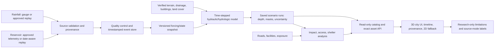

# Final-year architecture rebaseline (planning proposal)

**Status:** planning proposal; not implementation authorization. **Evidence cut:** 2026-10-31. Existing results, task history, gate findings, frozen contracts, and caveats remain authoritative and unchanged. This proposal does not claim the current system is live, operational, validated, or emergency-ready.

## Current verified baseline

- At review, `verify_state.py` passed its state checks and reported no running tasks. The optional database read check was unavailable because its Python database module was not installed; no database connection was made.
- Selectors: Lane A none ready; Lane B none ready; Integrator I22 (`CR-012 API projection for date-only observation replay`) ready. The task board must be rechecked before any follow-on registration or claim.
- G0 is ready. G5 and G6 are not ready. Do not infer G5/G6 completion from A20, B18, or I08.
- C1–C8 remain frozen at v0. C9 remains proposed and unfrozen. No contract is changed by this proposal.
- A20/B18/I08 provide a bounded display and replay acceptance of saved, coarse A05/A06 research assets. A20 describes 600 m EPSG:32644 grids, exact saved valid times for A05 and null peak valid times for A06, Float32 rasters, and NoData outside assessed coverage. These are not a continuously recomputed city model.
- Existing A05 is a hindsight scenario workflow using daily IMERG distributed by ERA5 hourly shape; forecast/scenario spread is not a calibrated forecast interval. A06 is an assumption-based local-inertial pilot, without a storm-drain network, external catchment inflows, or surveyed depth calibration. It is not validated street-scale hydraulics.
- B08 exposes exact saved A07 impact and A09 revision-3 result lookups with their recorded `SIMULATED` semantics. Route computation is unavailable without the required mapping. B09 demonstrates historical `REPLAY` through a Kafka/Redis/isolated-database/Prometheus pipeline, not live operation. B11 packages static UI, AI, and backend components but does not establish live ingestion or business-route readiness. B21/B23/B24/B25 serve approved, bounded read-only C9 metadata and original raster assets; C9 is still proposed.
- Current UI presents saved A20 rasters with 3D perspective and 2D fallback. Impact, shelter, and operational route decision support are unavailable/unknown. Its perspective display is not a terrain-flow simulation.
- A07 exposure uses WorldPop estimates; road access and thresholds are coarse/assumption-based. Facility capacity and operational status are not established. No independently validated city-scale time-stepped hydraulic twin or live update pipeline is evidenced.

## Proposed target and novelty hypothesis

Target: a bounded Chennai-wide research prototype with one explicit update pipeline. It accepts timestamped rainfall and reservoir updates (from approved live feeds if available and authorized, otherwise timestamped replay), validates source timestamps and provenance, updates forcing/state, produces a sequence of flood-depth scenarios at declared time steps, and presents saved/recomputed scenarios on a 3D city model. For each scenario/time it recomputes or explicitly derives exposure, road accessibility, and shelter allocation with uncertainty and source-mode labels. The prototype is not an operational warning service.

**Provisional novelty hypothesis (literature review required):** an uncertainty-aware coupling of rainfall and reservoir boundary conditions to time-stepped depth, road accessibility, and shelter allocation, with source provenance and uncertainty propagated across the chain. This is a candidate research contribution, not a novelty claim. Integrator must register a literature review before representing it as a gap; compare prior Chennai models, coupled hydrology/hydraulics, uncertainty propagation, and decision-support systems using an explicit search protocol.

Candidate measurable objectives (proposed for owner/domain-review approval, not demonstrated thresholds):

- update-to-display latency p50/p95, measured from timestamped input receipt to a complete scenario view, with an initial prototype target of <=5/10 minutes for the declared domain and resolution;
- numerical stability and mass-balance error, initially target <=1% per run where the governing model supports a meaningful balance;
- independent held-out-event depth MAE/bias and extent CSI/F1, with threshold values preregistered after reference-data quality review;
- uncertainty interval coverage (nominal 90% interval evaluated against observations), calibration, and spatial coverage reported separately;
- road accessibility and shelter allocation evaluated only where dated observed closure/access/capacity references exist; otherwise report as simulated/unknown and do not claim accuracy.

No current output is claimed to meet these targets. A domain reviewer must approve the numerical acceptance thresholds before science task registration.

## Target architecture

The prototype must make every run reproducible from source hashes, model/config version, forcing window, parameters, grid/CRS, and random seed. Historical date-only records remain date-only under the approved C3 policy; no synthetic instant or assumed timezone. A real hydraulic simulation means a declared governing model recomputes state over time from forcings and boundary conditions and passes numerical/physical checks. Rendering saved rasters in a timeline is visualization, not recomputation or simulated flow.

## Data inventory and required source record

Every candidate source below requires a machine-readable source record with coverage, resolution/cadence, units, timestamp semantics/timezone, provenance/hash, license/terms, and missing-data policy. “Unknown” is a required value where evidence is absent; do not fill gaps from convention.

| Data | Evidence/current candidate | Coverage/resolution and units | Time/provenance/license | Gap and safe missing behavior |
|---|---|---|---|---|
| City boundary | Datameet older CMA boundary in catalogue | Approx. 1,187.46 km²; vector; CRS/source vintage must be verified | Catalogue notes CC BY 4.0; source snapshot/date to record | Not authoritative/current by default; do not extend model domain without owner-approved boundary. Outside boundary = unavailable. |
| Terrain/elevation | Copernicus GLO-30 DSM | ~30 m; elevations; EGM2008 noted | Product/source hashes and attribution required | DSM is not bare-earth terrain; vertical-datum conversion absent; terrain report notes negative artefact. Require verified bare-earth/vertical reference and QA; invalid cells remain NoData. |
| Land cover | ESA WorldCover 2021 | 10 m classes | CC BY 4.0 per catalogue; retain tile/version/hash | Date may be stale; missing class remains unknown and cannot silently become a calibrated hydraulic parameter. |
| Rainfall | IMERG archive: 86 files | 0.1° (~10 km); current catalogued values mm/day | Daily UTC product; source version/hash required; license confirmation outstanding | Coarse for urban convective extremes; preserve missing intervals as gaps, never zero. Live gauges/IMD data not collected/authorized. |
| Rainfall alternative | Open-Meteo ERA5 points | ~25 km; hourly/daily; nine points | API output timestamps; CC BY 4 noted, non-commercial/rate terms apply | Not independent observations; no silent gap fill. Usage/redistribution terms need owner check. |
| Rainfall alternative | NASA POWER | Daily; nine points; variable-specific units | Timestamp/product provenance required; license not found in inventory | Units/terms must be confirmed per variable; missing values remain null. |
| Reservoir | Kaggle Chennai reservoir archive | Daily 2004–2020; storage in mcft; rainfall unit undocumented | CSV date-only; CC0 shown by source listing; archive/member hashes recorded in B28 | Historical measurement-time/timezone unknown under C3. Storage is not release. Missing date/value remains unknown; no midnight or assumed timezone. |
| Reservoir authoritative source | TN WRD/CWC time series not collected | Desired subdaily levels, storage, inflow/release/gates; coverage/cadence/units unknown | Source-owner identity, timestamp convention, license/access terms absent; portal may require login/OTP | Requires authorized acquisition and written semantics. No credentials or source access presumed. No value may be inferred from storage alone. |
| Reservoir reference | CWC 2020 advisory snapshot | Two-reservoir snapshot, PDF | PDF-specific terms not confirmed; dated advisory | Not a time series; not a substitute for telemetry or historical timestamp evidence. |
| Roads/facilities/buildings | OSM Geofabrik Southern Zone snapshot through 2026-10-06 | Vector snapshot; resolution/completeness varies | ODbL; retain extract date/hash/attribution | No dated road closures, verified shelter capacity/status, or complete building heights. Missing attributes remain unknown. |
| Drainage/culverts | No authoritative city network in current inventory; OSM waterways only | Coverage, dimensions, connectivity, units unknown | Provenance/licence vary by feature | Do not treat waterways as storm drains. Hydraulics requiring drainage must remain blocked or explicitly simplified and sensitivity-tested. |
| Population exposure | WorldPop R2025A 2021 | ~100 m; population estimate | CC BY 4.0; model/version/hash | Exposure estimate, not vulnerability. NoData remains unknown, not zero or hazard mask. |
| Flood extent/depth for validation | UNOSAT 2015 partial vectors through 24 Nov; 2021/2023 references are PDFs; 13 Sentinel-1 scenes | Partial event coverage; SAR ~30 m where available; units/labels depend on product | UNOSAT product cites CC BY-NC-SA 3.0 but HDX terms need confirmation; Sentinel-1 derived labels are not ground truth | No independent date-matched depth observations; 2015 peak incomplete, 2021/2023 labels require permission, digitization/georeferencing and QA. Unobserved areas are unknown, not dry. |
| Buildings/heights | OSM footprints; heights unverified | Vector; height coverage unknown | ODbL; source date/hash | No height must remain null; do not infer from DSM as building height without validated method. |

Before each source is admitted, record exact coverage geometry, spatial/temporal resolution, unit conversions, timezone and instant/date-only meaning, license evidence, hashes, QC, missing-data semantics, and owner sign-off in a versioned data manifest. Existing `DATA_MANIFEST.csv` is an inventory, not proof of fitness or licensing for every use.

## Science and validation plan (proposed)

1. **Domain and references:** freeze a versioned CMA study boundary and vertical datum; inventory verified bare-earth elevation, buildings/roughness, drainage/culverts, reservoir boundaries/releases, rainfall, and event observations. Stop/limit scope if critical drainage or boundary conditions cannot be sourced; label simplifications.
2. **Forcing and time:** preserve source time semantics and source mode. Use true timestamped gauges/telemetry where authorized; replay fixtures retain source timestamp/date and separate `received_at`. Specify solver time step from stability/convergence tests; output cadence is independently declared. Never interpolate missing input silently.
3. **Resolution:** select a city-scale grid only after resolution/runtime/convergence study and terrain QA. Compare at least two resolutions on a representative subdomain; report runtime, stability, sensitivity, and artifact size. Existing 600 m assets are visualization/prototype baselines, not target city hydraulics.
4. **Scenario generation:** version every forcing window, reservoir boundary condition, model parameters, source hash, code/container version, CRS/grid, seed, solver settings, masks, and output hash. Produce time-indexed depth and uncertainty members; missing forcing yields a failed/incomplete scenario, not fabricated values.
5. **Independent evaluation:** preregister held-out historical events and spatial/temporal blocking before tuning. Require independent, licensed observed flood extent and preferably gauge/field depth. Keep event-wide holdout to avoid leakage. If references are unavailable, report software/numerical verification only and do not claim predictive validation.
6. **Metrics:** depth MAE/RMSE/bias and quantiles where observed depth exists; extent CSI/F1/precision/recall with threshold and observed coverage; uncertainty coverage/width/calibration; numerical mass balance, stability, runtime, and sensitivity; road-access/shelter metrics only where independent dated truth exists. Always report denominators, spatial coverage, NoData masks, baseline and uncertainty.
7. **Failure criteria:** fail a run for unstable/non-finite values, failed mass balance, invalid CRS/vertical datum, input timestamp ambiguity, provenance/hash mismatch, invalid mask, undocumented gap filling, or inability to reproduce from manifest. Fail a validation claim for leakage, insufficient independent events, unlicensed reference data, absent observation denominator, or thresholds selected after seeing holdout. Failure must leave the previous saved result intact and mark the new run unavailable; never show partial output as current.

## Work packages (proposals, not yet executable tasks)

Task IDs, claims, lane status, and output locks must be assigned by the official protocol after open decisions below are resolved. These packages do not authorize implementation now. Exact file ownership is to be narrowed during registration; protected existing outputs and frozen contracts are excluded.

### WP-A — Lane A science and data

- **Owner:** Lane A science/data owner. **Dependencies:** approved domain boundary and vertical reference; verified/licensed data; domain reviewer acceptance thresholds; compute benchmark; current A15/A20 evidence preserved as baseline.
- **Candidate paths:** new versioned outputs under `data/features/citytwin_v1/` and `data/processed/citytwin_v1/`; new pipeline under `pipelines/citytwin/`; tests under `tests/citytwin/`; evidence under `docs/citytwin/`. Do not overwrite `data/features/phase11/`, A20 manifests/assets, or existing results.
- **Acceptance:** source manifests complete; independently versioned forcing/scenario pipeline; time-step and resolution convergence tests; physical/numerical checks; reproducible hashes; missing-data semantics; validation preregistration and held-out metrics where references exist. Clearly label unvalidated areas/results.
- **Evidence:** source licenses and hashes, data QA, model/config/seed, test logs, runtime/hardware, numerical balance/stability, validation denominators/metrics, uncertainty and limitations.

### WP-B — Lane B ingestion, backend, packaging

- **Owner:** Lane B service/package owner. **Dependencies:** approved source access and timestamp semantics; WP-A input/output schema proposal; Integrator versioned contract review; separately approved CORS/origin/auth model where needed; safe environment/hardware decision.
- **Candidate paths:** new scoped code under `services/trackb/` and/or `services/backend/`, ingestion adapters under `services/ingest/`, package changes in a new `docker-compose.citytwin.yml`/dedicated profile, tests under corresponding service test directories, evidence under `docs/trackb/citytwin/`. Existing B11 package constraints, current C9 routes, frozen C1–C8, and existing B21–B25 paths must be protected unless a non-conflicting task is explicitly registered.
- **Acceptance:** input adapters validate timestamps, units, source mode, hash and gaps; replay/live adapter interface is explicit; idempotent versioned scenario jobs; bounded read-only result serving; health/readiness and failure handling; no implicit DB migration or shared DB writes; packaged startup/shutdown and denial tests; no secrets in logs.
- **Evidence:** source fixture/live authorization, event identity and deduplication, API schemas/tests, end-to-end job logs/hashes, package image digest, health/readiness, latency, access-control/denial tests and cleanup record.

### WP-UI — Lane B UI city twin and animation

- **Owner:** Lane B UI owner. **Dependencies:** stable approved scenario/result projections from WP-I/WP-B; manifest-backed outputs from WP-A; accessible design and resolution/performance budget; browser access decision.
- **Candidate paths:** new isolated UI modules under `frontend/src/ui/city-twin/`, styles/components under the same new feature subtree, tests under `frontend/tests/city-twin/`, docs under `docs/ui/citytwin/`. Existing Phase 1–5 UI and B18 paths must be preserved; registration must resolve any exact-path conflicts.
- **Acceptance:** timeline updates only when a complete identified scenario is ready; 3D city context with 2D fallback; exact valid time/source mode/provenance/hash/mask/uncertainty shown; unknown/NoData visibly distinct; accessible keyboard/screen-reader behavior; stale/error/partial states; measured browser performance; no operational warning language unless separately validated/authorized.
- **Evidence:** browser test matrix, accessibility results, scenario-to-manifest identity assertions, rendering/hash checks, fallback/error screenshots or traces, performance and user review.

### WP-I — Integrator contracts and gates

- **Owner:** Integrator. **Dependencies:** owner schemas, source decisions, WP-A validation evidence, WP-B runtime/security evidence, WP-UI acceptance evidence, project-owner change approvals.
- **Candidate paths:** new versioned proposals and decision records under `docs/master/`; new additive projections under `docs/api/` only after task claim and owner artifacts; isolated tests under `tests/master/`. Do not edit or reopen frozen C1–C8, mutate C9 without CR approval, or change G0/G5/G6 status to match a plan.
- **Acceptance:** register unique change requests and tasks, audit owners/dependencies/output conflicts, align data contracts and UI semantics, define measurable gate criteria, reconcile generated views, and close only with current evidence plus required independent reviews.
- **Evidence:** owner decisions, schema/model/API conformance, test logs, gate report, raw audit, packaging/e2e evidence, limitations and exact version history.

## Real-time-style prototype versus operational deployment

The prototype may demonstrate the same update path with timestamped replay when live feeds are unavailable or unauthorized. Every screen/API/artifact must identify `REPLAY` versus genuinely authorized live source mode, source timestamp versus ingestion time, scenario/run identity, and whether outputs are derived. Replay-derived alerts/depths are never historical observed events. A polished animation does not upgrade scientific status.

Operational deployment is a separate future program requiring source-owner agreements and SLAs, reliable live telemetry and timestamp semantics, secure credentials/identity, monitoring/on-call, resilience/failover, independently validated physics and decision models, human-reviewed alert policy, legal/privacy review, penetration/security testing, disaster recovery, and an authorized agency operator. No current gate or task authorizes emergency warnings, safe routing, or public operational use.

## Owner decisions and external prerequisites

The exact decision request is registered in `docs/master/FINAL_YEAR_OWNER_DECISIONS.md` and CR-013. Before implementation tasks can be safely claimed, project owner/domain owners must decide: (1) study boundary and vertical datum; (2) target output grid/time step and numerical acceptance thresholds after benchmark; (3) acceptable rainfall/reservoir source and timestamp/license/access route; (4) whether to pursue manual official-data requests and who owns credentials; (5) licensing/permission for flood reference PDFs/SAR products; (6) external independent validation events/depth observations; (7) hardware budget/availability and runtime target; (8) whether limited live-feed demonstration is permitted or replay-only; (9) security/deployment boundary and public access; (10) whether a new gate/change-control branch is needed and who can approve it.

Known manual work: authoritative reservoir and rainfall acquisition; license verification; flood-map georeferencing/digitization/QA; verified terrain/vertical-reference correction; drainage and facility ground-truth inventory; independent observed flood depth/extent; domain review of thresholds; hardware benchmark. Do not infer any of these from current outputs. Do not use credentials or contact agencies without a separately authorized task.

## Execution order and present next action

1. Continue selector-ready I22 only within its registered CR-012 scope; this rebaseline does not expand it.
2. Obtain decisions and source/rights evidence listed in the owner-decision request.
3. Register narrow Lane A data/model tasks and Integrator schema/gate review; check exact output conflicts and baseline/version strategy.
4. Complete model/data validation or explicitly limit the prototype to a replay visualization, without describing it as computed flood dynamics.
5. Register Lane B ingestion/backend and then UI work against approved versioned interfaces; package and verify the bounded prototype.
6. Reassess gates independently. G5/G6 remain closed until their existing criteria are evidenced; adding any gate or redefining acceptance requires project-owner change control. This plan itself changes no gate status.

