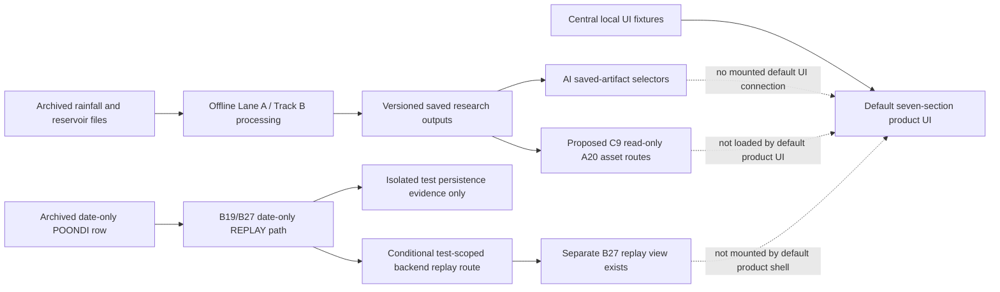

# Live-data integration map against frozen contracts

**Status:** Integrator evidence map, not an activation plan or implementation authorization. **Evidence reviewed:** 2026-11-04. **Current state:** G0 `ready`; G5/G6 `not_ready`; C1-C8 frozen at v0; C9 proposed and unfrozen. A21 is running. This review used repository files only; no feeds, credentials, database, Docker service, or external endpoint were accessed.

## Executive finding

TwinGuard currently has several bounded, separate capabilities, but no evidenced live-data-to-model-to-UI pipeline. The repository contains static/archived sources and derived research outputs; Track B has historical REPLAY and isolated persistence evidence; AI and backend routes expose saved-result projections under their registered limits; the default product UI is a static DEMO/SIMULATED experience. The presence of route code, OpenAPI schemas, replay evidence, or a polished UI does not establish a live feed, current running service, time-stepped operational model, validated flood forecast, or safe recommendation.

The project rebaseline and decision request remain proposals. D2 (rainfall source/access), D3 (reservoir source/access and time semantics), D8 (replay-only versus explicitly authorized live prototype), plus D1/D4-D7/D9-D11 remain unapproved or unresolved in `FINAL_YEAR_OWNER_DECISIONS.md`. The next safe work is interface mapping, followed by fixture-only adapter tests and UI state modeling. B34 has completed the repository-only inventory. Access to real feeds remains blocked until the relevant source owner/project-owner decisions and evidence are recorded.

## Current path: separate evidence branches, not one live pipeline

| Stage | Implemented/evidenced now | Status and boundary |
|---|---|---|
| Sources | Local raw/archive rainfall, reservoir, boundary, terrain, OSM, exposure, and flood-reference files are catalogued in lineage/reports. The B28/B27 POONDI row is source-backed and hash-identified. | Archived inputs only. No authorized live rainfall/reservoir connector is identified; candidate feed ownership, permission, cadence, latency, and/or timestamp semantics remain unknown. |
| Ingestion | `pipelines/trackb/replay.py`, `streaming.py`, `persistence.py` implement replay/message paths. B9 exercised a historical REPLAY through Kafka/Redis/Prometheus and isolated persistence. B19 preserves date-only reservoir semantics. | REPLAY and offline processing evidence, not live ingestion. `docs/trackb/REALTIME_DESIGN.md` describes proposed topics/retention and intended flow; it says no live ingestion is configured. |
| Storage | A/I science outputs are saved files. Track B has database schemas/migrations and B20 isolated PostgreSQL read/write/readback evidence for date-only compatibility. | Migration 101 was tested on `twinguard_trackb_test` only; it is not applied to shared `twinguard`. No production/shared live event store is evidenced. `docs/trackb/MESSAGES.md` still says migration 101 has not been applied to any database; that sentence conflicts with B20 and the updated C3 contract and needs its owner to reconcile. This map does not access a database. |
| Models | A05/A06 are saved hindcast/assumption-based forecast and coarse local-inertial simulation assets; A07 impact, A09 routes, A10 allocations, A13 priorities are saved simulated/assumption-based outputs. A21 is currently evaluating routing/decision stability. | No evidence of continuously recomputed city-scale hydraulics or independently validated live forecast. A21 is research work and is not a live service. Existing results are not replaced or promoted by this map. |
| APIs | AI has health, layer catalogue, exact B08 saved A07/A09 selectors, B13 date-only replay lookup, and C9 saved A20 metadata/raster paths. Backend has health, C9 catalog/detail, and a B13 replay route conditionally enabled in the B11 package. | Saved-result/read-only/test-scoped paths only. Forecast, uncertainty, route computation, scenario computation, live input, and emergency recommendation operations remain unavailable/unexposed. C9 remains proposed/unfrozen. Packaged runtime reports are historical evidence; no current service process was started or verified here. |
| UI | Default `frontend/src/ui/App.tsx` exports the seven-section `ProductExperience`; B29-B33 use centralized local DEMO/SIMULATED fixtures. B18 and B27 views remain separate code/evidence. | The default product makes no service calls. The B27 replay view has an HTTP adapter in its separate module, but is not exported/mounted by the default `App.tsx`. The B33 report says live input is not connected and saved A20 assets are not loaded in this product screen. No UI is connected to a live feed. |

`docs/DATA_MANIFEST.csv` and `docs/DATA_LINEAGE.md` provide catalogue and file-level lineage evidence, but lineage itself notes that some run metadata is unrecorded. B34's repository-only inventory is recorded in `docs/trackb/LIVE_SOURCE_READINESS_INVENTORY.md` and `docs/trackb/live_source_readiness_inventory.json`; its task record reports five focused checks passed and raw audit hashes matched. It classifies all live-source candidates as unverified/proposed and records owner/access, terms, cadence, units, timestamp semantics, coverage, latency, provenance and gaps. No source was contacted or verified live.

## Source and evidence inventory (repository findings only)

“Owner/access” below means the owner or local access path recorded by repository evidence; it does not imply an agreement or permission to connect. Unknown is intentional where the cited record does not establish a value.

| Source/input | Owner and access | License/terms evidence | Units, time and cadence | Coverage/resolution, latency, provenance and gaps |
|---|---|---|---|---|
| GPM IMERG daily V07B | NASA Earthdata/GPM; 86 local NetCDF4 files in `data/raw/weather/imerg/`; historical files only, no live/API access configured. | Product-specific terms remain unconfirmed in `docs/DATA_MANIFEST.csv` / B34 inventory. | Daily UTC product interval; mm/day per manifest verification. Live update-arrival semantics and latency unknown. | 0.1° (~10 km), CMA pixel-centre sample, selected windows 2015-11-01..2015-12-15, 2021-11-01..2021-11-20, 2023-11-25..2023-12-15; per-file hashes; no gauge validation. Outside-window gaps stay gaps. |
| Open-Meteo ERA5 archive | Open-Meteo service; upstream ERA5 by ECMWF; nine local point series and selected hourly windows under `data/raw/weather/`; no live adapter. | CC BY 4.0 data plus non-commercial/rate-limited API conditions are recorded; project-use/redistribution review remains required. | Daily 2015-2023 and selected hourly event windows. Event-hour request evidence uses Asia/Kolkata; verify output field timestamp semantics and units per variable. Live cadence/latency and entitlement unknown. | ~25 km, EPSG:4326, nine points; reanalysis, not gauge truth. Local historical holdings do not establish current service SLA or full spatial representativeness. |
| NASA POWER daily point product | NASA POWER; nine historical local point responses, no live adapter. | POWER-specific license was not found in the manifest; citation/terms need review. | Daily 2015-2023; local `PRECTOTCORR` metadata says mm/day; UTC recorded in comparison notes. Live update cadence/latency unknown. | Nine points, EPSG:4326; native grid resolution not quantified in manifest; no gauge validation. |
| ERA5 CDS and IMD rainfall candidates | CDS and IMD products are proposed in `docs/trackb/LIVE_SOURCE_READINESS_INVENTORY.md`; not downloaded or requested. | Product-specific terms/access unknown; no source-owner permission. | ERA5 CDS candidate hourly; IMD product cadence/units/timestamps depend on an unselected station/grid product. All operational latency unknown. | No local coverage artifact, hash, or validation. Keep both PROPOSED; do not infer availability. |
| Historical Chennai reservoir CSV | Kaggle Chennai Water Management archive at `data/raw/reservoirs/kaggle_chennai_water_management/archive.zip`; B28 records archive/member hashes and exact POONDI row selector. Publisher is listed as sudalairajkumar; original measurement operator/custodian unknown. | CC0 1.0 is shown on the Kaggle listing per `docs/DATA_MANIFEST.csv`; original-source rights/attribution remain unknown. | Four reservoirs, daily 2004-01-01..2020-12-03; storage described as mcft. Rainfall unit is undocumented/inferred; continuous release/inflow is absent. Date-only under C3; source measurement/reporting meaning and timezone unknown. | Historical replay only, no refresh/latency. Retain `source_date`, `observed_at=null`, unknown timezone and separate `received_at`; no midnight/interval. |
| OpenCity/CMWSSB monthly storage | Local CSV snapshots under `data/raw/reservoirs/opencity_lake_levels/`; OpenCity attributes dataset to CMWSSB, exact custodian unknown. | “Other (Public Domain)” is listed in the manifest; underlying source terms not independently verified. | Monthly values, generally month labels; storage in mcft per dataset description. Measurement instant/timezone and aggregation semantics unknown; live cadence/latency unknown. | Reservoir series 2003-2021, with Kannankottai 2020-2021 and 11 blank months. Not suitable for event-day release inference; blanks stay missing. |
| TN WRD/operator and CWC telemetry candidates | Proposed only; no time series collected. `docs/MANUAL_TODO.md` says no request was sent; an Agrisnet page requires login/OTP and was not accessed. Exact record holder and credential custodian are unknown. | Access and terms unknown. | Requested fields include levels/storage/inflow/outflow/gates, but actual units, cadence, timestamps/timezone, latency, coverage, revisions and QC are unknown. | No live sample/hash/adapter. D2/D3 remain pending. Do not use an advisory or portal mention as feed evidence. |
| CWC advisory and CAG release annotation | One local CWC PDF dated 2020-11-23; CAG 2017 report provides a retrospective 2015 discharge annotation. | PDF/report-specific terms are unknown. | Static document/narrative, not a continuous timestamped series. CAG annotation cites cusecs but is not a machine-readable release stream. | Neither source supplies current reservoir state, cadence, latency, or full operations coverage. Do not extrapolate or convert these into telemetry. |
| Terrain/elevation | Local Copernicus GLO-30 DSM and derived cleaned grids under `data/raw/` / `data/processed/`. | Attribution/product provenance required and recorded in project materials; use-specific evidence should be retained. | Approximately 30 m elevation; EGM2008 is noted in the rebaseline. Vertical-datum transformation/verification is unresolved. | DSM includes surface returns, is not validated bare-earth urban terrain; known artifacts/NoData. It is not sufficient evidence of surveyed street hydraulics. |
| Roads, buildings, facilities | Local OSM Geofabrik Southern Zone snapshot, extracted to `data/features/`; repository reports source vintage through 2026-10-06. | ODbL attribution applies. | Static snapshot, no observation timestamp for current road closures or facility operating status. Geometry resolution/completeness varies. | No verified closure stream, complete building heights, shelter capacity, or operational status. Missing attributes remain unknown. |
| Population exposure | Local WorldPop R2025A 2021 raster. | CC BY 4.0 is recorded in the rebaseline. | Population estimate, approximately 100 m; vintage 2021, not a timestamped event feed. | Exposure estimate only, not vulnerability or current population. NoData remains unknown, not zero. |
| Flood reference data | Partial UNOSAT 2015 vectors; 2021/2023 reference PDFs and Sentinel-1 derived labels are described in source reports. | UNOSAT product cites CC BY-NC-SA 3.0; HDX/source terms and PDF reuse permissions remain unconfirmed. | Event/reference dates and map acquisition times are source-specific; not continuous observations. Depth units/ground-truth status vary or are absent. | Partial event/area coverage; no independent date-matched observed depth corpus is currently established. Unobserved areas are unknown, not dry. |
| Drainage, culverts, verified shelter status | No authoritative complete drainage network or live facility-status source is recorded. | Owner/access/license unknown. | Dimensions, flow/capacity units, status timestamp, and cadence unknown. | Critical gaps for physical flood dynamics and emergency support. OSM waterways are not proof of storm drains. |

Source lineage references: `docs/master/FINAL_YEAR_ARCHITECTURE_REBASELINE.md`, `docs/master/FINAL_YEAR_OWNER_DECISIONS.md`, `docs/DATA_LINEAGE.md`, `docs/trackb/AUDIT_AND_BACKTEST.md`, `docs/trackb/TRACKB_REPORT.md`, `docs/trackb/B13_REPLAY_FIXTURE_EVIDENCE.md`, `docs/trackb/MESSAGES.md`, and `docs/trackb/REALTIME_DESIGN.md`.

## Contract and route mapping

| Contract | Role in a future data flow | Present capability and limit |
|---|---|---|
| C1 v0 — `contracts/c1_depth_v0.md` | Defines the depth raster representation, units/grid/NoData and assumption-bound uncertainty meaning for downstream impact/routing/simulation. | T6 depth is a DERIVED DEM-surface proxy with limited coverage; ±4 m legacy p05/p95 are assumption bounds, not calibrated quantiles. C1 does not define a live rainfall input or validated hydraulic output. |
| C2 v0 — `contracts/c2_labels_v0.md` | Accepted-label registry/export for science training/evaluation and read-only consumers. | GeoJSON serialization and filtering are evidenced; accepted label tier is not ground truth. Not an observation-ingestion endpoint. |
| C3 v0 — `contracts/c3_messages_v0.md` | JSONL `rain_update`, `reservoir_update`, `twin_update`, `alert` event envelope with source class, provenance, typed units and date/instant semantics. | C3 permits representation classes but is not proof of a configured LIVE producer. Historical reservoir dates stay date-only, with unknown/null observation instant/timezone and separate receipt time. The approved policy does not discover historical source-time truth. |
| C4 v0 frozen; C4 v1/v2 additive records | API request/response projections for saved results and separately approved replay selectors. | OpenAPI is a projection, not route/runtime proof. C4 v1 selectors retrieve exact saved A07/A09 records. C4 v2 B13 route is a test-scoped date-only replay operation. Neither enables live forecast or route computation. Current `docs/api/*.yaml` overview prose still says the B13 projection is unmounted pending B27, although B27's report documents a packaged test; Integrator projection wording needs reconciliation before using it as an authoritative status statement. |
| C5 v0 — layer catalogue | Read-only metadata for layer consumers. | Catalogue metadata is model-conformant; `tile_endpoint_available=false`. Database MVT functions are not an HTTP tile route. |
| C6 v0 — twin persistence | Maps typed state/provenance and replay idempotency to PostgreSQL/JSONB and external artifact references. | B9/B20 evidence is historical replay/isolated test database only. Migration 101 was applied/read back only on `twinguard_trackb_test`; shared `twinguard` remains untouched. This does not establish a live or shared event store. |
| C7 v0 — impact result | Unit-bearing A07 V4 result shape, coverage, uncertainty, provenance and QC. | Exact B08 selector reads saved `SIMULATED` results. Outputs include coarse assumptions and null/NoData; no live impact computation or operational emergency advice. |
| C8 v0 — routing result | A09 revision-3 route result with topology separated from flood accessibility, metre/second units, UTC times and null coverage/probabilities. | Saved results are `SIMULATED`; exact B08 result lookup does not calculate a route. `POST /route` remains 501 at AI and unexposed at backend. A21 is evaluating three-state research separately. No safe-route claim. |
| C9 — proposed, unfrozen | Additive metadata/detail and original saved-raster access for A20 assets under approved CR-009/010. | B21-B25 evidence is bounded to local B11 app-tier saved research assets. AI raster is exact original bytes; backend metadata catalog/detail only, no backend raster operation. It does not represent live observations or recomputed floods and C9 is not frozen. |

### Current service/API projections

- **AI service:** `services/ai-service/app/main.py` mounts `/health`, `/layers`, B08 `POST /impact` exact A07 lookup, `GET /route-results/{result_id}` exact A09 revision-3 lookup, and stubs for `/forecast`, `/uncertainty`, `/route`, and `/scenario` that return 501. B08's selectors return saved `SIMULATED` artifacts; A09 `run_id` is not an authoritative live run selector. B13 adds `GET /replay-alerts/{event_id}` for the one approved source-backed date-only observation; it separates archived REPLAY input from optional derived rule output. The C9 catalog/detail and AI raster routers read saved A20 assets under B21-B25's bounded local package evidence.
- **Spring backend:** `GET /health` is the foundation endpoint. `ScenarioVisualizationController` exposes read-only C9 catalog/detail. `B13ReplayController` is conditional on `TWINGUARD_B13_ENABLED` (default false in `services/backend/src/main/resources/application.yml`); B11's test package sets it true. No backend raster route exists. Backend impact/route business routes remain unexposed; DTOs/gateway adapters alone are not route activation.
- **Track B HTTP router:** `services/trackb/router.py` has read-only reservoir/alert/backtest/parameters endpoints behind an injected `TrackBReader`. If no reader is configured it returns 503; the router is not a live producer or proof of an attached data store. Date-only validation rejects fabricated instants/intervals.
- **B27 runtime limitation:** `docs/trackb/B13_VERTICAL_SLICE_REPORT.md` records a packaged runtime test of the exact replay lookup and mounted backend path, but Docker became unavailable before stop/current-container status could be confirmed; visual browser rendering was not verified. It is historical test evidence, not an assurance that services are running now. The derived result was a storage-rule alert, not a flood result or historical observed alert. G5 remains not ready.
- **Frontend:** `frontend/src/ui/App.tsx` exports the local `ProductExperience`. B29/B31-B33 evidence keeps the default seven-section UI on centralized DEMO/SIMULATED fixtures and explicitly says no live input or API calls. `frontend/src/ui/replay/B13ReplayView.tsx` contains a GET adapter but is separate from the default App export. The B18 saved A20 viewer and C9 routes are not the default product's live-data pipeline.

Relevant projections/evidence: `docs/api/ai-service.yaml`, `docs/api/backend.yaml`, `docs/master/contracts/c1_depth_v0.md` through `c8_routing_v0.md`, `contracts/c4_openapi_v1.md`, `contracts/c9_scenario_visualization_v0.md` and `v1.md`, `docs/trackb/B09_GATEWAY_FOUNDATION.md`, `docs/trackb/B11_PACKAGING_REPORT.md`, `docs/trackb/B23_RASTER_DELIVERY_REPORT.md`, `docs/trackb/B24_BROWSER_ORIGIN_REPORT.md`, `docs/trackb/B25_AI_IMAGE_RUNTIME_REPAIR.md`, and `docs/trackb/B13_VERTICAL_SLICE_REPORT.md`.

## Mode, freshness, provenance, and failure semantics

These are separate axes, not a single status enum:

- **Source mode:** `LIVE` means a source-owner-approved feed supplied the observation and a tested connector recorded it. `REPLAY` means a preserved historical/recorded sample was reprocessed; it never becomes LIVE because it was recently received. `SIMULATED` means a modeled/generated research result or scenario, not an observation. The UI's `DEMO` label identifies a local fixture environment and should remain visible; it is not a fourth source mode.
- **Freshness/availability:** `STALE` overlays a source mode when a valid last observation exceeds an approved, source-specific threshold. It does not change LIVE to REPLAY or SIMULATED. `UNAVAILABLE` means there is no usable current result/connection; it is not zero, dry, or healthy. “Unknown” is a value/coverage state and stays separate from freshness. No stale threshold is currently approved because feed cadence/SLA is unknown.
- **Time:** Preserve source-provided offset-aware instant and precision for real timestamped feeds; keep `received_at` distinct. Historical reservoir CSV remains `source_date` only with unknown/null observation instant/timezone under C3; never synthesize midnight, assume Asia/Kolkata, or use receipt time as source validity. Do not infer sub-day order or intervals from date-only rows.
- **Provenance:** A future accepted observation/result must bind source owner/id, access/license basis, source record/window, raw and normalized hashes, units/conversion, source time precision/offset, receipt time, QC, transformations, code/model/config version, run identity, grid/CRS and output hashes. Current completeness varies by dataset; unknown metadata stays explicit. Credentials belong in an approved secret store/custodian path, never in manifests, logs, fixtures, or this map.
- **Missing/error behavior:** Keep null, NoData, unknown, zero, dry, stale, and unavailable distinguishable. Missing samples remain gaps and must not be gap-filled as zero. Duplicate identities fail closed or use a documented idempotency key; malformed, stale, hash-invalid, or unavailable inputs must not produce partial current results or silently trigger fallback to a different source.

## Prerequisites and safe sequencing

### Can proceed independently now

1. **B34 source inventory** is `done_with_caveats`. Its repository-only inventory and tests establish a useful local evidence baseline, not a live feed, entitlement, operational SLA, or source-owner approval.
2. **I23 contract-flow map** (this task): document current routes and frozen semantics without changing contracts/OpenAPI or runtime behavior.
3. **Fixture-only work after those reports:** B35 is registered and blocked on I23/B34. It may define/test typed envelopes, date/instant handling, freshness calculations from caller-supplied thresholds, fake-clock retries, duplicate/idempotency, provenance and unavailable behavior using local fixtures/fakes only.
4. **UI boundary after service-design evidence:** B36 is registered and blocked on I23/B34/B35/B33. It can add local state types/display for LIVE/REPLAY/SIMULATED plus independent STALE/UNAVAILABLE status, while defaulting to DEMO/SIMULATED and making no calls. It cannot replace demo fixtures or claim a live feed.

These tasks have no A21 output overlap. A21's routing/decision stability work must finish under Lane A ownership; it does not validate live source access, hydraulic modeling, or emergency outcomes.

### Requires owner decisions or upstream evidence

- **Rainfall source (D2):** source/owner, authorized access path, use/retention license, source cadence, units, timestamp/timezone semantics, coverage, latency, credential custodian, rate limits and outage policy. Until supplied: live rainfall input unavailable.
- **Reservoir source (D3):** authoritative owner/access/license; measurement meaning and timezone/offset; level/storage/release/gate fields, units, cadence, coverage, QC, and rights. Historical C3 dates do not satisfy this. Until supplied: live reservoir inputs and release forcing unavailable.
- **Prototype mode (D8):** explicit choice of replay-only or named live source(s), authorization, secret handling, rollback and retention. Default remains replay-only; no live connector can be activated from I23/B34/B35/B36.
- **Domain/science (D1/D4-D7):** verified boundary/vertical datum and terrain; permitted, dated independent flood extent/depth observations; drainage/boundary conditions; domain-approved model scope, resolution/time-step after benchmark/convergence, failure criteria, and compute budget. Existing A05/A06 are not a validated real-time hydraulic model. Run-specific source/time/hash/provenance checks and held-out validation precede claims.
- **Impacts/routes/shelters:** validated inputs/coverage and independent evidence for closures/access and facility capacity/status; A07/A09/A10 are simulated or assumption-based. A21's pending OSSE/literature findings cannot establish operational accuracy. Keep decision outputs unavailable or explicitly research-only until their owners and evidence permit a versioned operation.
- **API/security/package (D9/D11):** approved exposure boundary, authentication/access control, permitted origin/CORS, owner-reviewed additive schemas and model/API conformance, readiness/liveness semantics, secret management, rate/size limits, failure tests and rollback. No C1-C8 change is authorized; C9 is separate and remains proposed. OpenAPI status prose for B27 needs Integrator reconciliation because its current text lags the B27 report.
- **Validation/claims (D10):** literature review and independent review are required before novelty claims; independent event observations and preregistered metrics are required before scientific validation, warning, route-safety, or emergency-readiness claims.
- **Gate/release (G5/G6, D11/I04):** preserve the current gate criteria and statuses. G5's approved B13 date-only replay path is not live operation; G6 validation/release requirements remain outstanding. Any changed gate scope, frozen contract semantics, or public deployment requires explicit change control and owner approval.

## Current blockers and integration posture

1. No approved, evidenced live rainfall or reservoir feed is registered. D2/D3/D8 are decision blockers, not package-install blockers.
2. Historical reservoir measurement-time meaning/timezone remain unknown. C3's approved date-only representation is not permission to fabricate timestamped live observations.
3. No verified end-to-end live ingestion, shared database deployment, continuously recomputed flood model, or current service runtime is evidenced.
4. AI `/forecast`, `/uncertainty`, `/route`, and `/scenario` remain unavailable; backend business impact/route operations remain unexposed. B08 selectors only read saved simulated artifacts. Route outputs are not safe recommendations.
5. Existing C9 operations read saved A20 research assets only and remain proposed/unfrozen. Static default UI does not call them.
6. Current UI should show DEMO/SIMULATED fixtures and explicit unknown/unavailable states. It must not display STALE/LIVE as factual without a real typed observation and source evidence.
7. B27 report and API projection overview disagree on route exposure status; reconcile the Integrator projection before using OpenAPI as the current source-of-truth for that route. The B27 report also records shutdown/browser limits, so its runtime evidence does not prove present availability.
8. `docs/trackb/MESSAGES.md` contains a stale migration-101 statement that conflicts with B20/C3 evidence. Track B owns that document; reconcile through its owner task, without database access.

**Conclusion:** proceed with B34's source inventory and the registered offline design/UI tasks in their dependency order. Do not connect external sources, configure credentials, mount new live routes, change contracts/gates, or claim live integration until the owner decisions, source evidence, science/service readiness, security boundaries, and required gate/change-control evidence are complete.
